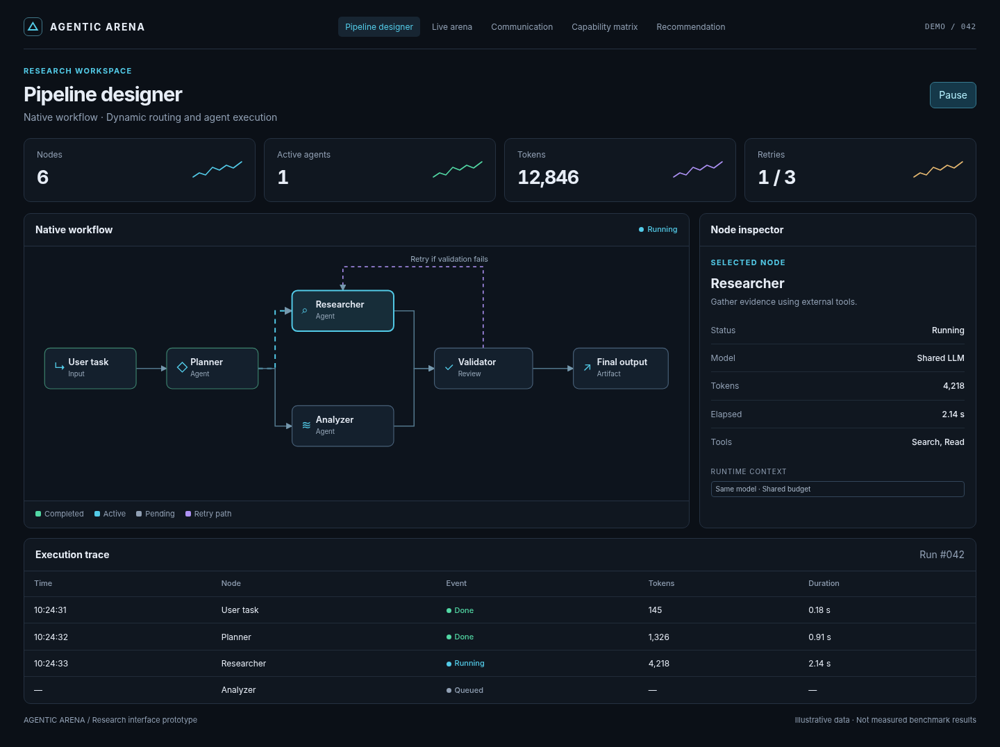

# Agentic Arena — UI prototypes

Five standalone HTML/CSS/JavaScript interfaces. No CDN, npm dependencies, backend or API keys required.

## Run

Open `index.html` in a browser after extracting the ZIP. Alternatively run `python -m http.server 8000` from this directory and visit `http://localhost:8000`.

| Page | Interaction |
|---|---|
| `pipeline.html` | Inspect nodes, pause/resume animated edge |
| `live.html` | Select frameworks, pause/resume simulated events |
| `communication.html` | Select agents and inspect message/token totals |
| `matrix.html` | Search, filter and inspect capability cells |
| `recommendation.html` | Change weights and minimum quality; recalculate ranking and 2D Pareto frontier |

Each HTML file includes its own CSS and JS. The optional `build.py` regenerates all pages from the shared `style.css` using only Python's standard library. Edit the HTML directly, or edit the generator and rerun it. Navigation links require the other HTML files in the same directory.

## Screenshots

PNG captures are in `screenshots/`, suitable for a GitHub README. All values, capability labels, workflow examples and simulated events are illustrative, not verified benchmark measurements. The live graph is a generic illustrative workflow; these are front-end design prototypes, not a running multi-agent system.

Example README embed:

```md

```

Browser validation: Chromium, with interaction checks for all five views. Local file navigation is restricted in the test environment; the page contents were rendered directly for testing.
