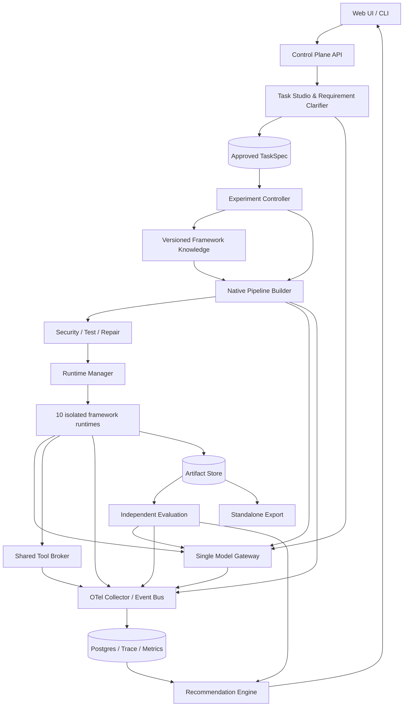
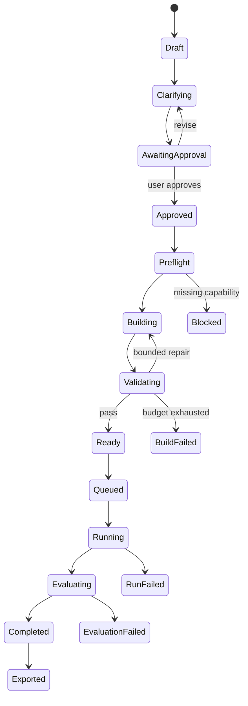
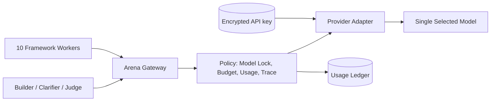
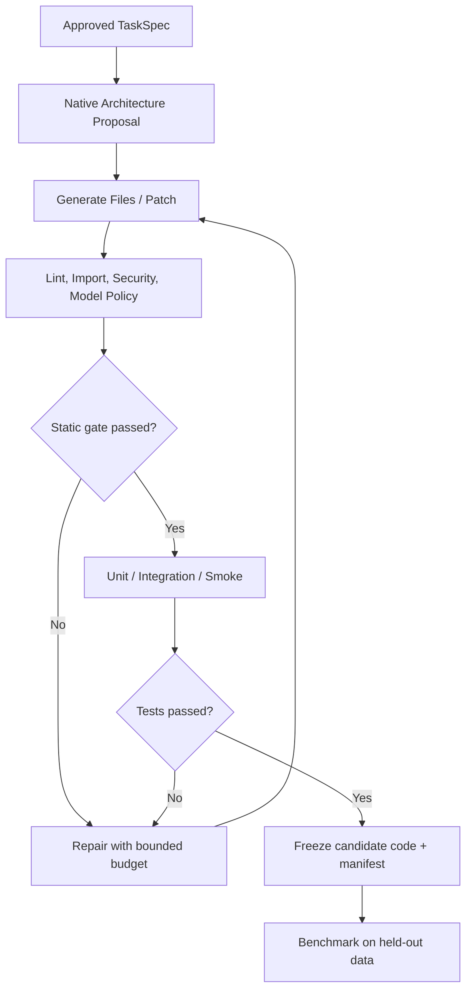
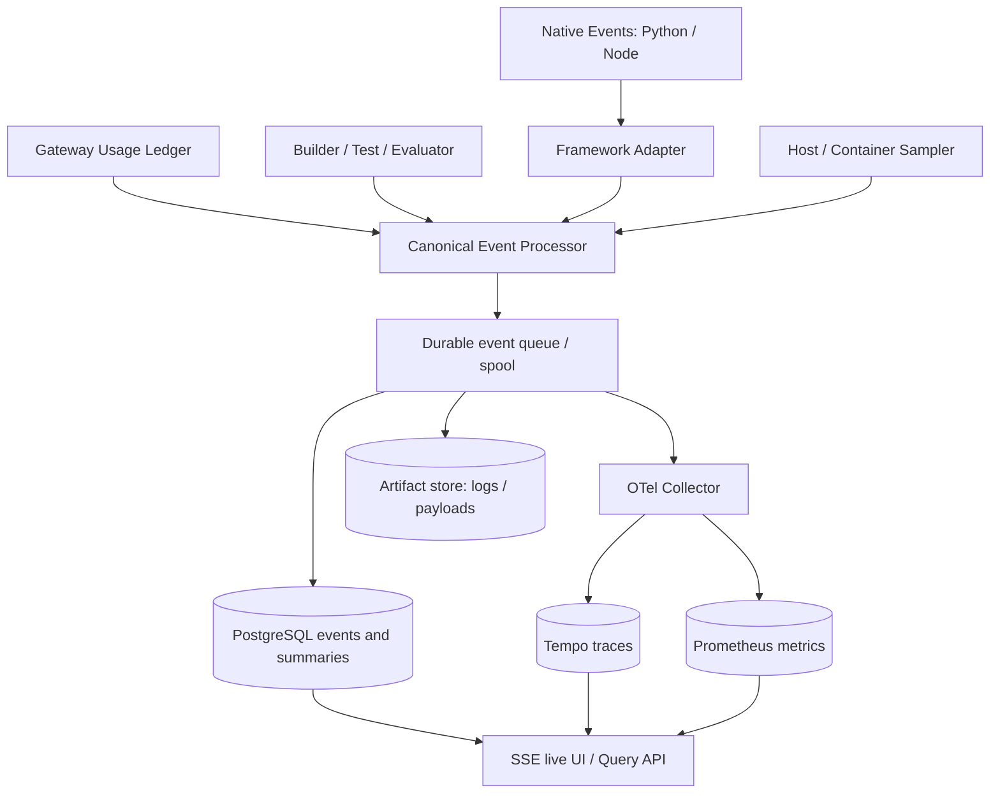

# Agentic Arena

> **One task. One model. Ten frameworks. Measurable results.**
>
> Tek bir GitHub deposundan kurulabilen, kullanıcı görevlerine özel agentic pipeline geliştiren, çalıştıran, ölçen ve en uygun framework'ü kanıta dayalı olarak öneren açık kaynak platform.

**Doküman:** Ürün gereksinimleri + sistem mimarisi + teknik uygulama planı  
**Sürüm:** 1.0 — Tasarım spesifikasyonu  
**Tarih:** 24 Kasım 2026  
**Durum:** Uygulama öncesi plan; mevcut bir çalışan ürün veya ölçülmüş benchmark sonucu değildir.

---

## İçindekiler

1. [Vizyon, kapsam ve değişmez kurallar](#1-vizyon-kapsam-ve-değişmez-kurallar)
2. [Framework kataloğu](#2-framework-kataloğu)
3. [Açık kaynak teknoloji ve repo seçimi](#3-açık-kaynak-teknoloji-ve-repo-seçimi)
4. [Sistem mimarisi](#4-sistem-mimarisi)
5. [Kullanıcı yolculuğu ve görev tanımlama](#5-kullanıcı-yolculuğu-ve-görev-tanımlama)
6. [Runtime ve sürüm yönetimi](#6-runtime-ve-sürüm-yönetimi)
7. [Tek API anahtarı ve tek model](#7-tek-api-anahtarı-ve-tek-model)
8. [Otonom pipeline geliştirme](#8-otonom-pipeline-geliştirme)
9. [Execution Arena ve deney metodolojisi](#9-execution-arena-ve-deney-metodolojisi)
10. [Gelişmiş telemetri](#10-gelişmiş-telemetri)
11. [Kalite ve kabul kriterleri](#11-kalite-ve-kabul-kriterleri)
12. [Öneri motoru ve interaktif skor](#12-öneri-motoru-ve-interaktif-skor)
13. [Arayüz tasarımı](#13-arayüz-tasarımı)
14. [Veri modeli, API ve event protokolü](#14-veri-modeli-api-ve-event-protokolü)
15. [Repo yapısı ve dağıtım](#15-repo-yapısı-ve-dağıtım)
16. [Güvenlik ve işletim](#16-güvenlik-ve-işletim)
17. [Örnek uçtan uca deneyler](#17-örnek-uçtan-uca-deneyler)
18. [Geliştirme aşamaları ve kabul testleri](#18-geliştirme-aşamaları-ve-kabul-testleri)
19. [Riskler, gelecekteki kapsam ve karar kaydı](#19-riskler-gelecekteki-kapsam-ve-karar-kaydı)
20. [Kaynaklar](#20-kaynaklar)

---

## 1. Vizyon, kapsam ve değişmez kurallar

### 1.1 Problem

Bir geliştirici agentic bir ürün yapmak istediğinde LangGraph, Google ADK, CrewAI ve diğer altyapılardan hangisini kullanacağını genellikle dokümantasyon, GitHub popülerliği veya başkalarının benchmark sonuçlarına göre belirliyor. Oysa framework'ün uygunluğu, yapılacak işe ve kullanıcının kabul kriterlerine bağlıdır. Genel bir benchmark'ta iyi olan framework, örneğin uzun doküman analizi ya da çok araçlı bir süreçte en iyi seçenek olmayabilir.

Agentic Arena, bu kararı kullanıcının kendi problemi üzerinde deneysel hale getirir. Tek repo kurulduktan sonra kullanıcı görevini tarif eder, platform gereksinimleri netleştirir, her framework için o framework'ün doğal özelliklerini kullanan bağımsız bir uygulama üretir, çalıştırır, sonuçları değerlendirir ve gerekçeli öneri verir.

### 1.2 Kullanıcıya teslim edilen sonuç

- Her seçili framework için bağımsız, test edilmiş veya neden başarısız olduğu belgelenmiş kaynak kod.
- Her uygulamanın graph/agent/topoloji görünümü, araçları, prompt'ları, giriş/çıkış sözleşmesi ve bağımlılık kilidi.
- Geliştirme, doğrulama, runtime ve değerlendirme maliyetlerinin ayrı dökümleri.
- Token, gecikme, kalite, başarı, güvenilirlik, kaynak kullanımı ve hata analizleri.
- Kullanıcının önceliklerine göre anında yeniden sıralanabilen karşılaştırma ekranı.
- En uygun framework önerisi, nedenleri, sınırlamaları ve alternatifler; yeterli kanıt yoksa kesin kazanan ilan edilmemesi.
- Kazanan veya herhangi bir diğer pipeline'ın ana platformdan bağımsız çalıştırılabilen paket olarak dışa aktarılması.

### 1.3 Kesin ürün kararları

| ID | Karar | Uygulama kuralı |
|---|---|---|
| D01 | Tek GitHub reposu | Kullanıcı 10 upstream reposunu ayrı ayrı kurmaz; Arena sürümlü runtime paketlerini hazırlar. |
| D02 | 10 framework | Dokuz Python ortamı ve bir TypeScript/Node ortamı; KOVAN ayrı opsiyonel plugin. |
| D03 | Yalnızca Native karşılaştırma | Her framework kendi doğal orchestration primitive'leri ile en uygun çözümü geliştirir. Strict/Optimized adlı kullanıcı modu yoktur. |
| D04 | Tek API anahtarı, tek model | Bir deneyde planlama, kod geliştirme, tüm pipeline'lar ve LLM ile değerlendirme aynı seçilmiş modele gider. Gizli model fallback yoktur. |
| D05 | Üç giriş biçimi | Doğal dil, görsel gereksinim akışı, mevcut proje/kod import. |
| D06 | Gereksinim onayı | Belirsizlikler etkileşimli sorularla çözülür; kullanıcı bir alanı serbest bırakabilir. Onaysız geliştirme başlamaz. |
| D07 | Uzman geliştirici ajanları | Her framework'ün kurulu sürümüyle eşleşen dokümantasyon ve şablonlarla kod üretimi. |
| D08 | İzole hazır runtime | Sürümü sabitlenmiş image'lar; hazır/warm çalışma opsiyonu, kaynak kotaları. |
| D09 | Güncellik ve yeniden üretilebilirlik | En yeni **doğrulanmış** kararlı sürüm varsayılan; deneydeki sürüm sonradan değişmez. |
| D10 | Otomatik doğrulama | Kod üretimi → güvenlik kontrolü → test → sınırlı düzeltme → benchmark. |
| D11 | Çok gelişmiş telemetri | Ortak trace protokolü, merkezi token ölçümü, ham/normalize edilmiş loglar ve canlı arayüz. |
| D12 | İnteraktif öneri | Kalite, hız, token ve güvenilirlik ağırlıkları değiştirilebilir; önce kabul kriterleri, sonra sıralama. |

Önceki fikirlerden tekrar çalıştırma, dışa aktarma, istatistik ve özel framework plugin desteği de bu plana tasarım varsayılanı olarak dahil edilmiştir. Başlangıç mühendislik aşamasında beş runtime ile temel altyapı doğrulanabilir; **ilk tamamlanmış ürün sürümü on runtime içermelidir.**

### 1.4 Native karşılaştırma neyi kanıtlar?

Aynı problem, test verisi, kabul kriterleri, izinli araçlar, model, kaynak ve geliştirme bütçesi sabit kalır. Ajan sayısı, prompt içeriğinin göreve uygun tasarımı, state paylaşımı, koşullu routing, paralellik, bellek kullanımı ve native retry stratejisi serbesttir. Kullanıcının zorunlu kıldığı adımlar her uygulamada korunur.

Bunun ölçtüğü şey, **Arena'nın aynı koşullar altında her framework ile üretebildiği uygulamanın performansı**dır; bütün olası uygulamaların matematiksel olarak en iyisi veya framework runtime'ının tek başına hızı değildir. Örneğin bir pipeline daha az ajan kullanırsa avantajı tasarımdan da geliyor olabilir. Bu farkı raporda açıklamak gerekir. Ayrı kullanıcı modları eklemeden sistem içi tanı amaçlı no-op, mock ve gateway calibration testleri yapılabilir; bunlar liderlik tablosunda gerçek görev skoruna katılmaz.

### 1.5 Kapsam dışı (V1)

- Farklı framework'lerde farklı modeller veya provider fallback; model arena ve model routing.
- Kullanıcıdan her framework için ayrı abonelik ya da ayrı API anahtarı istemek.
- Cross-framework hybrid pipeline ve otomatik migration (import edilen projeye eşdeğer çözümler üretilebilir, birebir migration garantisi yoktur).
- Bulut hesabı, dış veri kaynağı, ödeme işlemi veya production deployment için yetkisiz erişim.
- GitHub yıldızına göre performans puanı; gizli benchmark sonuçları; otomatik harici veri paylaşımı.
- Arşiv/bakım modundaki AutoGen'i MAF ile birlikte varsayılan kataloğa almak.

## 2. Framework kataloğu

Katalog 10 framework ile sabittir. Sürümler dokümana elle yazılarak kalıcılaştırılmaz; release registry kurulum anında doğrulanmış versiyon ve image digest'ini verir. Paket isimleri kurulu upstream sürümden test edilerek kesinleştirilir. Aşağıdaki bileşenler mimari tasarım hedefleridir; her sürüm için API uyumluluğu smoke test ile doğrulanmalıdır.

| ID | Framework / resmi repo | Runtime | Native paradigma | Örnek güçlü kullanım |
|---|---|---|---|---|
| langgraph | [LangGraph](https://github.com/langchain-ai/langgraph) | Python | State/graph | Kontrollü döngüler, fan-out/fan-in |
| google-adk | [Google ADK](https://github.com/google/adk-python) | Python | Hierarchical agents/workflows | Uzman ajan delegasyonu |
| microsoft-af | [Microsoft Agent Framework](https://github.com/microsoft/agent-framework) | Python | Agent/executor/workflow | Kurumsal orchestration ve checkpoint |
| openai-agents | [OpenAI Agents SDK](https://github.com/openai/openai-agents-python) | Python | Agent loop/handoff | Hafif ajan koordinasyonu |
| crewai | [CrewAI](https://github.com/crewAIInc/crewAI) | Python | Crew/role/task/flow | İş birliği ve raporlama |
| agno | [Agno](https://github.com/agno-agi/agno) | Python | Agent/Team/Workflow | Takım koordinasyonu, oturum |
| pydantic-ai | [Pydantic AI](https://github.com/pydantic/pydantic-ai) | Python | Typed agent/dependency/graph | Şemalı çıktı, araç sözleşmeleri |
| llama-agents | [LlamaAgents](https://github.com/run-llama/llama-agents) | Python | Event-driven async workflows | Olay tabanlı paralel belge analizi |
| smolagents | [Smolagents](https://github.com/huggingface/smolagents) | Python | Code/Tool-calling agent | Kod ve araç üzerinden problem çözme |
| mastra | [Mastra](https://github.com/mastra-ai/mastra) | TypeScript | Agent/workflow | Node ekosisteminde typed workflow |

### 2.1 LangGraph

- **Repo:** https://github.com/langchain-ai/langgraph — **Docs:** https://docs.langchain.com/oss/python/langgraph/overview
- **Çalışma mantığı:** StateGraph benzeri açık yürütme grafiğinde node'lar state okuyup günceller, edge'ler sonraki adımı belirler. Koşullu yönlendirme, dinamik fan-out ve join, reducer, checkpoint ve interrupt gibi araçlar farklı topolojilere izin verir.
- **Uzman geliştirici yaklaşımı:** Önce işin state şemasını tasarla; bağımsız işlerde parallel node/Send, şartlı doğrulama döngüsü ve gerekiyorsa subgraph kullan. Sırf agent sayısını artırmak için node oluşturma. Checkpoint gerekiyorsa etkinleştir, overhead'i ölç.
- **Adapter:** graph run/stream event'leri, node kimliği, state güncellemeleri, checkpoint ölçümü, ortak model istemcisi ve tool wrapper.
- **Smoke:** koşullu branch, iki paralel node, reducer, model çağrısı, streaming ve checkpoint resume.

### 2.2 Google ADK

- **Repo:** https://github.com/google/adk-python — **Docs:** https://adk.dev/
- **Çalışma mantığı:** Ajanlar root/sub-agent ilişkileri, araçlar ve workflow bileşenleriyle tanımlanır; runner, event akışı, session/state yönetimi ve farklı orchestration seçenekleri sağlar.
- **Uzman yaklaşımı:** Delegasyon gereken yerde uzman sub-agent, sabit seri işte sequential, bağımsız işlerde parallel, doğrulamada sınırlandırılmış loop; gereksiz LLM routing kullanma.
- **Adapter:** runner event'leri, session state delta, ajan transferi, model çağrıları, tool event'leri. Harici model bağlantısı için doğrulanmış LiteLLM/custom model köprüsü.
- **Smoke:** root→subagent, paralel yürütme, structured tool, ortak gateway, session izolasyonu.

### 2.3 Microsoft Agent Framework (MAF)

- **Repo:** https://github.com/microsoft/agent-framework — **Docs:** https://learn.microsoft.com/en-us/agent-framework/ — [AutoGen geçiş rehberi](https://learn.microsoft.com/en-us/agent-framework/migration-guide/from-autogen/).
- **Çalışma mantığı:** Ajanlar ve mesajlarla çalışan executor/workflow bileşenleriyle çok adımlı sistemler kurulabilir. AutoGen ve Semantic Kernel çizgisinin halefi; AutoGen API'si ile aynı değildir. V1 Python runtime; .NET ayrı karşılaştırma varyantı değildir.
- **Uzman yaklaşımı:** Typed mesajlar, workflow executor, branching, uygun durumda native orkestrasyon kalıpları ve dayanıklılık mekanizmaları.
- **Adapter:** executor/agent event'leri, workflow edge ve mesajları, model client, varsa checkpoint ve OTel entegrasyonu.
- **Smoke:** iki executor, koşullu yönlendirme, tool, seçilen provider/gateway, interrupt/resume desteği mevcutsa doğrulama.
- **Doğrulama notu:** Bu doküman hazırlanırken doğrudan repo sayfası tekrar açıldığında 404 yanıtı alındı. Kullanıcının aktardığı resmi README bağlantısı ve Microsoft dokümantasyonu esas alınmıştır; otomatik registry kabulünde repo erişimi, paket/release ve API'ler ayrıca doğrulanmalıdır.

### 2.4 OpenAI Agents SDK

- **Repo:** https://github.com/openai/openai-agents-python — **Docs:** https://openai.github.io/openai-agents-python/
- **Çalışma mantığı:** Runner, model çağrısı/tool loop, agent handoff, agents-as-tools, guardrail ve session bileşenleri. Kontrol devri ile başka bir ajanın araç gibi çağrılması farklı tasarım seçenekleridir.
- **Uzman yaklaşımı:** Basit görevlerde minimum agent loop, uzmanlık geçişlerinde handoff, alt görevlere agents-as-tools; output guardrail gerekiyorsa test et.
- **Adapter:** trace processor, run item, handoff, tool call ve streaming. OpenAI uyumlu provider için uygun custom model/client; Responses ile Chat Completions uyumsuzluğunda sessiz fallback yoktur.
- **Smoke:** seçilen model üzerinden iki ajan, tool, handoff ve token doğrulaması. Varsayılan dış trace export kapalı, yerel telemetry kullanılır.

### 2.5 CrewAI

- **Repo:** https://github.com/crewAIInc/crewAI — **Docs:** https://docs.crewai.com/
- **Çalışma mantığı:** Agent rolü ve hedefi, Task ve Crew üzerinden görev paylaşımı; Flow ile kontrol akışı. Seri veya hiyerarşik görev yönetimi kullanılabilir.
- **Uzman yaklaşımı:** Rollerin gerçekten farklı sorumlulukları olmalı. Gerektiğinde Flow ile deterministik kontrol, Crew ile otonom iş birliği; manager kullanıyorsa ek maliyet dahil. Aynı model tüm agent/manager/yardımcı çağrılarda zorunlu.
- **Adapter:** task/step callback, agent mesajı, LLM ve tool invocation, context paylaşımı; merkezi token kaydı.
- **Smoke:** iki görevli ekip, veri aktarımı, çıktı şeması, doğru model kimliği ve istenmeyen harici telemetri olmaması.

### 2.6 Agno

- **Repo:** https://github.com/agno-agi/agno — **Docs:** https://docs.agno.com/
- **Çalışma mantığı:** Agent, Team ve Workflow katmanları ile uzman koordinasyonu, model ve araç erişimi, state/session ve bellek.
- **Uzman yaklaşımı:** Gereksiz team manager yerine tek ajan yeterliyse tek ajan; kompleks görevlerde Team veya Workflow, izinli session storage ve gereksinime uygun bellek.
- **Adapter:** native run events, team member event'leri, session bilgisi, tool call ve model client.
- **Smoke:** team/workflow, tool, ortak model, temiz oturum, stream event.

### 2.7 Pydantic AI

- **Repo:** https://github.com/pydantic/pydantic-ai — **Docs:** https://ai.pydantic.dev/
- **Çalışma mantığı:** Typed agent output, dependency injection ve doğrulanan araç girdileri; agent delegation ve graph altyapısı ile daha kompleks akış kurulabilir.
- **Uzman yaklaşımı:** Ortak output schema'yı doğal tip sistemine aktar; doğrulama hatalarını ölç; işi gerektirdiğinde delegasyon veya graph kullan. Tip güvenliği, semantik doğruluğun yerine geçmez.
- **Adapter:** agent run/stream, validation retry, dependency ve tool event'leri, OTel; model sağlayıcısını merkezi client üzerinden geçir.
- **Smoke:** typed output, hatalı tool parametresi, düzeltme retry ve çok ajanlı görev.

### 2.8 LlamaAgents / LlamaIndex Workflows

- **Repo:** https://github.com/run-llama/llama-agents — **Docs:** https://developers.llamaindex.ai/python/llamaagents/workflows/
- **Çalışma mantığı:** Asenkron step'ler event alır ve üretir; event türleri akışı tanımlar. `llama-index-workflows` temel yürütme paketi; LlamaIndex core ajanları gerekiyorsa tamamlayıcı olarak kullanılır.
- **Uzman yaklaşımı:** Event fan-out/fan-in, state context, asenkron adımlar ve gerektiğinde native agent workflow. Retrieval gerekiyorsa ortak veri/araç politikasına uy; farklı embedding modeli çağırma.
- **Adapter:** workflow events, step execution, context snapshot, event queue ve LLM client.
- **Smoke:** event üretme/tüketme, parallel collector, stop event, tek model ve varsa checkpoint.
- **Sınır:** Genel LlamaIndex reposunun yıldız sayısı, Workflows motorunun tek başına popülerliği değildir.

### 2.9 Smolagents

- **Repo:** https://github.com/huggingface/smolagents — **Docs:** https://huggingface.co/docs/smolagents/
- **Çalışma mantığı:** CodeAgent modelin araçları Python kodu olarak birleştirmesine olanak verir; ToolCallingAgent yapılandırılmış çağrılarla çalışabilir. Managed agents üzerinden delegasyon kurulabilir.
- **Uzman yaklaşımı:** Kodla problem çözmenin anlamlı olduğu işlerde CodeAgent, diğerlerinde uygun tool-calling ajanı; generated code kesinlikle ayrı sandbox'ta çalıştırılır.
- **Adapter:** step callback, tool call, code execution span, managed agent event ve model wrapper.
- **Smoke:** izinli kod çalıştırma, yasaklı ağ/dosya erişiminin engellenmesi, tool calling, model kuralı.

### 2.10 Mastra

- **Repo:** https://github.com/mastra-ai/mastra — **Docs:** https://mastra.ai/docs/
- **Çalışma mantığı:** TypeScript agent ve workflow primitive'leri, typed step/branch/parallel, state ve suspend/resume özellikleri; uygun model/provider bağlantısı.
- **Uzman yaklaşımı:** TypeScript tipleri, native step schema, paralel ve koşullu akış; Python'a çevirip başka framework gibi davranma.
- **Adapter:** Node worker, native trace ve step event'leri, ortak gateway HTTP client, artifact protokolü. Node ve Python span'ları aynı trace şeması ile normalize edilir.
- **Smoke:** agent tool, typed step, paralel akış, abort ve ortak model.

### 2.11 Ortak yetenek matrisi

`Capability manifest` her release için test sonuçlarından üretilir. Aşağıdaki tablo planlanan native yaklaşımı gösterir; bütün özelliklerin her sürümde aynı kalitede var olduğu iddiası değildir.

| Framework | Routing/coordination | Paralellik yaklaşımı | State/bellek | Telemetri kaynağı |
|---|---|---|---|---|
| LangGraph | Edge/conditional | Graph fan-out | State/checkpoint | Stream + wrapper |
| ADK | Root/sub-agent | Workflow agent | Session/state | Runner events |
| MAF | Executor/message | Workflow | Workflow state | Events/OTel |
| OpenAI SDK | Handoff/agent-as-tool | Task orchestration | Session/context | Trace processor |
| CrewAI | Crew/Flow | Task/flow | Crew/Flow state | Callback + wrapper |
| Agno | Team/Workflow | Team/workflow | Session/storage | Run events |
| Pydantic AI | Delegation/graph | Async graph/task | Typed deps/state | OTel/run events |
| LlamaAgents | Event routing | Async event steps | Context | Workflow events |
| Smolagents | Managed agents | İzinli async/tool planı | Agent memory | Step callback |
| Mastra | Workflow/agents | Native steps | Storage/state | Step/trace events |

Her adapter native veya derived olarak event kaynağını belirtir. Yetenek yoksa `unsupported` gösterilir; platform başka framework çalıştırarak bunu varmış gibi sunmaz.

## 3. Açık kaynak teknoloji ve repo seçimi

Amaç on framework'ü fork'lamak değil, upstream paketleri sürümlü bağımlılık olarak kurmak. Arena'nın kendisi açık kaynak ve framework bağımsız bir control plane olur.

| Katman / repo | Ne yapar? | Arena kullanım biçimi | Karar |
|---|---|---|---|
| [FastAPI](https://github.com/fastapi/fastapi) | HTTP API, validation, async | Control plane ve SSE endpoints | Core |
| [Pydantic](https://github.com/pydantic/pydantic) | Veri sözleşmeleri | TaskSpec, event ve API modelleri | Core |
| [uv](https://github.com/astral-sh/uv) | Python bağımlılık kilitleme | Her runtime ayrı lockfile | Core |
| [pnpm](https://github.com/pnpm/pnpm) | Node paket yönetimi | Mastra bağımlılıkları | Core |
| [Docker Compose](https://github.com/docker/compose) | Yerel servis kurulumu | Tek repo kurulumu, profiller | Core |
| [LiteLLM](https://github.com/BerriAI/litellm) | Provider/model adaptasyonu | Tek model gateway için doğrulanmış köprü; Arena policy middleware ayrıca gerekir | Core adayı |
| [OpenTelemetry Python](https://github.com/open-telemetry/opentelemetry-python) / [JS](https://github.com/open-telemetry/opentelemetry-js) | Trace, metric, context | Python/Node instrumentation | Core |
| [OTel Collector](https://github.com/open-telemetry/opentelemetry-collector-contrib) | Telemetri toplama ve yönlendirme | OTLP alımı, filtre, batching, export | Core |
| [Grafana Tempo](https://github.com/grafana/tempo) | Trace storage | Waterfall ve trace retrieval | Core/profil |
| [Prometheus](https://github.com/prometheus/prometheus) | Zaman serisi metrikleri | Host/worker ve gateway metrikleri | Core/profil |
| [PostgreSQL](https://github.com/postgres/postgres) | İlişkisel veri | Proje, run, event, score, queue state | Core |
| [React](https://github.com/facebook/react) | UI | Tek sayfalı çalışma alanı | Core |
| [React Flow](https://github.com/xyflow/xyflow) | Node-edge editörü | Pipeline Designer, live graph | Core |
| [Apache ECharts](https://github.com/apache/echarts) | Veri grafikleri | Waterfall, Pareto, histogram ve heatmap | Core |
| [shadcn/ui](https://github.com/shadcn-ui/ui) | UI bileşenleri | Form, tablo, modal, slider | Core |
| [pytest](https://github.com/pytest-dev/pytest) / [Vitest](https://github.com/vitest-dev/vitest) | Test yürütme | Python/TS testleri | Core |
| [Playwright](https://github.com/microsoft/playwright) | Browser testleri | Uçtan uca UI kabul testleri | Core |
| [Renovate](https://github.com/renovatebot/renovate) | Dependency update | Kontrollü update PR, otomatik test | Core |
| [Trivy](https://github.com/aquasecurity/trivy) | Image ve paket taraması | Runtime release security gate | Core |
| [gVisor](https://github.com/google/gvisor) | Container izolasyonu | Linux'ta güvenilmeyen kod sandbox seçeneği | Önerilen hardened profil |
| [Inspect AI](https://github.com/UKGovernmentBEIS/inspect_ai) | Dataset/task/scorer | Evaluation pattern veya adapter | Opsiyonel |
| [Promptfoo](https://github.com/promptfoo/promptfoo) | LLM test/eval | Regression suite adaptasyonu | Opsiyonel |
| [Langfuse](https://github.com/langfuse/langfuse) | LLM observability | İsteğe bağlı yerel exporter | Opsiyonel |
| [Opik](https://github.com/comet-ml/opik) | LLM eval ve trace | Alternatif gözlemleme entegrasyonu | Opsiyonel |
| [Phoenix](https://github.com/Arize-ai/phoenix) | Trace/evaluation | Araştırma ve görselleştirme referansı | Opsiyonel |
| [Agent Framework Analysis](https://github.com/amoul10/agent-framework-analysis) | Çoklu framework testbed | Adapter ve scenario tasarım referansı | Referans |
| [Agent Framework Benchmark](https://github.com/LukaszGrochal/agent-framework-benchmark) | Ortak görev ve local-first benchmark | Runner, ortak tool ve sonuç formatı referansı | Referans |

**Minimal kurulum:** API, UI, PostgreSQL, model gateway, worker launcher ve OTel Collector; ilk aşamada artifact store yerel volume. Tempo/Prometheus ile gelişmiş sorgulama profili ve opsiyonel S3 uyumlu depolama eklenir. Gelişmiş dashboard Arena'nın kendi arayüzüdür; Langfuse, Opik ve Phoenix'i üçü birden kurmak gerekmez.

Repo lisansları ve transitif bağımlılıkları release öncesi SBOM ile incelenir. Özellikle gateway/observability ürünlerinin open-core veya farklı lisanslı bileşenleri varsa yalnızca uygun açık kaynak parçalar kullanılır. Referans repoların kodları lisansı ve kalitesi doğrulanmadan kopyalanmaz.

## 4. Sistem mimarisi

### 4.1 Control plane ile execution plane ayrımı



Control plane hiçbir karşılaştırılan framework'e bağımlı olmaz. Basit Python state machine ve kalıcı job queue ile orkestrasyonu yönetir. Böylece örneğin platformun kendi LangGraph kullanımı adayın ölçümlerini etkilemez. Generated pipeline'ların tüm LLM istekleri gateway'den, tüm dış araçları broker'dan geçer.

| Servis | Sorumluluk | Sınır |
|---|---|---|
| API | REST, SSE, auth, input validation | Generated kod çalıştırmaz. |
| Task Studio | Sorular, gereksinim sözleşmesi, onay | Bilinmeyen alanları gizlice zorunlu yapmaz. |
| Experiment Controller | Durum geçişi, bütçe, queue, iptal, tekrar | Aday pipeline'ın iş mantığına müdahale etmez. |
| Framework Registry | Versiyon, capability, docs, image | Onaylanmış deney sürümünü değiştirmez. |
| Builder | Kod, plan, test, patch | Gizli test cevabına erişmez. |
| Runtime Launcher | İzolasyon, resource limit, worker lifecycle | Docker socket'i generated kodla paylaşmaz. |
| Model Gateway | Tek model, provider, token, rate limit | Başka modele fallback etmez. |
| Tool Broker | İzinli araçlar, fixture, audit | Gizli veri ve kontrol plane'e erişim vermez. |
| Telemetry | Span, event, metric, artifact reference | Token'ları çift saymaz. |
| Evaluator | Kriter sonuçları, evidence, judge | Framework adına veya geliştirici konuşmasına erişmez. |
| Recommendation | Eligibility, Pareto, ağırlıklı sıralama | Eksik veriyi başarılı saymaz. |
| Exporter | Bağımsız proje ve rapor | Anahtar/secret ve gizli testleri export etmez. |

### 4.2 İş durumları



Bu state machine aday seviyesinde de bulunur; bir framework build hatası aldığında diğerleri devam edebilir. Experiment sonucu `completed`, `completed_partial`, `blocked`, `cancelled`, `failed` olabilir. İptal ve recovery her işin checkpoint'ine göre idempotent yapılır. Onaylı spec değişirse yeni revision ve yeni experiment açılır.

## 5. Kullanıcı yolculuğu ve görev tanımlama

### 5.1 Üç giriş modu

**Task Mode:** Kullanıcı doğal dilde amaç, veri, istenen çıktı veya mevcut iş akışını anlatır. Sistem taslağı oluşturur, ihtiyaç halinde sorular sorar ve onaylanabilir bir TaskSpec üretir.

**Pipeline Mode:** React Flow ile kullanıcı zorunlu iş adımlarını, giriş/çıkış, tool, bağımlılık ve koşulları çizer. Bu bir **iş gereksinimi grafiği**dir; native runtime graph değildir. Kullanıcı zorunlu kıldığı bağımlılıkların korunmasını ister; serbest adımlar her framework'te yeniden tasarlanabilir. Her node `required`, `suggested` veya `free` olarak işaretlenebilir.

**Import Mode:** ZIP veya yerel repo snapshot yüklenir. Statik olarak dosya ağacı, entrypoint, testler, schema ve tool gereksinimleri okunur. Kodu otomatik güvenilir sayma; hiçbir import script'i tarama öncesi çalıştırılmaz. Kullanıcı iş amacını ve korunacak davranışları onaylar. Mevcut framework kodu yalnızca referans olabilir; diğer framework'ler için bağımsız native çözüm hazırlanır.

### 5.2 Clarifier — geliştirme öncesi soru mekanizması

Sorular sabit 30 alanlık form şeklinde dayatılmaz. LLM önce zorunlu belirsizlikleri bulur; UI benzer soruları gruplayarak birer bölüm sunar. Kullanıcı cevaplarına göre yeni soru gerekiyorsa oluşturur. Aynı soru tekrar sorulmaz.

| Konu | Örnek soru | Cevap çeşitleri |
|---|---|---|
| Amaç | Başarıyla tamamlandığında ne üretilmeli? | Metin / kod / JSON / rapor / özel |
| Girdi | Hangi dokümanlar veya veri kaynakları kullanılacak? | Dosya, fixture, izinli URL, kullanıcı tanımı |
| Zorunlu adım | Çapraz doğrulama mutlaka ayrı bir aşama mı? | Zorunlu / öneri / serbest |
| Kalite | Hangi doğruluk/format kriteri geçilmelidir? | Eşik / rubric / kullanıcı kararı |
| Süre | Maksimum runtime sınırı var mı? | 60 sn / özel / serbest |
| Token | Görev başına token limiti var mı? | Limit / optimize et / serbest |
| Ajan sayısı | Belirli sayıda ajan şart mı? | Sabit / aralık / framework karar versin |
| Araçlar | İnternet, dosya okuma veya kod çalıştırma izinli mi? | Allowlist / kapalı / sandbox |
| Test | Beklenen cevap veya test örneği var mı? | Mevcut / oluştur / manuel değerlendirme |
| Öncelik | Kalite mi, hız mı, maliyet mi daha önemli? | Slider veya varsayılan |
| Tekrar | Kaç bağımsız koşu yapılacak? | 1 / 5 / 30 / özel |
| Bütçe | Geliştirme + deney toplam harcaması? | Sayısal limit / onaylı güvenli varsayılan |

Her alanın durumu `required`, `preferred`, `free`, `not_applicable` veya `unresolved` olarak kaydedilir. Örnek: `duration.max_s: null, policy: free` iş süresi için kabul eşiği bulunmadığı anlamına gelir; sistem seviyesindeki zorunlu runaway timeout yine geçerlidir. Serbest kriter sıralama metriği olmaktan otomatik çıkmaz: kullanıcı isterse süreyi ölçüp önem verebilir; istemezse ağırlığını sıfırlar.

Zorunlu teknik bilgiler: model bağlantısı, veri erişim izni, çıktı tanımı, en az bir geçerlilik kontrolü, güvenlik sınırları ve sonlu kaynak bütçesi. Her şey serbest ise sistem minimum schema/çalışabilirlik kriterleri önerir ve kullanıcı onaylar. Gerçek dünyada doğruluk için ground truth yoksa subjektif kalite rubric'i ve belirsizlik raporlanır; doğruluk garantisi verilmez.

### 5.3 Onay ekranı

- Görev özeti, varsayımlar, zorunlu adımlar ve izinli esneklik.
- Seçili framework'ler (varsayılan on), model adı, sağlayıcı, test örnekleri ve tekrar sayısı.
- Hard ve soft kriter tablosu; serbest alanlar açıkça görünür.
- Geliştirme ve runtime bütçesi ile öngörülen çağrı üst sınırı; maliyet fiyatı bilinmiyorsa tahmin `unknown`.
- Kullanıcı `Approve & Build`, `Edit`, `Save Draft` veya `Cancel` seçer. Onay spec hash'ine bağlanır. Onaydan sonra kriter, model ve deney verisi değişmez.

### 5.4 Örnek TaskSpec (YAML)

```yaml
schema_version: 1
project_id: doc-review
revision: 1
input_mode: natural_language
task:
  objective: 'Dokümanları analiz et, çelişkileri bul ve kanıtlı rapor üret.'
  output_schema_ref: schemas/report.json
  language: tr
  required_steps: [read_documents, identify_conflicts, cite_evidence]
  free_design: [agent_count, topology, prompt_strategy, memory_strategy]
model:
  connection_ref: user-model-01
  model_id: selected-model
  temperature: 0.2
  max_output_tokens: 4096
  fallback: disabled
frameworks:
  - langgraph
  - google-adk
  - microsoft-af
  - openai-agents
  - crewai
  - agno
  - pydantic-ai
  - llama-agents
  - smolagents
  - mastra
comparison_mode: native
inputs:
  dataset_ref: datasets/docs-v1
  tools_allowlist: [read_document, find_evidence]
  internet: false
criteria:
  - id: valid_schema
    policy: required
    evaluator: json_schema
    threshold: 1.0
  - id: conflict_f1
    policy: required
    evaluator: labeled_f1
    threshold: 0.90
  - id: runtime
    policy: free
    max_seconds: null
  - id: token_usage
    policy: preferred
    direction: minimize
experiment:
  repetitions: 5
  execution_order: sequential_interleaved
  independent_sessions: true
  build_budget_per_framework: {max_attempts: 4, max_tokens: 60000, max_seconds: 1200}
  runtime_budget_per_run: {max_calls: 40, max_tokens: 100000, watchdog_seconds: 600}
  seed_policy: fixed_if_supported
ranking:
  weights: {quality: 40, speed: 25, token: 20, reliability: 15}
  min_quality: 85
```

Sayılar örnek konfigürasyon, ölçülmüş sonuç veya zorunlu her görev için eşik değildir. Model kimliği, provider ve parametre yetenekleri preflight sırasında doğrulanır. `max_output_tokens` seçilen modelin desteklediği alana güvenli şekilde map edilir.

## 6. Runtime ve sürüm yönetimi

### 6.1 İzole runtime modeli

Her framework için OCI image, ayrı dependency lock, native example set, offline docs snapshot ve küçük bir worker entrypoint hazırlanır. Python framework'lerinin bir venv'de birleştirilmemesinin nedeni bağımlılık çakışması ve sürüm bağımsızlığıdır. Mastra Node image'ı kullanır. Host Python/Node kurulumu gerektirmeyen Docker yolu varsayılan.

| Durum | Anlam |
|---|---|
| NOT_INSTALLED | Image henüz mevcut değil. |
| PULLING / BUILDING | Hazırlık sürüyor. |
| READY_COLD | Image ve docs hazır, container başlatılmamış. |
| READY_WARM | Boş runtime hazır; görev state'i yok. |
| BUSY | Bir job aktif. |
| DEGRADED | Capability veya smoke test başarısız. |
| UPDATE_AVAILABLE | Yeni release doğrulanmış ve seçilebilir. |
| BLOCKED | Güvenlik, uyumluluk veya provider engeli var. |

Kurulum bütün on image'ı hazırlar; warm profil açık ise kullanıcı seçtiği runtime'ları beklemede tutar. Varsayılan cold-ready image, düşük RAM tüketimi sağlar. Benchmark'ta warm/cold başlangıç farkı kaydedilir. Her run yeni workspace, temiz session ve kendi artifact dizinine sahiptir. Cache politikasına göre state temizlenir; framework dışı gizli önbellek ile sonuçlar kirletilmez.

### 6.2 Manifest

```yaml
id: langgraph
upstream: https://github.com/langchain-ai/langgraph
runtime: python
package: langgraph
release_version: '<resolved-stable-version>'
image_digest: 'sha256:<digest>'
lockfile_sha256: '<hash>'
docs_revision: '<release-tag-or-commit>'
worker_protocol: 1
capabilities:
  tool_calling: verified
  streaming: verified
  parallel_graph: verified
  checkpoint: verified
  gateway_compatibility: pending_provider_probe
security: {sbom_ref: '<artifact>', scan_status: passed}
status: ready_cold
```

Bu placeholder'lar build tarafından gerçek değerlerle değiştirilir. `verified` yalnızca test kaydıyla kullanılabilir. Her manifest capability listesi ve hangi test tarafından kanıtlandığını saklar.

### 6.3 Update Manager

1. Upstream GitHub releases ve paket kayıtlarından kararlı sürüm tespit edilir; prerelease opsiyonel, varsayılan kapalı.
2. Renovate veya release watcher yeni manifest adayını açar. Lockfile üretilir; base image ve digest sabitlenir.
3. Upstream release ile uyumlu docs örnekleri arşivlenir, SBOM ve vulnerability scan yapılır.
4. Install/import, model probe, tool, streaming, cancellation, resource ve regression testleri çalışır. Gerçek LLM testleri limitli ve açıkça ücretlidir; CI varsayılan mock ile çalışır.
5. Onaylanırsa `latest_verified` pointer atomik güncellenir. Başarısızsa son iyi sürüm kalır; UI yeni sürümün neden bloklu olduğunu gösterir.
6. Başlamış deneyler eski digest ile tamamlanır. Tarihsel deney referansı olan image silinmez; kullanıcı depolama politikasını yönetir.

Kullanıcı `Update All`, `Pin Version`, `Rollback`, `Verify Runtime` işlemlerini yapabilir. Kendi ortamında eski deneyler yeniden üretilebilir; uzak model sağlayıcısının aynı model snapshot'ını sunmaya devam etmesi Arena'nın garanti edemeyeceği bir koşuldur.

### 6.4 Runtime protokolü

Control plane, her worker'a sürümlü JSON job gönderir; framework'e özel kodla native çalışma worker içinde yapılır.

```typescript
interface RuntimeAdapter {
  manifest(): Promise<FrameworkManifest>;
  preflight(config: PreflightSpec): Promise<CapabilityReport>;
  validate(artifact: ProjectArtifact): Promise<ValidationReport>;
  execute(spec: RunSpec): AsyncIterable<ArenaEvent>;
  cancel(runId: string): Promise<void>;
  exportProject(runId: string): Promise<ArtifactRef>;
}
```

Bu API bir ortak graph DSL değildir. Python/Node worker'lar aynı iş protokolünü HTTP veya stdio JSONL ile karşılar. Adayların framework API'si, agent loop ve scheduler'ı kendi kodlarında bulunur. Platform yalnızca lifecycle, model/tool erişimi, trace ve sonuç sözleşmesini standartlaştırır.

## 7. Tek API anahtarı ve tek model

### 7.1 Kullanıcı deneyimi

Settings → Model Connection ekranında kullanıcı bir API anahtarı, sağlayıcı, gerekiyorsa base URL ve tek bir model ID seçer. API key secret store'da şifreli tutulur; UI yalnızca maskelenmiş son karakterleri gösterir. `Test Connection` ile erişim, model ID, tool calling, streaming, structured output, usage ve gerekiyorsa seed/temperature desteği test edilir. Model listesi sağlayıcı tarafından sunuluyorsa gösterilir; sunulmuyorsa model ID elle girilir.

V1'de bütün LLM çağrıları **aynı model kimliğine ve aynı provider bağlantısına** gider: görev netleştirme, mimari plan, uzman coding ajanları, code review, test düzeltme, çalışan 10 pipeline ve LLM judge. Harici coding CLI'ları ayrı model/abonelik gerektiriyorsa V1'in kapsamında değildir. Platform kendi coding harness'ini aynı model bağlantısıyla kullanır. Deterministik parser, test runner ve lint araçları model sayılmaz.

Yerel OpenAI uyumlu sunucular desteklenebilir; authentication gerektirmeyen yerel bağlantılar için boş/yerel bağlantı sırrı kabul edilebilir, fakat aynı tek model kuralı geçerlidir. Harici embedding, reranking, moderation, vision, hosted search gibi ikinci modele veya gizli servise giden çağrılar V1'de yasaktır. Retrieval için ortak deterministik BM25/lexical search veya kullanıcı tarafından verilen precomputed index kullanılabilir. Seçilen model aynı ID ile multimodal özellik sunuyorsa bütün adaylar için eşit erişimle kullanılabilir.

### 7.2 Gateway güvenlik ve yönlendirme mimarisi



Gateway iç bağlantıları kısa ömürlü run-scoped capability token ile doğrular. Bu token'lar kullanıcı API anahtarı değildir; Arena'nın iç güvenlik mekanizmasıdır. Provider key hiçbir worker'a, generated koda veya coding prompt'una verilmez. Worker'ın outbound network'ü gateway ve tool broker dışında kapalıdır.

- `model_id`, `connection_id`, `experiment_id`, `phase`, `run_id`, `span_id` policy doğrulamasından geçer. Generated kodun model override isteği 403 ile reddedilir.
- LiteLLM veya ince custom provider adapter katmanı çağrıyı uygun protocol'e çevirir. Model adını alias ile gizleyip başka model çağırmak yasaktır.
- Chat Completions ve Responses arasında semantic farklar capability raporunda belirtilir. Tool definitions, JSON schema ve reasoning parametrelerinin dönüşümünde kayıp varsa kayıt edilir; gereksinim karşılanmıyorsa preflight bloklanır.
- Provider kendi iç model snapshot'ını değiştirebilir. Response model adı, fingerprint/revision mevcutsa kaydedilir; kesin tekrarlanabilirlik iddiası yapılmaz.
- Aynı model sampling profili bütün aday runtime'larında uygulanır. Desteklenmeyen parametre zorlanmaz; sapma kaydedilir. Prompt içeriği ve çağrı sayısı native tasarımda serbesttir.
- Rate limit ortak token bucket ile uygulanır; provider 429, backoff, timeout, client cancellation ve queue süreleri ayrı loglanır.
- Framework-native retry ve gateway retry farklı katmanlarda sayılır; sonsuz katmanlı retry engellenir. Her fiziksel provider denemesi tek benzersiz `request_id` alır.
- Bütçe rezervasyonu atomik yapılır; eş zamanlı çağrılar toplam limitin çok üzerine çıkamaz. Streaming sırasında provider'a zaten gönderilmiş tüketim tam geri alınamayabilir; üst sınır ve kalan belirsizlik UI'da gösterilir.

### 7.3 Usage ledger ve maliyet

`UsageLedger` her fiziksel model isteğini tekil kayıt olarak tutar. Gateway canonical kaynaktır; framework sayaçları reconciliation amacıyla tutulur. Provider usage varsa önce o; yoksa uygun tokenizer ile `estimated`; ikisi de mümkün değilse `unknown`. Estimated değer kesin ölçüm gibi gösterilmez. Cache ve reasoning sayaçlarının input/output toplamının alt kümesi olduğu durumlarda yeniden eklenmez.

Her kayıt: request id, provider request id, phase, experiment/run/candidate/span id, requested/resolved model, input/output/cache-read/cache-write/reasoning tokens, raw usage, source, fiyat snapshot, estimated/confirmed maliyet, retry parent, outcome, latency, TTFT. Secret ve ham header saklanmaz.

Fazlar: `clarification`, `architecture`, `development`, `review`, `repair`, `runtime`, `evaluation`, `platform_diagnostics`. Runtime sıralaması yalnızca `runtime` tüketimini kullanır. Toplam proje harcaması bütün fazları ayrı ayrı ve toplam gösterir. Aynı pipeline daha sonra N kez çalıştırılacaksa geliştirme maliyeti amortismanı `build_cost / N + mean_runtime_cost` şeklinde opsiyonel gösterilir.

## 8. Otonom pipeline geliştirme

### 8.1 Builder bileşenleri

| Rol | Girdi | Çıktı |
|---|---|---|
| Requirement Clarifier | Kullanıcı görevi ve cevapları | Onaylanacak TaskSpec |
| Chief Architect | Onaylı spec, capability matrix | Framework bağımsız gereksinim paketi, test sözleşmesi |
| Framework Specialist (10 adet) | Aynı spec, kendi docs ve şablonları | Native tasarım ve kod |
| Static Reviewer | Kod, policy, output sözleşmesi | Bulgular ve patch isteği |
| Test Runner | Kod ve public fixture | Deterministik test raporu |
| Repair Agent | Hata, log, docs | Sınırlı kod patch'i |
| Independent Evaluator | Kilitli çıktı, private test ve rubric | Skor, evidence ve belirsizlik |

Bunlar ayrı rol ve context'lerdir, ayrı modeller değildir. On uzman aynı seçilmiş modelle çalışır. Chief Architect ortak bir çözüm topolojisini dayatmaz; yalnızca input/output, zorunlu iş davranışları, tool izinleri ve kriterleri belirler. Kodlama ajanlarına birbirlerinin kodu veya benchmark sonuçları varsayılan olarak gösterilmez.

### 8.2 Framework Knowledge Base

Her kurulu sürüm için release docs, API reference, örnekler, deprecated API listesi, release note, provider bağlantı örneği, test edilmiş native skeleton ve capability manifest bir paket olur. RAG gerekiyorsa deterministik lexical index kullanılır; ikinci model çağrılmaz. Uzman ajan docs parçasının source path/tag bilgisini görür. Docs'daki komutlar veya prompt injection niteliğindeki metinler otomatik talimat olarak çalıştırılmaz.

Uzman prompt bileşenleri:

1. Framework adı, kesin kurulu sürüm, izinli primitive'ler ve doğrulanmış örnekler.
2. Kullanıcının kilitli TaskSpec'i, ortak model ve tool contract.
3. Gerekli artifact dosyaları, entrypoint, output schema, test yükümlülüğü.
4. Framework'ün güçlü yanlarını kullanma, gereksiz agent/tool/model çağrısı eklememe.
5. Güvenlik politikası, bütçe, yasaklı secret/network erişimi ve başka aday framework import yasağı.
6. Mevcut kod, test raporu, kalan token/attempt bütçesi ve düzeltilecek hatalar.

### 8.3 Build lifecycle



Kod üretimi araç tabanlı bir harness ile yapılır: `list_files`, `read_file`, `write_file`, `apply_patch`, `search_docs`, `run_lint`, `run_test`, `inspect_trace`. Komutlar sandbox'ta allowlist ile sınırlandırılır. Generated `Dockerfile` veya install script'i otomatik olarak privileged build edilmez; upstream bağımlılık allowlist'i dışına çıkılması ek onay gerektirir.

Her aday eşit başlangıç kaynaklarına sahiptir: aynı model, aynı public task fixture, aynı maksimum model çağrısı/token/süre/repair attempt. Docs kalitesinin eşit olmadığı raporda sınırlama olarak belirtilir. Başarısız framework'e gizli ekstra fırsat verilmez. Bütçe değişirse tüm adaylara aynı politika ile yeni experiment revision açılır.

### 8.4 Native kalite kontrolü

- Hedef framework gerçekten orchestration işini yapıyor mu? Yalnızca import edip bütün agent loop'u raw Python/başka framework ile kurmak geçersizdir.
- Basit deterministik yardımcı fonksiyon, veri ayrıştırma, matematik, async I/O ve test kodu normaldir; native olmayan orchestration bypass tespit edilir.
- Hard gereksinimler ve tool policy karşılanıyor mu? User'ın serbest bıraktığı topoloji bağımsızca tasarlanmış mı?
- Hiçbir aday fixture cevabını hard-code etmiyor mu, gizli evaluation verisine ulaşmıyor mu?
- Gateway dışı LLM/embedding çağrısı, gizli network, token limitini atlatma veya kendi skorunu yazma yok mu?
- Kaynak kodu çalışıyor mu? Output schema, smoke test ve public testler geçiyor mu?

Code reviewer LLM'in değerlendirmesine tek başına güvenilmez. AST/import analizi, dependency graph, egress policy, run trace ve testler birlikte kullanılır. Her native tasarımın kısa gerekçesi ve gerçek kullanılan framework API'leri saklanır.

### 8.5 Geliştirme artefaktları

Her build attempt dosya snapshot hash'i, plan özeti, model istem ve çıktıları (policy izin verirse), patch diff, test stdout/stderr, error class, token, süre ve artifact kayıtlarına sahiptir. Başarılı candidate freeze sonrası `source_digest`, `image_digest`, `spec_hash`, `toolset_hash` bağlanır. Runtime sırasında aday kodu otomatik olarak yeniden yazılmaz; repair yalnızca build aşamasında yapılır. Runtime native self-correction farklıdır ve kullanım bütçesine dahil edilir.

## 9. Execution Arena ve deney metodolojisi

### 9.1 Ön koşullar

Model capability, runtime sağlığı, disk ve RAM, tool fixture, schema, dataset split, izinler, bütçe ve approved spec hash kontrol edilir. Unsupported adaylar `not_comparable` veya `blocked` görünür; model değiştirilmez. Varsayılan tüm on framework seçili; kullanıcı alt küme seçebilir ve öneri yalnızca seçilen/karşılaştırılabilir küme için geçerlidir.

### 9.2 Yürütme sırası

Varsayılan sıralı ve interleaved: A, B, C ... ardından farklı seed/randomized order ile ikinci tur. Böylece zamanla değişen provider yoğunluğu tek framework lehine sistematik kaymaz. Aynı dataset örneği bütün adaylarda aynı input hash ile çalışır. Tek model API'sinde aynı anda on aday çalıştırmak rate-limit ve queue etkisi yaratacağından bağımsız hız kıyaslaması için varsayılan değildir. Paralel yük testi seçilebilir fakat rapor ayrı `load_profile` etiketi taşır; sıralı ve paralel sonuçlar tek ortalamada karıştırılmaz.

- Her runtime fresh session ve aynı başlangıç state ile başlar.
- CPU/RAM kotaları, ağ ve araç erişim politikası sabittir. Node/Python doğal runtime farkları ölçülür.
- Cold start (`image pull`, process startup, import) ile warm execution ayrılır; end-to-end kullanıcı süresi ikisini içerebilir.
- Cache policy (disabled if possible / cold / natural warm) sabitlenir; provider cache kapatılamıyorsa gözlemlenen cached token miktarı raporlanır.
- Tool fixture mümkün olduğunda dondurulur. Canlı web veya dış veri zorunluysa snapshot/capture-replay tercih edilir; gerçek zamanlı veri farkları raporlanır.
- Benchmark output private evaluation'a gönderilir. Geliştirici ajan sonucu görüp kodu değiştirirse bu yeni aday ve yeni deneydir.

### 9.3 Tekrar ve istatistik

Smoke 1; hızlı deneme 5; standart 30; ileri araştırma 100+ örnek/tekrar önerilir. Kullanıcı bütçeye göre azaltabilir. Tek test girdisine 30 tekrar ile 30 farklı girdi birbiriyle aynı kapsam değildir: dataset coverage ve stochastic repeat ayrı alanlardır. Büyük görevlerde önce tüm adaylara smoke, ardından kullanıcı onaylı sayıda final ölçüm; başarısız adayların nedenleri saklanır.

Karşılaştırma ölçüleri: median/P50, mean, P95, P99 (örnek sayısı yeterliyse), IQR, stdev, sample count, timeout/cancel sayısı, başarı oranı, Wilson veya uygun bootstrap confidence interval; mümkün olduğunda eşlenmiş örnekler üzerinde fark. 5 örnekle güvenilir P99 iddiası veya küçük farkla kesin kazanan ilan edilmez.

Görev başına sonuçlar `passed`, `failed`, `timeout`, `cancelled`, `infra_error`, `not_run`, `invalid` olarak ayrılır. Gerçek framework hataları başarı oranına dahil; bağımsız kanıtla doğrulanmış platform arızası ayrı raporlanır ve önceden belirlenmiş retry politikasıyla tekrar edilebilir. Başarısız koşuların maliyeti dahil edilir. Sadece başarılı örneklerin latency dağılımı gösteriliyorsa etiket açıkça belirtilir; tüm koşuların observed time ayrıca raporlanır.

### 9.4 Ölçüm planı

| Test | Ne ölçer? | V1 konumu |
|---|---|---|
| Native task benchmark | Kullanıcı görevinde gerçek uygulama performansı | Ana sıralama |
| Gateway calibration | Ortak gateway'in ek süresi, token accounting | Sistem tanısı |
| Runtime smoke/no-op | Process başlatma ve temel framework çalışması | Sistem tanısı |
| Fault injection | Timeout, kontrollü tool failure, recovery | Opsiyonel native senaryo |
| Load profile | Sabit concurrency altında throughput/queue | Opsiyonel, ayrı rapor |
| Pure Python baseline | Framework olmadan çözülebilen eşdeğer referans | Opsiyonel, katalog dışı |

Bütün bu tanı testleri ayrı strict/optimized karşılaştırma modu değildir. Ürünün kullanıcıya önerdiği framework yalnızca onaylı native görev değerlendirmesi üzerinden seçilir.

## 10. Gelişmiş telemetri

### 10.1 Tasarım hedefleri

Her API isteği, ajan, node, event, tool, kod üretim denemesi ve artifact birbirine bağlanır. Kullanıcı bir framework yavaşsa **hangi adımın, neden ve ne kadar** etkilediğini görür. Telemetri aynı zamanda replay, audit, karşılaştırma ve hata ayıklama altyapısıdır.



OpenTelemetry GenAI semantic conventions gelişmeye açık olduğundan kullanılan sürüm manifestte sabitlenir. `gen_ai.*` alanları standarda göre map edilir; Arena'nın kendi alanları `arena.*` namespace'inde saklanır. Yüksek cardinality run_id/agent_id gibi alanlar Prometheus label'ına dönüştürülmez; trace/event DB'de tutulur.

### 10.2 Trace hiyerarşisi ve event sözlüğü

Örnek: Experiment → Candidate → Run → Agent/Workflow step → LLM/tool/state child spans. Gerçek asenkron parent-child mümkün değilse `span links` ile nedensel ilişki gösterilir. Framework native node/event kimliği normalize edilmiş agent/span kimliğine bağlanır.

| Event grubu | Event örnekleri |
|---|---|
| Task | `task.created`, `question.asked`, `answer.received`, `spec.approved` |
| Runtime | `runtime.pull`, `runtime.ready`, `worker.start`, `worker.stop`, `health.failed` |
| Build | `architecture.proposed`, `file.created`, `patch.applied`, `test.started`, `test.finished`, `repair.requested`, `candidate.frozen` |
| Run | `run.queued`, `run.started`, `run.finished`, `run.timeout`, `run.cancelled` |
| Agent | `agent.started`, `agent.completed`, `agent.waiting`, `agent.failed`, `handoff` |
| Workflow | `node.scheduled`, `node.started`, `node.finished`, `branch.selected`, `join.wait`, `loop.iteration` |
| LLM | `llm.request`, `llm.first_token`, `llm.usage`, `llm.response`, `llm.error`, `llm.retry` |
| Tool | `tool.started`, `tool.finished`, `tool.error`, `tool.denied` |
| State | `state.read`, `state.update`, `checkpoint.write`, `checkpoint.restore` |
| Artifact | `artifact.created`, `artifact.updated`, `artifact.finalized` |
| Eval | `criterion.started`, `criterion.result`, `judge.response`, `evaluation.completed` |
| Budget | `budget.reserved`, `budget.warning`, `budget.exhausted` |
| Integrity | `telemetry.gap`, `usage.reconciled`, `policy.violation`, `event.dropped` |

Event envelope örneği:

```json
{
  "schema_version": 1,
  "event_id": "evt-001",
  "experiment_id": "exp-01",
  "candidate_id": "langgraph-r1",
  "run_id": "run-001",
  "trace_id": "32hex-placeholder",
  "span_id": "16hex-placeholder",
  "parent_span_id": null,
  "sequence": 42,
  "timestamp_utc": "2026-11-24T08:00:00.000Z",
  "monotonic_ns": 12000000,
  "clock_id": "worker-1-process-42",
  "phase": "runtime",
  "framework_id": "langgraph",
  "event_type": "llm.usage",
  "source": "gateway",
  "observation": "measured",
  "payload": {
    "request_id": "req-123",
    "model_id": "selected-model",
    "input_tokens": 1200,
    "output_tokens": 300,
    "cached_input_tokens": 200,
    "usage_source": "provider"
  },
  "artifact_refs": []
}
```

`observation` = measured / provider_reported / derived / estimated / unsupported. Saatler arası süre hesabında farklı süreçlerin monotonic değerleri çıkarılmaz; her süreç kendi elapsed süresini ölçer, UTC zaman çizgisi clock skew ihtimali ile gösterilir. Queue, gateway ve provider süreleri ayrı span'lar olur.

### 10.3 Latency ve yürütme metrikleri

| Metrik | Ölçüm tanımı |
|---|---|
| End-to-end | Run kabulünden son artifact/çıktının tamamlanmasına kadar wall clock |
| Execution latency | Worker iş başlangıcından sonucu bitirmesine kadar |
| Queue latency | Schedule → worker start |
| Cold start | Container/process start + import/init; image pull ayrı |
| TTFT | Model isteğinin gateway/provider sınırından ilk gözlemlenen token/delta'ya kadar |
| Time to first useful output | Kullanıcıya ilk anlamlı çıktı event'i; tanımı task spec'te |
| LLM request duration | Bir fiziksel provider isteği toplam süresi |
| LLM active union | Run zaman ekseninde LLM span'larının birleşim süresi |
| Tool duration | Tool broker çağrı süresi; queue/exec ayrımı |
| Agent duration | Native agent span elapsed; child span'larla çakışabilir |
| Scheduling delay | Ready node → node start (gözlemlenebiliyorsa) |
| Handoff latency | Gönderim ile kabul arasında gözlemlenebilir süre |
| State/checkpoint | Okuma/yazma/serialize/restore süresi |
| Retry latency | Backoff ve yeniden yürütmenin ayrı süreleri |
| Critical path | Nedensel DAG üzerinde en uzun gerçekleşmiş bağımlılık yolu |
| Throughput | Belirli yük profili altında tamamlanan iş/saniye |
| Parallelism | Aynı anda aktif span/node sayısı ve overlap oranı |
| Orchestration exclusive time | Ölçülebilen scheduler/state/dispatch vb. exclusive span'lar |
| Unattributed time | Açıklanamayan wall-clock aralık; ayrı rapor |

Paralel ajanların sürelerinin toplamı end-to-end değildir. `total_wall - sum(llm_spans) - sum(tool_spans)` formülü yanlış olabilir. Timeline interval union, explicit exclusive span ve causal links kullanılır. Framework iç scheduler instrument edilemiyorsa `unsupported` veya `unattributed` gösterilir; saf overhead olduğu iddia edilmez. Remote provider prefill/decode/queue ayrımı yalnızca server ölçümü varsa gösterilir, aksi halde bilinmiyor.

### 10.4 Token analizi

| Alan | Tanım / kural |
|---|---|
| Input/output | Fiziksel model isteğinin provider-reported değerleri |
| Total | Input + output; provider semantiği ile doğrulanır |
| Reasoning | Provider sunuyorsa ve output ile ilişkisi biliniyorsa ayrı alt kategori |
| Cached input | Input alt kümesi olabilir; total'e tekrar eklenmez |
| Cache write/read | Provider'a göre ayrı ücretli alt alan; mapping kayıtlı |
| System prompt | Tokenizer ile prompt segment tahmini |
| Task/data context | Girdi dokümanı ve görev token tahmini |
| Communication context | Ajanlar arası mesajların modele tekrar verildiği token tahmini |
| Tool schemas/results | Tool tanımı ve çıktı payload'ının input katkısı |
| Repeated context | Hash/segment bazında tekrar gönderilen bölüm tahmini |
| Planning/review | Span rolü/phase etiketine göre canonical istek toplamı |
| Retry/wasted tokens | Başarısız/retry çağrılarındaki tüketim; total'in alt kümesi |
| Per-agent tokens | Request'in çağrıyı yapan agent/span'a atanması |
| Tokens per success | Başarılı ve başarısız tüm geçerli denemelerin toplam token'ı / başarı sayısı; sıfırsa N/A |
| Output efficiency | Başarı veya rubric puanı başına token; tanım ve örneklem açık |

Token breakdown iki görünüm sunar: (1) kesin/estimated input-output accounting, (2) prompt içeriğine göre tahmini dağılım. Bir çağrı hem retry hem communication içerebilir; bunlar üst üste gelen boyutlardır. Tek donut'ta çifte sayım yapılmaz. Her fiziksel istek benzersizdir; framework callback ve gateway log'u aynı isteği iki kez eklemez. Streaming usage son chunk gelmezse eksik işaretlenir. Provider token'ları her zaman elde edilemeyebilir; kullanıcı telemetry completeness yüzdesini görür.

### 10.5 Ajan, state, iletişim, araç ve kaynak analizi

- **Agent:** role, parent, native id, görev özeti, status, invocation sayısı, bağımlılık, output schema, tool/LLM çağrı sayısı, token/cost, wait reason, hata, retry.
- **İletişim:** handoff sayısı, mesaj source/target, payload byte, tahmini token, state referansı, tekrar oranı, delivery latency. Ulaşılamayan framework iç mesajları kayıp olarak işaretlenir.
- **State:** size before/after, delta bytes, serialization latency, checkpoint id, state hash, conflict/reducer davranışı; içerik policy izin verirse saklanır.
- **Tool:** canonical tool name, input hash/izinli parametre, output hash/preview, duration, bytes, exit code, cache hit, failure reason, retry, security decision.
- **Kaynak:** container CPU usage/time, RSS ve peak memory, I/O bytes, ağ bytes, process count, disk artifact size. Host GPU kullanımı yalnızca erişilebilir yerel sunucuda ölçülür; uzak provider VRAM ölçülemez. Örnekleme periyodu varsayılan 1 saniye, kısa testlerde high-resolution opt-in.
- **Kod geliştirme:** lines changed, patch count, failed tests, attempts, test coverage varsa, time-to-first-valid-build, model çağrıları, docs kaynakları, build cost.
- **Güvenilirlik:** crash, timeout, retries, native recovery, state restore success, output parsing failure, policy denials, budget exceeded.

### 10.6 Log seviyeleri ve payload retention

`metrics_only`, `standard`, `debug_full` profilleri. Varsayılan standard: metadata, redacted kısa preview, hash ve artifact referansı. Full prompt/response ve tool içeriği yalnızca kullanıcı onayıyla; hassas dokümanlara erişim yetkisi ayrı. Secret detection, PII redaction ve log truncation her export öncesinde. Modelin gizli chain-of-thought'u talep edilmez veya uydurulmaz; API'nin sunmuş olduğu görünür mesajlar, reasoning token sayısı ve izinli özetler gösterilebilir.

Her event idempotent insert ile kaydedilir; source sequence gap, dropped event, duplicate ve export retry takip edilir. Kritik lifecycle/usage event'leri durable write ile kaydedilir. Trace backend geçici olarak yoksa bounded local spool; disk dolarsa run durdurulur veya önceden onaylanmış degradation policy ile telemetry incomplete işaretlenir. Sessiz veri kaybı kabul edilmez.

### 10.7 Trace Explorer arayüzü ve sorguları

Waterfall'da ajan, LLM, tool, queue, retry, state ve build/eval renk/ikon ile ayrılır. Bir span seçildiğinde duration, request id, parent/child, model, token, prompt preview, output, error, raw event JSON, artifact link açılır. Timeline zoom, run compare, yalnızca hata göster, critical path highlight, token heatmap, agent-to-agent message matrix, flamegraph benzeri exclusive time görünümü bulunur. Her metric'in tanımı ve veri kaynağı tooltip ile açıklanır. Canlı ekran geçmiş event cursor'undan yeniden bağlanabilir.

## 11. Kalite ve kabul kriterleri

### 11.1 Kriter tipleri

Hard criterion: kullanıcı zorunlu kıldığı minimum kalite/format/güvenlik/süre eşiği. Başarısızsa aday öneri listesine uygun değildir. Soft criterion: istenen ama ihlalinde otomatik elenmeyen özellik; skor veya uyarı oluşturur. Free: kabul eşiği yok; kullanıcı isterse ölçüm ve sıralamaya dahil eder. `not_applicable` ölçüm uygulanmaz. `unknown` ölçüm eksik, başarılı sayılmaz.

| Evaluator | Uygulama | Örnek |
|---|---|---|
| JSON schema | Deterministik | Zorunlu alanlar mevcut |
| Unit tests | Sandbox'ta test | Kodun testleri geçmesi |
| Exact match | Normalize edilmiş beklenen cevap | Sayısal veri çıkarımı |
| Precision/recall/F1 | Labeled items | Çelişki tespiti |
| Citation validation | Kaynak kimliği, span ve metin eşleşmesi | Kanıtlı rapor |
| Rule-based | İzin/format/limit | Yasak tool çağrısı yok |
| Artifact inspection | Dosya türü/içerik kontrolü | Rapor, CSV, görsel |
| LLM judge | Aynı model, kör rubric | Yazı kalitesi, semantik yeterlilik |
| Human review | Kullanıcı değerlendirmesi | Açık uçlu tasarım kalitesi |

### 11.2 Evaluation Engine

1. Output schema ve artifact geçerliliği kontrol edilir.
2. Deterministik kriterler önce çalışır; her sonuç evidence gösterir.
3. LLM judge gerekiyorsa framework adı, runtime ve kod silinerek yalnızca görev, rubric, referans ve anonim çıktı verilir. Adayın output içindeki talimatları veri olarak işlenir.
4. Judge structured JSON ile her kriter için skor, kısa gerekçe, evidence ve uncertainty verir. Schema invalid ise sınırlı retry; eksikse unknown.
5. Kritik açık uçlu işlerde birden fazla judge çağrısı (aynı model) ve rastgele çıktı sırası kullanılabilir; disagreement raporlanır. Aynı model judge olduğu için bağımsız model doğrulaması yoktur; bu sınırlama açıkça görünür.
6. Hard kriter geçişi, soft skor, run status ve quality aggregate kaydedilir. Kullanıcı manuel kalite notu ekleyebilir; otomatik deney sonucu değiştirilmez, ayrı ranking revision oluşturulur.

Geliştirme için public test seti ve final held-out test seti ayrılır. Held-out veri yalnızca evaluator ve run input broker'a erişilebilir; beklenen cevap generated worker'a verilmez. Yeni kullanıcı görevi için gerçek ground truth yoksa sistem örnek test önerir; kullanıcı/uzman tarafından doğrulanmadan `verified ground truth` etiketi verilmez.

### 11.3 Örnek kriter sonucu

```json
{
  "criterion_id": "conflict_f1",
  "policy": "required",
  "value": 0.92,
  "threshold": 0.90,
  "status": "passed",
  "evaluator": "labeled_f1",
  "evidence_refs": ["artifact:conflicts-eval"],
  "sample_count": 50,
  "confidence": "measured"
}
```

Bu örnekteki sayılar temsilidir. Dataset örneklerinin önem ağırlığı, kriter agregasyonu (tümü geçmeli, minimum başarı oranı, quantile vb.) benchmark başlamadan spec'e yazılır.

## 12. Öneri motoru ve interaktif skor

### 12.1 Sıralama prensibi

Önce eligibility: güvenlik ve hard criteria, minimum kalite, minimum örnek sayısı, gerekli metriklerin varlığı ve deney karşılaştırılabilirliği kontrol edilir. Başarısız adaylar sıralama dışında kalır ama tüm sonuçları görünür. Hiçbir aday hard kriterleri geçemezse sonuç “Uygun framework bulunamadı” olur. En az kötü aday otomatik olarak kazanan gösterilmez.

Daha sonra kalite, hız, token verimliliği ve güvenilirlik boyutları hesaplanır. Metrikler arası ilişki ve ölçüm kapsamı açıklanır. İki aday istatistiksel olarak ayırt edilemiyorsa yakın sonuç veya eşdeğer grup gösterilir.

| Boyut | Varsayılan hesaplama |
|---|---|
| Quality (Q) | Rubric ve deterministik kriterlerin önceden belirlenmiş ağırlıklı 0–100 skoru; başarısız görevler için önceden tanımlı skor politikası |
| Speed (S) | Geçerli tamamlanan run'ların medyan end-to-end veya kullanıcının seçtiği P95 süresinden, ayrı başarı oranı ile birlikte |
| Token efficiency (T) | Tüm geçerli denemelerin toplam runtime token'ı / başarılı görev sayısı; başarı sıfırsa N/A |
| Reliability (R) | Geçerli denemelerde bütün hard kabul kriterlerini sağlayan görevlerin yüzdesi |

Hız ve token için aynı onaylı deneydeki uygun adaylar arasında düşük değerin daha iyi olduğu bir normalize fonksiyon kullanılır. Varsayılan `score = 100 × best / candidate` (pozitif değerler için). Hepsi sıfırsa 100; sıfır ile pozitif birlikteyse görev öncesi tanımlı pozitif referans/epsilon ile güvenli normalizasyon veya ölçümün geçersizliğine göre N/A. Alternatif olarak kullanıcı sabit hedef değer referansı belirleyebilir. Referans kümesi ve normalization version sabitlenir; filtreleme veya slider oynatılması tek başına normalizasyonu değiştirmez. Farklı deneylerin normalize skorları doğrudan karşılaştırılmaz.

### 12.2 Ağırlıklı skor

```text
W = wQ + wS + wT + wR
score = (wQ × Q + wS × S + wT × T + wR × R) / W
```

Varsayılan 40/25/20/15; tüm ağırlıklar kullanıcı tarafından 0–100 arasında değiştirilebilir. UI normalize edilmiş yüzdeleri gösterir. Bütün ağırlıklar sıfırsa sıralama hesaplanmaz. Bir boyutun ağırlığı pozitifken metriği eksik aday “insufficient data” olarak ayrılır; diğer adaylar için farklı ağırlık toplamı kullanarak adaletsiz skor hesaplanmaz.

Minimum kalite filtresi ve ek kullanıcı filtreleri hard TaskSpec kriterlerini gevşetemez. Slider ayarları sonuçları tekrar ölçmez; sadece mevcut metrikler üzerinden bir `ranking_revision` üretir. Kullanıcı hard kabul kriterini değiştirmek isterse yeni deney revision gerekir.

### 12.3 Ekranın hedef görünümü

```text
┌───────────────────────────────────────────────────────────────────────┐
│ FRAMEWORK RECOMMENDATION                              Experiment #042 │
│ Model: selected-model     Native mode      10 candidates / 8 eligible │
├─────────────────────────────────┬─────────────────────────────────────┤
│ PRIORITIES                      │ RECOMMENDATION                      │
│ Quality      ━━━━━━━●━━━━ 40%   │ 1. Framework A         91.4 / 100   │
│ Speed        ━━━━●━━━━━━━ 25%   │ ██████████████████░░                │
│ Tokens       ━━━●━━━━━━━━ 20%   │ 2. Framework B         89.7 / 100   │
│ Reliability  ━━●━━━━━━━━━ 15%   │ █████████████████░░░                │
│ Minimum quality    [85/100]     │ 3. Framework C         87.2 / 100   │
│ [Reset] [Save ranking]          │ ...                                 │
├─────────────────────────────────┴─────────────────────────────────────┤
│ Why this framework? / Trade-offs / Confidence / Pareto alternatives    │
│ [Inspect traces] [Compare source] [Download winning project]          │
└───────────────────────────────────────────────────────────────────────┘
```

Görünüm örnektir; skorlar gerçek benchmark sonucu değildir. Önceki konuşmada gösterilen dört slider ve minimum kalite kontrolü aynen ürünün tasarımına alınır. Slider değişiminde grafik ve sıralama anlık güncellenir, yeni LLM çağrısı gerekmez. Tavsiye gerekçesi ölçülmüş sonuçlardan deterministik oluşturulur; LLM ile doğal dil özeti istenirse aynı model ve evaluation/reporting bütçesi kullanılır.

### 12.4 Pareto ve trade-off analizi

Bir aday başka bir adaydan kalite/güvenilirlikte düşük değil, süre/token'da yüksek değil ve en az bir boyutta daha iyiyse diğerini domine eder. Domine edilmeyenler Pareto frontier oluşturur. Kullanıcı “en kaliteli”, “en hızlı”, “en az token kullanan”, “en güvenilir” ve “ağırlıklı en uygun” seçeneklerini ayrı görür. Tüm seçenekler hard kriterleri geçmelidir. Scatter plot x=süre, y=kalite, bubble=token, tooltip=başarı ve CI; tablo ham ölçüleri gösterir.

### 12.5 Örnek sonuç anlatımı (temsili)

> Bu görev için Framework A öneriliyor: zorunlu 5 kriteri geçti, medyan süre 12.4 s, başarılı görev başına 9.200 token, başarı oranı 29/30. Framework B 10.1 s ile daha hızlı ancak kalite skorunda 5 puan düşük. Farkın anlamlılığı örnek sayısı ve güven aralığına bağlıdır. Geliştirme maliyeti ayrı raporlanmıştır.

Bu metnin her sayısı `metric_id` ve run referanslarıyla bağlanır. Eksik veri için metin “bilinmiyor” der. Framework'ün tüm görevler için en iyi olduğu iddia edilmez.

## 13. Arayüz tasarımı

### 13.1 Genel yerleşim

Desktop-first, dark/light tema, responsive. Sol sidebar: Overview, Task Studio, Pipeline Designer, Framework Hub, Development Studio, Execution Arena, Telemetry Center, Evaluation Center, Comparison Lab, Project Library. Settings erişimi tüm sayfalardan. Üst bar: proje, deney seçici, model bağlantı durumu, runtime hazır sayısı, toplam harcama/bütçe, çalışan job, global cancel. Sağ panel context'e göre agent/node/span ayrıntısı. Tüm canlı görünümler aynı event cursor ve canonical query API'den beslenir.

### 13.2 Overview / Dashboard

| Bölüm | İçerik / kontrol |
|---|---|
| System health | 10 framework kartı, version, ready/warm/busy/degraded, gateway health |
| Active experiment | Adım ilerleme, başarı/başarısız aday sayısı, token ve süre |
| Recent results | Son deneyler, amaç, model, uygun aday sayısı, kazanan veya inconclusive |
| KPI | Toplam deney/run, başarılı görev oranı, harcama, artifacts |
| Quick actions | New task, import, update runtimes, resume draft |

Boş durumda örnek görev ve setup rehberi; örnek veriler açıkça demo olarak işaretlenir. Gateway bağlantısı yoksa gerçek model çağrısı yapılamaz, mock smoke mümkün.

### 13.3 Task Studio

Doğal dil sohbeti, kaynak dosya yükleme, gereksinim kartları, sorular/cevaplar, required/preferred/free seçimi, tool allowlist, model özet kartı, dataset ve test planı, bütçe ve tekrar seçimi. Onaydan önce `unresolved` zorunlu alanlar kırmızı; serbest alanlar gri. Sorulara serbest metin veya hızlı seçenek ile cevap verilebilir. “Süreyi serbest bırak” ve “ajan sayısını framework seçsin” gibi seçenekler doğrudan bulunur.

Sağ panel canlı TaskSpec YAML/JSON önizlemesi ve gereksinim diff'i. Kullanıcı geçmiş cevabı değiştirebilir; yeni onay gerekir. Form autosave ve export destekler. `Approve & Build` yalnızca precondition'lar sağlanınca aktif.

### 13.4 Pipeline Designer

React Flow canvas, node palette (input, required action, validation, output, conditional, tool), edge tipi, zorunlu/önerilen/serbest işaretleri. Kullanıcı node'a görev açıklaması, output schema ve izinli tool ekleyebilir. Framework native pipeline'larının sonradan ayrı read-only graph görünümü oluşturulur. Ortak iş akışı ile native graph farklı ekran/etiketlerdir. Bir framework'ün dinamizmini statik graph gibi yanlış sunmamak için runtime graph event bazlı büyüyebilir; bilinmeyen edge kesik çizgi ile gösterilir.

### 13.5 Framework Hub

10 framework için ad, logo yerine gerekirse text, upstream bağlantısı, kurulu sürüm, latest verified, varsa newer unverified, dil, image digest, disk, docs revision, capability matrix, sağlık ve son test. Eylemler: install/update, pin, rollback, warm/cold, smoke test, docs aç, release history, resource limit. Bir güncelleme aktif deneyin sürümünü değiştirmez. KOVAN ve custom plugin alanı ayrı sekme; güvenilmeyen plugin yüklemeden önce manifest doğrulama ve izin onayı.

### 13.6 Development Studio

Framework başına uzman agent kartı ve build aşaması: planning → coding → testing → repair → frozen/failed. Kullanıcı kart seçerek native plan, dosya ağacı, syntax-highlighted code, diff, terminal logs, test sonuçları, docs kaynakları, kullanılan model çağrıları, token ve bütçe, security review sonuçlarını inceler. Çalışmakta olan model çağrısının gizli düşüncesi yerine görünür aksiyonlar, kısa plan ve test sonuçları gösterilir. Build durdurma ve onaylı bütçe değişikliği yeni revision üzerinden yapılır. Adaylar arası kod diff'i ve geliştirme maliyeti tablosu bulunur.

### 13.7 Execution Arena

Üst bar: model, run/round/dataset, sıra, concurrency, warm/cold, elapsed, token, bütçe. Grid: framework durum kartları (queued/running/passed/failed), active agent sayısı, son event, elapsed, token. Alt panel: seçili adayın canlı native graph'ı, event stream, tool calls, artifact listesi. Agent/node rengi: pending gri, running mavi, waiting sarı, succeeded yeşil, failed kırmızı; renk dışında ikon/metin de kullanılır. Run replay, pause scheduler, cancel queued/active, rerun failed (politika ile), compare two executions. Pause aktif provider çağrısını geri almayı garanti etmez.

### 13.8 Telemetry Center — gelişmiş araştırma konsolu

| Alt sekme | Görsel / işlev |
|---|---|
| Overview | KPI, per-phase harcama, run dağılımı, coverage |
| Latency | Waterfall, P50/P95/P99, histogram, critical path, queue/overhead |
| Tokens | Input/output, cached/reasoning alt alanlar, agent breakdown, retry/repeated context, tokens per success |
| LLM Calls | Fiziksel istek listesi, model kimliği, TTFT, stream, usage raw/normalized |
| Agents | Agent listesi, invocation, süre, durum, token, output |
| Communication | Message graph, handoff, source/target matrix, bytes ve tahmini token |
| State & Checkpoints | State delta, serialize, read/write, restore, hash |
| Tools | Tool invocation listesi, input/output preview, duration, failures |
| Resources | CPU, RSS, peak, disk/network, yerel GPU varsa |
| Errors & Recovery | Error groups, retry tree, recovery, timeout, infra vs candidate |
| Logs | Structured JSON, text logs, full-text arama, redacted payload, export |
| Artifacts | Dosyalar, içerik preview, hash, üretildiği span ve framework |
| Data Integrity | Coverage, dropped events, usage mismatch, unknown/estimated metrikler |

Filtreler: experiment/candidate/run, phase, framework, agent, event kind, model, status, time range, observation source. Trace drill-down tüm grafiklerden açılır. Grafik tıklaması ilgili span/run listesini filtreler. Export JSONL, CSV ve trace OTLP (izinli payload politikasıyla).

### 13.9 Evaluation Center

Kabul kriterleri matrisi: satır kriter, kolon framework; pass/fail/unknown/free ayrımı. Her hücrede ölçüm, eşik, evaluator türü, evidence, sample count. Raw outputs yan yana; judge framework kimliğini bilmez, kullanıcı sonuç sonrasında görebilir. Dataset coverage, per-example sonuç, yanlış örnekler, judge disagreement, citation verification, manuel değerlendirme alanı. Held-out cevaplar yalnızca yetkili kullanıcıya ve değerlendirme bittikten sonra; build agent erişemez.

### 13.10 Comparison Lab

Önceki öneri motoru ekranı: dört interaktif slider + minimum quality. Rank tablosunda ham metrik, normalized score, eligible status, uncertainty. Pareto scatter, radar (normalizasyon açık), bar chart, box plot, pairwise delta, cost vs quality. `Compare` ile 2–4 aday seçip graph, kod ve trace yan yana açılır. `Save ranking`, `Export report`, `Download project`, `View why`. Tavsiye bir değişken seçimine bağlıdır; filtre dışı kalanların nedenleri kaybolmaz.

### 13.11 Project Library ve Settings

Library: projeler, spec revision, deney tarihi, model snapshot, framework versions, artifact checksum, favori, archive/delete, yeniden çalıştırma, fork experiment. Geçmiş model artık yoksa uyumsuzluk açıkça bildirilir. Settings: bir API connection, secret rotate/test, bütçe, storage ve retention, telemetry mode, runtime limits, tool policy, network erişimi, update policy, kullanıcı/erişim ayarları. V1 tek kullanıcı local-first; çok kullanıcılı deployment ayrı güvenlik çalışması gerektirir.

## 14. Veri modeli, API ve event protokolü

### 14.1 PostgreSQL ana tabloları

| Tablo | Ana alanlar / ilişki |
|---|---|
| projects | id, name, created_at, owner, archived |
| task_specs | id, project_id, revision, schema_json, spec_hash, approved_at |
| requirement_answers | spec_id, field, question, answer, policy, version |
| model_connections | id, provider, base_url, encrypted_secret_ref, status; secret plaintext yok |
| framework_releases | framework_id, version, image_digest, lock_hash, docs_ref, capability_json, status |
| datasets | id, revision, split, manifest, content_hash |
| experiments | id, spec_id, model_snapshot, policy, status, budgets, started_at, completed_at |
| candidates | id, experiment_id, framework_release_id, architecture_ref, source_digest, status |
| build_attempts | id, candidate_id, attempt_no, test_ref, patch_ref, metrics, status |
| runs | id, candidate_id, input_ref, repetition, seed, order_index, load_profile, outcome, timings |
| events | event_id, run/candidate/experiment id, phase, seq, timestamp, type, payload/ref |
| spans_index | trace_id, span_id, parent_id, run_id, kind, elapsed, status, backend_ref |
| model_requests | request_id, phase, run_id, model, usage_json, usage_source, cost, timing, outcome |
| criterion_results | id, run_id, criterion_id, value, status, evidence, evaluator_version |
| metric_aggregates | experiment_id, candidate_id, metric, value, sample_count, coverage, CI |
| ranking_revisions | id, experiment_id, weights, eligibility_policy, normalization_version, ordered_result |
| artifacts | id, project/run/build id, type, path/ref, sha256, size, content_type, visibility |
| jobs | id, type, scope, lease, attempts, heartbeat, state, idempotency_key |
| audit_events | id, actor, action, target, outcome, timestamp, redacted_details |

Foreign key, unique event/request id ve `(experiment_id, candidate_id, input_ref, repetition, attempt)` uniqueness. Büyük event payload ve artifact ayrı storage; trace backend ile DB iki yönlü ID üzerinden bağlanır. Job lease, heartbeat, retry policy ve transaction ile crash recovery. SQLite yalnızca test/dev seçeneği; tek resmi deployment PostgreSQL ile doğrulanır.

### 14.2 REST API taslağı

| Method / path | İşlev |
|---|---|
| POST /v1/projects | Proje oluştur |
| GET /v1/projects | Proje listesi |
| POST /v1/projects/{id}/specs | Taslak revision oluştur |
| POST /v1/specs/{id}/clarify | Sonraki soru veya spec taslağı |
| PATCH /v1/specs/{id} | Taslak cevap ve policy değiştir |
| POST /v1/specs/{id}/approve | Hash ile onay |
| PUT /v1/settings/model-connection | Tek bağlantı yapılandır |
| POST /v1/settings/model-connection/test | Capability ve model doğrula |
| GET /v1/frameworks | Registry ve durum |
| POST /v1/frameworks/{id}/prepare | Runtime hazırla |
| POST /v1/frameworks/{id}/update | Yeni doğrulanmış sürüm seçimi |
| POST /v1/frameworks/{id}/verify | Smoke/capability test |
| POST /v1/experiments | Onaylı spec ve snapshot'tan oluştur |
| POST /v1/experiments/{id}/build | Native build job enqueue |
| POST /v1/experiments/{id}/run | Frozen adayları benchmark et |
| POST /v1/experiments/{id}/cancel | Job cancellation |
| GET /v1/experiments/{id} | State, budgets, candidate summaries |
| GET /v1/experiments/{id}/events | SSE veya paginated replay |
| GET /v1/candidates/{id}/files | İzinli kaynak dosyaları/diff |
| GET /v1/runs/{id}/trace | Trace waterfall |
| GET /v1/runs/{id}/metrics | Raw/normalized metrik |
| GET /v1/runs/{id}/evaluations | Kriter ve evidence |
| GET /v1/experiments/{id}/comparison | Ham ve aggregate metrikler |
| POST /v1/experiments/{id}/rankings | Ağırlıkla yeni ranking revision |
| POST /v1/candidates/{id}/exports | Bağımsız proje export job |
| GET /v1/artifacts/{id}/download | Yetkili dosya indirme |

Mutasyonlarda idempotency key, auth ve revision conflict (409). Asenkron build/run/export `202 Accepted` + job ID. Error body: `code`, `message`, `details`, `correlation_id`, `retryable`. Secret yanıt gövdesinde dönmez. SSE `Last-Event-ID` ile yeniden bağlanır; duplicate event ID client tarafından ayıklanır. Worker'ın dahili callback endpoint'i ayrı ağ ve scope ile korunur.

### 14.3 Shared tool contract

```json
{
  "name": "read_document",
  "version": "1",
  "description": "Read an approved document by ID",
  "input_schema": {"type":"object","properties":{"document_id":{"type":"string"}},"required":["document_id"]},
  "output_schema_ref": "schemas/document-result.json",
  "permission": "dataset_read",
  "deterministic": true,
  "timeout_ms": 5000
}
```

Her framework kendi FunctionTool/Tool/Agent primitive'ine bu ortak sözleşmeyi map eder. Broker input validation, ACL, timeout, result hash, fixtures ve telemetry uygular. Tool metadata/prompt formatı framework'e göre farklı olabilir; işlev ve erişim hakkı aynıdır. Egress allowlist, dış siteye veri gönderimi ve side-effect tool'lar kullanıcıdan ayrıca izin gerektirir. Default tool set: read approved file, lexical search, sandbox execution, artifact write; yetkisiz web/host shell yok.

## 15. Repo yapısı ve dağıtım

```text
agentic-arena/
├── README.md
├── LICENSE
├── CONTRIBUTING.md
├── SECURITY.md
├── CHANGELOG.md
├── .env.example
├── compose.yaml
├── Makefile
├── apps/
│   ├── web/                         # React, TS, React Flow, ECharts
│   │   ├── src/pages/
│   │   │   ├── dashboard/
│   │   │   ├── task-studio/
│   │   │   ├── pipeline-designer/
│   │   │   ├── framework-hub/
│   │   │   ├── development-studio/
│   │   │   ├── execution-arena/
│   │   │   ├── telemetry-center/
│   │   │   ├── evaluation-center/
│   │   │   ├── comparison-lab/
│   │   │   └── project-library/
│   │   ├── src/components/
│   │   └── src/api/
│   └── api/                         # FastAPI control plane
│       ├── routes/
│       ├── models/
│       ├── auth/
│       └── migrations/
├── services/
│   ├── task_studio/
│   ├── experiment_controller/
│   ├── builder/
│   │   ├── clarifier/
│   │   ├── architect/
│   │   ├── specialists/
│   │   ├── knowledge_base/
│   │   ├── coding_harness/
│   │   ├── reviewer/
│   │   └── repair/
│   ├── runtime_manager/
│   ├── model_gateway/
│   ├── tool_broker/
│   ├── telemetry/
│   │   ├── adapters/
│   │   ├── event_processor/
│   │   ├── usage_ledger/
│   │   ├── aggregators/
│   │   └── exporters/
│   ├── evaluation/
│   ├── recommendation/
│   └── artifact_exporter/
├── runtimes/
│   ├── langgraph/
│   ├── google-adk/
│   ├── microsoft-af/
│   ├── openai-agents/
│   ├── crewai/
│   ├── agno/
│   ├── pydantic-ai/
│   ├── llama-agents/
│   ├── smolagents/
│   └── mastra/
│       # Her dizin: Dockerfile, manifest.yaml, lockfile, worker,
│       # examples, docs index, capability tests, telemetry mapper.
├── registry/
│   ├── framework-catalog.yaml
│   ├── releases/
│   └── update_manager/
├── packages/
│   ├── contracts/                   # JSON Schema, Python/TS generated types
│   ├── worker-sdk/
│   └── shared-tool-sdk/
├── benchmarks/
│   ├── fixtures/
│   ├── tasks/
│   ├── evaluators/
│   └── fault_injection/
├── plugins/
│   ├── sdk/
│   └── example-custom/               # KOVAN adaptörü ayrı/private olabilir
├── infra/
│   ├── otel/
│   ├── tempo/
│   ├── prometheus/
│   ├── postgres/
│   └── sandbox/
├── tests/
│   ├── unit/
│   ├── integration/
│   ├── contract/
│   ├── security/
│   ├── benchmark_integrity/
│   └── e2e/
├── docs/
│   ├── architecture/
│   ├── adr/
│   ├── getting-started/
│   └── framework-guides/
└── .github/workflows/
    ├── ci.yml
    ├── runtime-matrix.yml
    ├── release.yml
    └── security.yml
```

Generated projeler repository çalışma ağacına yazılmaz; kullanıcı volume'unda `data/projects/<id>/experiments/<id>/candidates/<id>/` altında immutable attempt ve frozen artifact olarak tutulur. `.gitignore` secret, logs, local data ve kullanıcı belgelerini kapsar.

### 15.1 Kurulum hedefi

Aşağıdaki komutlar **tasarlanan ürünün** komutlarıdır; henüz yayımlanmış Arena reposu yoktur.

```bash
git clone https://github.com/<owner>/agentic-arena.git
cd agentic-arena
# CLI bu projede geliştirilecek; tek komutlu kurulum hedefi:
docker compose up -d --build
# Web UI: http://localhost:3000 (planlanan varsayılan)
```

İlk açılış wizard: host preflight → core servisler → on runtime image prepare → model connection → smoke test → ready. Docker/Compose ve internetten image indirme ilk kurulum ön koşuludur. Offline kullanım için önceden indirilmiş image, docs ve bağımlılıklar ile bir paket hazırlanabilir; uzak API modeli seçiliyse model bağlantısı yine gerekir.

CLI hedefleri:

```bash
arena doctor
arena runtimes prepare --all
arena runtimes status
arena runtimes update --all
arena experiment create --spec task.yaml
arena experiment build <experiment-id>
arena experiment run <experiment-id>
arena experiment report <experiment-id> --format json
arena export <candidate-id> --format zip
```

CLI ve UI aynı API/approval kurallarına tabidir. CLI spec onayı açık komut/flag ile yapılır, varsayılan otomatik onay yoktur. Anahtar command-line argümanı olarak verilmez; güvenli config veya secret input kullanılır.

### 15.2 Bağımsız export

```text
exported-pipeline/
├── README.md
├── src/
├── prompts/
├── schemas/
├── tools/
├── tests/
├── pyproject.toml / package.json
├── uv.lock / pnpm-lock.yaml
├── Dockerfile
├── compose.yaml
├── .env.example
├── framework-manifest.json
├── task-spec.json
├── benchmark-summary.json
├── telemetry-summary.json
└── checksums.sha256
```

Export edilen pipeline kendi framework'üyle çalışır, Arena control plane'e bağımlı değildir. Ortak tool contract'ın izinli yerel uygulaması veya açıkça belirtilmiş tool endpoint yapılandırması eklenir. Gateway client yerine kullanıcının aynı model bağlantısını kurabileceği bağımsız provider client/gateway-lite sağlanır; davranış farkı test edilmelidir. API key, hidden ground truth, başka kullanıcının verisi, tam hassas loglar export edilmez. Export smoke testi ayrı temiz ortamda uygulanır.

## 16. Güvenlik ve işletim

### 16.1 Threat model

Generated kod ve yüklenen repo, docs, model output, tool result ve kullanıcı dataset'i güvenilmeyen girdidir. Framework bağımlılıkları supply-chain riski taşır. Bir sandbox'ın içine giren kod kontrol plane'e, diğer adayların koduna, secret store'a veya host'a erişmemelidir.

| Risk | Kontrol |
|---|---|
| Generated kod API key çalıyor | Secret yalnız gateway'de, worker token scope, network deny |
| Docker üzerinden host erişimi | Worker'da Docker socket yok, privileged yok, non-root, cap drop |
| Dosya traversal | Read-only dataset mount, ayrı writable workspace, path validation |
| Network exfiltration | Egress allowlist ve broker; host metadata/private subnet erişimi engelli |
| Resource abuse | cgroups CPU/RAM/PID/disk, timeout, token/call limit, process cleanup |
| Prompt injection | Docs/tool/output veri olarak, araç yetkileri LLM'den bağımsız |
| Test hilesi | Held-out split, evaluator izolasyonu, output integrity, freeze hash |
| Başka model çağrısı | Gateway model lock, network deny, dependency/static checks |
| Telemetri gizlilik sızıntısı | Redaction, payload policy, retention, dış exporter opt-in |
| Dependency compromise | Lockfiles, digest, SBOM, scan, signed release tercih |
| Zararlı upload | Boyut sınırı, ZIP path traversal/symlink kontrolü, statik tarama |
| Skor manipülasyonu | Evaluator ve aggregate yalnız trusted services'te, append-only audit |

Docker container izolasyonu tek başına güçlü bir güvenlik sınırı olarak varsayılmaz. Güvenilmeyen kullanıcı kodu için hardened profile (gVisor veya uygun microVM sandbox) önerilir; desteklenmiyorsa dışarıdan güvenilmeyen multi-tenant kullanım kapalı olmalıdır. Worker launcher sınırlı yetkili ayrı servis; API doğrudan host socket'e erişmez. Sandbox'ın kurulumu işletim sistemine göre değişebilir.

### 16.2 İşletim özellikleri

- Health/readiness/liveness; bağımlılık servisleri için ayrı durum.
- Backpressure, durable queue, idempotency, orphan job recovery, worker cleanup.
- Cancel: queued job hemen iptal; active job cooperative abort ardından süre sonunda kill; provider tarafında tamamlanan tüketim saklanır.
- Retention: metadata ve artifact ayrı politikalar; delete işlemi trace/storage/DB referanslarını temizler, yasal/kurumsal policy kullanıcıya bağlı.
- Disk usage ve spool limit; kullanıcı workspace backup/restore; versioned migration.
- Local default bind `127.0.0.1`; uzak erişim TLS/auth ve ayrıca yapılandırma ister.
- Default dış SDK analytics/tracing kapalı; test ile doğrulanır. Model API'ye gönderilecek görev verileri kullanıcıya açıklanır.
- Model Gateway veya evaluator erişilemezse `blocked`/`partial` sonuç; hiçbir yerde model fallback yok.

## 17. Örnek uçtan uca deneyler

### 17.1 Doküman analizi ve çelişki bulma

Kullanıcı 10 PDF yükler. Beklenti: iddia listesi, çelişkiler, sayfa/belge kaynağı, özet rapor. Süre serbest, token tercihen az, kaynaklar zorunlu. Ortak PDF parser ve lexical tool bütün adaylara aynı metin/sayfa bilgisi sunar. Parser maliyeti ayrı shared preprocessing olarak raporlanır. Native örnek yaklaşımlar (tasarım fikirleri, zorunlu pipeline değildir):

| Framework | Uygulanabilecek native yapı |
|---|---|
| LangGraph | Dynamic fan-out belge analiz node'ları, reducer, cross-check node |
| Google ADK | Root agent, parallel document specialists, verification loop |
| MAF | Document executor'lar, typed mesajlar, merge ve validation workflow |
| OpenAI SDK | Research agent, analyst-as-tool, handoff to verifier |
| CrewAI | Researcher/analyst/reviewer crew, flow ile çıktı validasyonu |
| Agno | Document team, synthesis workflow |
| Pydantic AI | Typed claims ve evidence, typed agent delegation/graph |
| LlamaAgents | DocumentParsed/ClaimExtracted event'leri, collector ve conflict step |
| Smolagents | CodeAgent ile izinli retrieval/claim aggregation araçları |
| Mastra | Typed parallel analysis steps, merge, schema validation |

Test: labeled conflicts F1, valid citations, supported claims, output schema, tüm belge coverage. Ajanların ham veriye erişimi aynı, ancak okuma stratejisi serbest. Bir aday belge okumadan doğru cevabı hard-code ederse geçersiz.

### 17.2 Coding agent

Kullanıcı küçük bir repo ve feature/bug fix görevi verir. Her aday runtime'ı bağımsız aynı başlangıç snapshot'ında kod yazıp test eder. Build coding agent ile runtime coding agent ayrımı önemli: ilki framework pipeline'ını oluşturur, ikincisi oluşturulan pipeline içinde hedef repo görevini çözer. Aynı model ikisinde de kullanılır ancak fazları farklı loglanır. Hard criteria: hidden test pass, değişiklik izni, yasaklı dosya değiştirmeme. Ölçüm: patch kalitesi, task success, runtime token, test çağrısı, retry, latency.

### 17.3 Veri işleme ve dinamik routing

Girdi: CSV + farklı kullanıcı talepleri. Bazı talepler özet, bazıları anomaly tespiti, bazıları yapılandırılmış rapor ister. Native routing ve tool kullanımı serbest. Deterministik sayısal ground truth; schema ve doğru route sonuçları. Basit görevde tek agent yeterliyse framework'e çok ajan kullanması dayatılmaz.

### 17.4 Hata toleransı (opsiyonel)

Kullanıcı dayanıklılığı önemli seçerse tool broker önceden onaylı seed/policy ile timeout veya geçici hata enjekte eder. Aynı hata senaryosu eşdeğer tool çağrısı aşamasında uygulanır; topoloji farklılığı nedeniyle eşleşme yoksa ayrıca işaretlenir. Recovery success, retry tokens, checkpoint restores, duplicated side effects, time-to-recovery. Üretim servisine gerçek arıza verilmez; fixture/sandbox kullanılır.

## 18. Geliştirme aşamaları ve kabul testleri

### 18.1 Aşamalı roadmap

| Aşama | Teslimatlar | Çıkış kriteri |
|---|---|---|
| 0 — Foundation | ADR, TaskSpec, event/worker contract, monorepo, Docker, CI, fixture | API/schema ve core servisler temiz kurulum |
| 1 — Single Model Core | Gateway, secret, model probe, policy, usage ledger, tool broker | Farklı model/secret erişimi engellenir, usage doğru |
| 2 — First runtimes | LangGraph + ADK, worker adapter, docs, locks, smoke | Aynı görev iki native pipeline ile çalışır |
| 3 — Builder & requirements | Clarifier, onay, specialist harness, tests/repair/freeze, üç giriş modu | Kullanıcı görevi girip iki çalışan native proje alır |
| 4 — Telemetry & evaluation | Events, OTel, metrics, private eval, replay, waterfall, comparison sliders | Trace/token ve kalite sonuçları karşılaştırılabilir |
| 5 — Five runtime alpha | OpenAI SDK, CrewAI, MAF ekle; full UI akışı | 5 framework uçtan uca, kaynak export |
| 6 — Ten runtime beta | Agno, Pydantic AI, LlamaAgents, Smolagents, Mastra | 10 runtime ready, gateway/tool/eval contract testleri |
| 7 — Release hardening | Update/rollback, sandbox, redaction, retention, load/fault, docs | V1 kabul testleri; temiz kurulumdan final rapor |
| 8 — Extensions | Custom plugin SDK, opsiyonel KOVAN adaptörü, Pure Python referansı | Çekirdek kod değişmeden plugin eklenebilir |

Beş runtime alpha geliştirme ara hedefidir; son kullanıcıya sunulan ilk tamamlanmış sürüm için on framework şartı korunur. Kesin takvim ekip büyüklüğü ve model/adapter uyumluluğuna bağlıdır; süre garantisi verilmez. Kritik yol: gateway uyumluluğu → worker protocol → builder güvenliği → evaluator integrity → telemetry → kalan runtime adapter'ları.

### 18.2 İş paketleri

| Epic | Öncelik | Alt işler |
|---|---|---|
| E01 Control plane | P0 | DB migrations, task revisions, job lease, lifecycle, cancellation |
| E02 Runtime registry | P0 | Manifest, image builds, locks, docs sync, readiness, update rollback |
| E03 Single model | P0 | Secure connection, capability probe, model enforcement, budget/usage |
| E04 Tool contracts | P0 | Broker, fixtures, adapters, permissions, sandbox |
| E05 Task Studio | P0 | Natural input, graph, import, clarifier, free fields, approval |
| E06 Native builder | P0 | 10 specialists, knowledge index, test/repair, freeze, source artifacts |
| E07 Telemetry | P0 | Event store, OTel, trace, metrics, tokens, resource samplers, replay |
| E08 Evaluation | P0 | Criteria, deterministic evaluators, blind judge, private test split |
| E09 Recommendation | P0 | Eligibility, normalized score, sliders, Pareto, explanation, uncertainty |
| E10 UI | P0 | 10 pages, setup wizard, live events, drill-down, accessibility |
| E11 Export | P0 | Standalone project, manifests, report, export smoke |
| E12 Security/CI | P0 | Threat model, sandbox tests, scans, matrix, release docs |
| E13 Advanced analytics | P1 | Paired statistics, communication graph, critical path, fault/load profile |
| E14 Plugin ecosystem | P1 | Custom framework SDK, KOVAN, Python reference |

Gelişmiş telemetri kapsamındaki temel trace/token/phase/agent/tool/state/quality kayıtları P0'dır. P1 gelişmiş grafiklerin veya opsiyonel yük testlerinin geliştirme önceliğini gösterir; release öncesi kullanıcıya sunulan özelliklerin doğrulanması gerekir.

### 18.3 V1 kabul testleri (Definition of Done)

| ID | Test | Beklenen sonuç |
|---|---|---|
| AC01 | Tek repo temiz makinede kurulum | 10 runtime image hazır ve registry görünür; üçüncü taraf framework repo clone gerekmez |
| AC02 | Tek API anahtarı | Tüm 10 adapter aynı model üzerinden smoke ve tool testini geçer; ikinci key istenmez |
| AC03 | Model override | Worker farklı model isterse gateway reddeder ve audit event oluşur |
| AC04 | Runtime izolasyonu | Framework A'nın workspace'i B/host/secret tarafından erişilemez |
| AC05 | Doğal dil görevi | Clarifier soruları, taslak, user approval, immutable hash |
| AC06 | Görsel/import girişi | Zorunlu gereksinimler korunur; import öncesi güvenlik kontrolü |
| AC07 | Serbest kriter | `runtime: free` kabul eşiği oluşturmaz, watchdog ve ölçüm çalışır |
| AC08 | Native pipeline | Her aday gerçek kendi framework primitive'lerini kullanır; cross-framework bypass reddedilir |
| AC09 | Eşit geliştirme bütçesi | Bütün adaylar aynı limit/attempt politikası; exhaustion görünür |
| AC10 | Repair loop | Test hatası otomatik patch ve bounded tekrar; başarısız aday raporlanır |
| AC11 | Freeze | Runtime başladığında source/spec/model/image hash sabit; değişim yeni revision |
| AC12 | Token integrity | Mock provider bilinen usage ile gateway toplamı eşleşir; cache/reasoning çift sayılmaz |
| AC13 | Telemetry coverage | Lifecycle ve usage event'leri eksiksiz veya açıkça incomplete; duplicate idempotent |
| AC14 | Paralel span latency | Bilinen overlap senaryosunda wall clock doğru, span süreleri yanlış toplanmaz |
| AC15 | Phase ayrımı | Build/runtime/eval token'ları ve maliyetleri ayrı; ranking yalnız runtime policy |
| AC16 | Private evaluation | Builder hidden ground truth'a erişemez; evaluator framework-blind |
| AC17 | Başarısız deneme | Retry/timeout tüketimi token-per-success hesabına dahil |
| AC18 | Ranking | Slider değişimi mevcut veriden deterministik yeniden sıralar; hard fail kazanan olamaz |
| AC19 | No eligible | Tüm adaylar başarısızsa sonuç “uygun aday yok” |
| AC20 | Update rollback | Hatalı upstream sürüm son iyi image'ı bozmaz; tarihsel deney pin'i değişmez |
| AC21 | Live UI | SSE reconnect/replay, graph, trace drill-down, log ve artifact görünür |
| AC22 | Export | Frozen pipeline bağımsız temiz ortamda çalışır, secret içermez |
| AC23 | Cancellation | Worker/child süreç temizlenir; gerçek harcanan token saklanır |
| AC24 | Security | Egress, filesystem, prompt injection, archive traversal, secret redaction testleri geçer |
| AC25 | Reproducibility | Aynı snapshot/fixture/lock ile mock deterministic replay; uzak model varyansı raporlanır |
| AC26 | Provider unsupported | Uyumsuz framework bloklanır; sessiz model fallback yapılmaz |
| AC27 | Storage/restart | Control plane restart sonrası job ve event geçmişi kaybolmaz; double execution politikası doğrulanır |
| AC28 | Reporting | Ham metrik, sample count, unknown/estimated, sürümler, karar gerekçesi ve sınırlamalar dışa aktarılır |

### 18.4 CI stratejisi

Pull request: lint/typecheck, unit, schema compatibility, mock gateway, worker contract, security checks. Matrix: 10 runtime × smoke/capability tests, Python/Node lock resolution, native example. Nightly/manuel: tek sağlanan CI test modeli ile bütçeli integration; secrets fork PR'lara verilmez. Release: temiz Docker kurulumu, end-to-end UI, image scan, signed/pinned manifests, regression benchmark, export validation. Metrik hesaplama testleri golden JSON fixtures ile doğrulanır. CI model maliyeti kullanıcı benchmark maliyeti değildir.

## 19. Riskler, gelecekteki kapsam ve karar kaydı

### 19.1 Temel risk ve çözüm

| Risk | Azaltma |
|---|---|
| Coding modeli bazı framework'leri daha iyi biliyor | Sürüm uyumlu docs, eşit build budget, test edilmiş skeleton; sonuçta builder etkisini belirt |
| Native tasarım her framework için farklı | Aynı görev/criteria/model/tool/data; farkı gerçek uygulama sonucu olarak yorumla |
| Model provider gecikmesi değişiyor | Interleaved order, aynı load policy, repeat, CI ve raw trace |
| Ortak gateway bir SDK özelliğini desteklemiyor | Capability probe, explicit unsupported, native bridge; ikinci model yok |
| Framework sayısı bakım yükü | Bağımsız adapter, manifest, CI matrix, version pin |
| Token usage eksik | Provider source, estimated/unknown, completeness; yanlış kesinlik yok |
| Açık uçlu kalite subjektif | Rubric, blind judge, ground truth varsa deterministic, human review |
| 10 framework × tekrar maliyetli | Başlangıçta smoke, kullanıcı onaylı bütçe, staged benchmark, stop/cancel |
| Native framework telemetrisi eksik | Gateway canonical, adapter ve derived events; unsupported açık |
| LLM aynı modelle kendi çıktısını değerlendiriyor | Kör rubric, deterministik test, disagreement ve sınırlama notu |
| Güncellemeler eski projeyi bozuyor | Latest verified, immutable digest, eski sürüm saklama |
| Generated code tehlikeli | Sandbox, least privilege, no secrets, network/tool policy |

### 19.2 Gelecek (V1 sonrası, şimdilik aktif değil)

Multi-model arena, ayrı coding/judge modeli, framework migration, hybrid workflow, otomatik architecture search, public anonymized leaderboard (explicit opt-in), production monitoring, distributed worker cluster, GPU scheduler, learned recommendation from past tasks. V1'in kesin tek API/tek model kuralı bunlar için gevşetilmez. İleride yeni comparison mode eklenirse yeni ADR gerekir; şu an tek kullanıcı modu Native.

### 19.3 ADR özeti

- ADR-001: Framework-independent control plane.
- ADR-002: Native pipeline is the only user-facing comparison policy.
- ADR-003: Single provider credential and selected model, all LLM phases.
- ADR-004: Runtime isolation and versioned OCI manifests.
- ADR-005: Explicit requirement approval, free fields and separate safety watchdog.
- ADR-006: Canonical gateway usage ledger + OTel/event-based telemetry.
- ADR-007: Hard acceptance gates before user-weighted ranking.
- ADR-008: Public build tests vs private held-out evaluation, immutable candidate.
- ADR-009: Standalone export without secrets, framework-native implementation.
- ADR-010: KOVAN is optional plugin, not core dependency.

### 19.4 Ürün başarısı nasıl ölçülür?

Kurulumda başarılı runtime oranı, model uyumluluk oranı, time-to-first-valid-build, tüm adayların build success rate'i, benchmark tamamlama oranı, telemetry completeness, evaluation coverage, export success ve kullanıcıların öneriyi açıklayabilme oranı. Hedef “her zaman bir kazanan çıkarmak” değil; kullanıcının görevi için ölçülebilir ve güvenilir karar vermek. Yetersiz kanıtı açıkça söyleyen platform da doğru çalışmış sayılır.

## 20. Kaynaklar

Aşağıdaki kaynaklar framework ve altyapı seçimlerinin başlangıç referanslarıdır. Doküman, bunların üstüne tasarlanan yeni Arena mimarisini anlatır; Arena'nın halihazırda mevcut veya benchmark'ların çalıştırılmış olduğu iddia edilmez. Güncel sürüm numaraları özellikle yazılmamıştır; release registry her kurulumda doğrulamalıdır.

### Framework upstream kaynakları

1. LangGraph — https://github.com/langchain-ai/langgraph ; https://docs.langchain.com/oss/python/langgraph/overview
2. Google ADK — https://github.com/google/adk-python ; https://adk.dev/
3. Microsoft Agent Framework — https://github.com/microsoft/agent-framework ; https://learn.microsoft.com/en-us/agent-framework/ ; https://learn.microsoft.com/en-us/agent-framework/migration-guide/from-autogen/ (repo sayfası bu oturumda 404; upstream doğrulaması release gate'te yapılacak.)
4. OpenAI Agents SDK — https://github.com/openai/openai-agents-python ; https://openai.github.io/openai-agents-python/
5. CrewAI — https://github.com/crewAIInc/crewAI ; https://docs.crewai.com/
6. Agno — https://github.com/agno-agi/agno ; https://docs.agno.com/
7. Pydantic AI — https://github.com/pydantic/pydantic-ai ; https://ai.pydantic.dev/
8. LlamaAgents — https://github.com/run-llama/llama-agents ; https://github.com/run-llama/llama-agents/blob/main/docs/src/content/docs/llamaagents/workflows/index.md
9. Smolagents — https://github.com/huggingface/smolagents ; https://huggingface.co/docs/smolagents/
10. Mastra — https://github.com/mastra-ai/mastra ; https://mastra.ai/docs/

### Benchmark referansları

- Agent Framework Analysis — https://github.com/amoul10/agent-framework-analysis — çoklu framework ve görev senaryosu testbed'i.
- Agent Framework Benchmark — https://github.com/LukaszGrochal/agent-framework-benchmark — aynı şirket araştırma işi için beş framework, local-first ve LLM-as-judge.
- Framework Benchmarks — https://github.com/agenticallysh/agent-framework-benchmarks — karşılaştırma ve performans raporu referansı; sonuçların güvenilirliği ayrıca incelenmelidir.

### Standartlar ve ek dokümantasyon

- OpenTelemetry GenAI semantic conventions — https://opentelemetry.io/docs/specs/semconv/gen-ai/
- OpenTelemetry specification — https://opentelemetry.io/docs/specs/otel/
- LiteLLM — https://docs.litellm.ai/ ; https://github.com/BerriAI/litellm
- Inspect AI — https://inspect.aisi.org.uk/ ; https://github.com/UKGovernmentBEIS/inspect_ai
- JSON Schema — https://json-schema.org/
- Diğer upstream repo bağlantıları Bölüm 3'te ilgili kullanım amacı ile verilmiştir.

---

**Nihai ürün tanımı:** Agentic Arena, kullanıcının tek bir model bağlantısı ve kendi görev tanımı ile on agentic framework üzerinde bağımsız native uygulamalar geliştiren, bunları adil ortak koşullarda deneyen, tüm erişilebilir operasyonel veriyi kaydeden ve kabul kriterleri ile kullanıcının tercihleri üzerinden gerekçeli framework önerisi ve bağımsız kaynak kod teslim eden açık kaynaklı araştırma/geliştirme platformudur.
