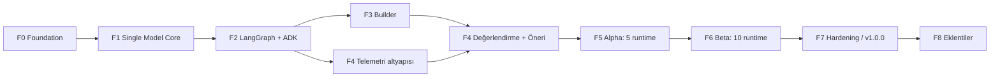

# Agentic Arena — İnşa Planı

> Teknik Geliştirme Planı'nda tanımlanan ürünün **hangi sırayla, hangi mühendislik standartlarıyla ve hangi kabul kapılarından geçerek** inşa edileceğini anlatan faz faz uygulama planı.

**Doküman:** İnşa (oluşturma) planı — uygulama sırası, iş paketleri, mühendislik standartları, izlenebilirlik
**Sürüm:** 1.0
**Tarih:** 24 Kasım 2026
**Kaynak:** [Teknik Geliştirme Planı](./gelistirme-plani.md) — bu dokümanda **GP §x.y** olarak anılır
**Durum:** Uygulama öncesi plan. Burada adı geçen dosya, komut, servis ve tablolar henüz yazılmamıştır. Takvim ve süre tahmini verilmez (GP §18.1).

---

## İçindekiler

0. [Bu doküman nasıl kullanılır](#0-bu-doküman-nasıl-kullanılır)
1. [Mühendislik ilkeleri ve standartlar](#1-mühendislik-ilkeleri-ve-standartlar)
2. [Hedef repo yapısı](#2-hedef-repo-yapısı)
3. [Faz haritası](#3-faz-haritası)
4. [Faz 0 — Foundation](#4-faz-0--foundation)
5. [Faz 1 — Single Model Core](#5-faz-1--single-model-core)
6. [Faz 2 — Pilot runtime'lar (LangGraph + Google ADK)](#6-faz-2--pilot-runtimelar-langgraph--google-adk)
7. [Faz 3 — Builder ve gereksinimler](#7-faz-3--builder-ve-gereksinimler)
8. [Faz 4 — Telemetri, değerlendirme ve öneri](#8-faz-4--telemetri-değerlendirme-ve-öneri)
9. [Faz 5 — Beş runtime alpha](#9-faz-5--beş-runtime-alpha)
10. [Faz 6 — On runtime beta](#10-faz-6--on-runtime-beta)
11. [Faz 7 — Release hardening (V1)](#11-faz-7--release-hardening-v1)
12. [Faz 8 — Eklentiler](#12-faz-8--eklentiler)
13. [Runtime ekleme reçetesi](#13-runtime-ekleme-reçetesi)
14. [Takip ve izlenebilirlik matrisleri](#14-takip-ve-izlenebilirlik-matrisleri)
15. [CI/CD evrimi](#15-cicd-evrimi)
16. [Riskler ve azaltma](#16-riskler-ve-azaltma)
17. [Başlangıç: ilk PR sırası](#17-başlangıç-ilk-pr-sırası)
18. [Sözlük](#18-sözlük)

---

## 0. Bu doküman nasıl kullanılır

- **GP "ne ve neden"i, bu doküman "nasıl ve hangi sırayla"yı anlatır.** Çelişki olursa GP'deki ürün kararları (D01–D12, GP §1.3) önceliklidir. Bu dokümandaki teknik seçimler (kütüphane, protokol, dizin) yalnızca ADR ile değiştirilir.
- **Kimlik sistemi:**

  | Önek | Anlam | Kaynak |
  |---|---|---|
  | `F0`–`F8` | Faz | Bu doküman §3 |
  | `F3.7` | Faz içi iş paketi | Bu doküman §4–§12 |
  | `E01`–`E14` | Epic | GP §18.2 |
  | `AC01`–`AC28` | V1 kabul testi | GP §18.3 |
  | `D01`–`D12` | Değişmez ürün kararı | GP §1.3 |
  | `ADR-NNN` | Mimari karar kaydı | `docs/adr/` |

- **Her faz aynı şablonla yazılmıştır:** Amaç · Ön koşullar · Kapsam / kapsam dışı · İş paketleri · Teknik tasarım notları · Testler · Çıkış kapısı · Riskler.
- **Faz kapısı kuralı:** Bir faz, çıkış kapısındaki maddelerin tamamı sağlanmadan kapanmaz. Sonraki fazın işi paralel başlayabilir, ancak `main`'e giren hiçbir değişiklik kapanmış bir fazın kapı testlerini kırmızıya çeviremez.
- **İş paketi = bir veya birkaç PR.** İş paketi tablolarındaki "Kabul" sütunu o paketin PR'larında bulunması gereken testi tanımlar.

---

## 1. Mühendislik ilkeleri ve standartlar

### 1.1 Mimari ilkeler

1. **Framework-bağımsız control plane (ADR-001).** `apps/`, `services/` ve `packages/` altındaki hiçbir kod karşılaştırılan 10 framework'ten birini import edemez. Framework kodu yalnızca `runtimes/<id>/` içinde ve kendi image'ında yaşar. Kural `import-linter` sözleşmesiyle CI'da zorlanır.
2. **Ports & adapters (hexagonal).** Her servis şu katmanlardan oluşur ve bağımlılık yönü daima içeri doğrudur:

   ```text
   api  ──►  application  ──►  domain
    │            │
    └──► adapters ──► ports (Protocol)  ◄── application
   ```

   - `domain`: saf iş kuralları; I/O, saat, rastgelelik, framework yok.
   - `application`: use-case'ler (`ApproveSpec`, `ReserveBudget`); port'lar üzerinden çalışır.
   - `ports`: `typing.Protocol` arayüzleri (`ProviderAdapter`, `LedgerRepository`, `Clock`).
   - `adapters`: Postgres, LiteLLM, Docker, OTel gibi somut uygulamalar.
   - `api`: FastAPI router'ları ve DTO dönüşümü; iş kuralı içermez.
   - `main.py`: composition root — bağımlılıklar yalnızca burada birleştirilir.
3. **Sözleşmeler tek doğruluk kaynağıdır (ADR-013).** `packages/contracts/schemas/` altındaki JSON Schema dosyalarından Python ve TypeScript tipleri **üretilir**. Elle kopyalanmış DTO yoktur. Üretilmiş kodun güncelliği CI'da doğrulanır.
4. **Modüler monolit + güvenlik sınırı servisleri (ADR-016).** Task Studio, Experiment Controller, Evaluation, Recommendation ve Exporter aynı API sürecinde kütüphane olarak çalışır. Model Gateway, Tool Broker, Runtime Manager ve Telemetry Processor ayrı süreç/container'dır; çünkü yetki ve güvenlik sınırları farklıdır (secret, Docker socket, sandbox ağı).
5. **Immutable deney kayıtları.** Onaylı spec, frozen candidate, run sonucu ve usage kaydı append-only'dir. Değişiklik yeni revision demektir (GP §4.2, §8.5).
6. **Ölçülmeyeni uydurmama.** `measured / provider_reported / derived / estimated / unsupported / unknown` ayrımı enum olarak tip sistemine taşınır. `None`, `0` ve `unknown` asla birbirinin yerine kullanılmaz (GP §10.2).
7. **Fail closed.** Belirsiz politika, eksik capability, erişilemeyen gateway veya evaluator → `blocked`/`partial`. Hiçbir katmanda model fallback'i yoktur (D04, GP §16.2).

### 1.2 Clean code kuralları

| Kural | Uygulama | Zorlayan |
|---|---|---|
| Niyet açıklayan isim | Kısaltma yok: `reserve_budget`, `usage_ledger`; boolean'lar `is_/has_/can_` | Review, ruff `N` |
| Tek sorumluluk | Fonksiyon tek iş yapar; cyclomatic complexity ≤ 10 | ruff `C901` |
| Tip güvenliği | Python `mypy --strict`; TS `strict: true`; `Any`/`any` yalnızca gerekçeli yorumla | mypy, tsc, typescript-eslint |
| Saf domain | Domain'de I/O yok; `Clock`, `IdGenerator`, `Random` port olarak enjekte edilir | import-linter |
| Hata yönetimi | Domain hataları `ArenaError` alt sınıfları + katalog kodu; `except Exception` yalnızca sınır katmanında | ruff `BLE`, `TRY` |
| Sihirli sayı yok | Limitler settings veya TaskSpec'ten gelir; sabitler `Final` ile isimlendirilir | ruff `PLR2004` |
| Yorumlar "neden"i anlatır | Public API'de Google stili docstring; "ne" yorumu yazılmaz | ruff `D` |
| TODO disiplini | Yalnızca `TODO(#issue)` biçimi | ruff `TD`, `FIX` |
| Timeout zorunlu | Her dış çağrıda açık timeout; blocking I/O async yolda yok | ruff `ASYNC`, review |
| Secret hijyeni | Kodda/testte gerçek anahtar yok; log processor redaction yapar | gitleaks, test |
| Yapılandırılmış log | structlog JSON; event adı dot.case; `correlation_id` zorunlu | test |
| Erken dönüş | Derin `if` iç içeliği yerine guard clause | Review |
| Değişmez veri | Domain modelleri `frozen=True` Pydantic/dataclass | Review |
| Yeni bağımlılık | PR açıklamasında gerekçe + lisans; copyleft lisans ADR ister | dependency-review |

### 1.3 Dil ve araç zinciri

| Alan | Seçim | Not |
|---|---|---|
| Python | 3.12 (control plane) | Runtime image'larında framework desteğine göre 3.12/3.13 |
| Python paket yönetimi | uv workspace | Her runtime **ayrı** uv projesi ve ayrı `uv.lock`; workspace üyesi değildir (D08) |
| Python lint/format | ruff (lint + format) | Tek araç, tek yapılandırma (`pyproject.toml`) |
| Python tip | mypy `--strict` | Pydantic plugin açık |
| Python test | pytest, pytest-asyncio, hypothesis, testcontainers | Postgres entegrasyon testleri gerçek container ile |
| Node | Node.js 24 LTS, pnpm workspace | Mastra runtime'ı workspace dışı, kendi `pnpm-lock.yaml` |
| Web | TypeScript strict, Vite, React, React Router, TanStack Query, Tailwind + shadcn/ui, @xyflow/react, Apache ECharts | GP §3 |
| TS lint/format | ESLint (typescript-eslint, eslint-plugin-boundaries) + Prettier | |
| TS test | Vitest, Testing Library, Playwright | |
| API | FastAPI, Pydantic v2, pydantic-settings | |
| Veritabanı | PostgreSQL 17, SQLAlchemy 2 (async), Alembic, psycopg 3 | SQLite yalnızca birim test kolaylığı için (GP §14.1) |
| Log | structlog | JSON çıktı, redaction processor |
| Telemetri | OpenTelemetry SDK (Python/JS), OTel Collector contrib, Grafana Tempo, Prometheus | GenAI semconv sürümü manifestte sabit |
| Konteyner | Docker Engine + Compose v2 | Hardened profil: gVisor `runsc` |
| Güvenlik | gitleaks, Trivy, Syft (SBOM), cosign, pip-audit, `pnpm audit` | |
| Mimari kural | import-linter (Python), eslint-plugin-boundaries (TS) | |
| Kod üretimi | datamodel-code-generator, json-schema-to-typescript, openapi-typescript | |
| Git hook | pre-commit | ruff, mypy (değişen paket), prettier, eslint, gitleaks, commit mesajı kontrolü |
| Görev çalıştırıcı | `Makefile` (GP §15) | Windows için `make` gerektirmeyen `scripts/` karşılıkları |
| Bağımlılık güncelleme | Renovate | Gruplama: control plane / web / her runtime ayrı |

Kütüphane sürümleri bu tabloda sabitlenmez; lockfile'lar ve Renovate yönetir.

### 1.4 İsimlendirme sözleşmeleri

| Öğe | Biçim | Örnek |
|---|---|---|
| Framework ID | kebab-case | `google-adk`, `llama-agents` |
| Python dağıtım / import adı | `arena-<ad>` / `arena_<ad>` | `arena-gateway` / `arena_gateway` |
| TS paket | `@arena/<ad>` | `@arena/contracts` |
| Servis dizini | snake_case (GP §15) | `services/model_gateway` |
| Web sayfa dizini | kebab-case | `src/pages/task-studio` |
| Event tipi | `grup.eylem` (dot.case) | `llm.usage`, `candidate.frozen` |
| DB tablo / kolon | snake_case; tablo çoğul | `model_requests.usage_source` |
| REST yolu | `/v1/<çoğul-kaynak>`; kebab-case | `/v1/settings/model-connection` |
| Kaynak ID | Tür öneki + ULID | `exp_01JDX…`, `run_01JDX…`, `evt_01JDX…` |
| Ortam değişkeni | `ARENA_<SERVİS>_<AD>` | `ARENA_GATEWAY_REQUEST_TIMEOUT_MS` |
| Hata kodu | `ALAN_NEDEN` (UPPER_SNAKE) | `GATEWAY_MODEL_OVERRIDE_DENIED` |
| Birimli alan | Birim ad içinde | `timeout_ms`, `size_bytes`, `max_seconds` |
| Git dalı | `<tür>/<faz>-<konu>` | `feat/f1-budget-reservation` |

### 1.5 Test stratejisi

| Katman | Konum | Kapsam | Çalışma zamanı |
|---|---|---|---|
| Unit | `<paket>/tests/unit/` | Domain, saf fonksiyon, state machine | Her PR |
| Integration | `<paket>/tests/integration/` | Postgres (testcontainers), HTTP, Docker | Her PR |
| Contract | `tests/contract/` | JSON Schema uyumluluğu, OpenAPI, worker protokolü | Her PR |
| Worker conformance | `tests/contract/worker_conformance/` | Aynı suite 10 runtime'da | `runtime-matrix` |
| Security | `tests/security/` | Egress, dosya sistemi, traversal, redaction, model override | Hızlı alt küme her PR; tam suite nightly |
| Benchmark integrity | `tests/benchmark_integrity/` | Metrik, istatistik, ranking golden fixture'ları | Her PR |
| E2E | `tests/e2e/` | Playwright + compose, uçtan uca deney | `main` ve release |

- **Golden fixture'lar** (`tests/fixtures/golden/*.json`) beklenen metrik/rank çıktılarını sabitler. Değişiklikleri CODEOWNERS ile ayrı onay gerektirir.
- **Coverage eşikleri:** domain paketleri ≥ %90 satır; metrik, istatistik, ranking ve usage hesapları ≥ %95 dal; genel ≥ %80. Eşiği düşüren PR kırmızıdır.
- **Gerçek LLM:** CI varsayılanı deterministik `MockProvider`'dır. Gerçek model testleri yalnızca nightly/manuel, bütçeli çalışır; fork PR'lara secret verilmez (GP §18.4).
- **Property-based test:** state machine geçişleri, budget rezervasyonu, interval union ve normalizasyon hypothesis ile test edilir.

### 1.6 Git iş akışı ve sürümleme

- **Trunk-based:** `main` korumalıdır (zorunlu review, yeşil CI, linear history). Dallar kısa ömürlüdür.
- **Conventional Commits:** scope = paket veya servis. Örnek: `feat(gateway): reject model override with 403`, `fix(telemetry): dedupe usage events by request_id`.
- **PR kuralları:** tek mantıksal değişiklik; hedef ≤ ~400 satır diff; PR şablonu (amaç, GP referansı, test kanıtı, güvenlik etkisi); en az bir onay; squash merge.
- **SemVer ve faz etiketleri:**

  | Faz | Etiket | Anlam |
  |---|---|---|
  | F0 | `v0.1.0` | İskelet ve sözleşmeler |
  | F1 | `v0.2.0` | Tek model çekirdeği |
  | F2 | `v0.3.0` | İki runtime |
  | F3 | `v0.4.0` | Builder |
  | F4 | `v0.5.0` | Telemetri + değerlendirme |
  | F5 | `v0.6.0` | Alpha (5 runtime) |
  | F6 | `v0.7.0` | Beta (10 runtime) |
  | F7 | `v1.0.0` | İlk tamamlanmış ürün sürümü |
  | F8 | `v1.1.0` | Eklentiler |

- **CHANGELOG:** Keep a Changelog biçimi; her kullanıcıya görünür PR `Unreleased` altına bir satır ekler.
- **GitHub düzeni:** Milestone = faz. Label seti: `phase:F0…F8`, `epic:E01…E14`, `prio:P0|P1`, `area:<servis>`, `type:feat|fix|docs|chore|security`.

### 1.7 Genel Definition of Done

Her iş paketi için:

- [ ] Kod, test, tip kontrolü ve lint yeşil.
- [ ] Public arayüzler docstring'li; paket `README.md` güncel.
- [ ] Sözleşme değiştiyse: schema sürümü artırıldı, kod yeniden üretildi, uyumluluk testi geçti.
- [ ] Yeni davranış event üretiyorsa event sözlüğüne (`packages/contracts/schemas/events/`) eklendi.
- [ ] Güvenlik etkisi GP §16.1 tehdit tablosuna göre değerlendirildi; gerekiyorsa `tests/security/` testi eklendi.
- [ ] İlgili AC testi eklendi veya güncellendi.
- [ ] CHANGELOG satırı eklendi.
- [ ] Mimari bir seçim yapıldıysa ADR yazıldı.

---

## 2. Hedef repo yapısı

GP §15'teki ağaç temel alınmıştır. İnşa sırasında netleştirilen eklemeler `(+)` ile işaretlidir.

```text
agentic-arena/
├── README.md
├── LICENSE
├── CONTRIBUTING.md
├── SECURITY.md
├── CODE_OF_CONDUCT.md                (+)
├── CHANGELOG.md
├── .editorconfig                     (+)
├── .gitattributes                    (+)
├── .gitignore
├── .env.example
├── .pre-commit-config.yaml           (+)
├── renovate.json                     (+)
├── pyproject.toml                    (+) uv workspace kökü, ruff/mypy/pytest ayarları
├── uv.lock                           (+)
├── package.json                      (+) pnpm workspace kökü
├── pnpm-workspace.yaml               (+)
├── tsconfig.base.json                (+)
├── compose.yaml
├── Makefile
├── apps/
│   ├── web/                          React + TS (10 sayfa, GP §13)
│   ├── api/                          FastAPI control plane (modüler monolit girişi)
│   └── cli/                          (+) `arena` CLI (Typer); yalnızca API istemcisi
├── services/
│   ├── task_studio/
│   ├── experiment_controller/
│   ├── builder/                      clarifier, architect, specialists, knowledge_base,
│   │                                 coding_harness, reviewer, repair
│   ├── runtime_manager/
│   ├── model_gateway/
│   ├── tool_broker/
│   ├── telemetry/                    adapters, event_processor, usage_ledger,
│   │                                 aggregators, exporters
│   ├── evaluation/
│   ├── recommendation/
│   └── artifact_exporter/
├── runtimes/                         10 framework; her biri bağımsız proje (§2.2)
├── registry/
│   ├── framework-catalog.yaml
│   ├── releases/
│   └── update_manager/
├── packages/
│   ├── contracts/
│   │   ├── schemas/                  (+) JSON Schema — tek doğruluk kaynağı
│   │   ├── python/                   (+) üretilmiş `arena_contracts`
│   │   └── typescript/               (+) üretilmiş `@arena/contracts`
│   ├── kernel/                       (+) `arena_kernel`: id, clock, hata, log, settings, hash
│   ├── worker-sdk/
│   │   ├── python/                   (+)
│   │   └── typescript/               (+) Mastra için
│   └── shared-tool-sdk/
├── benchmarks/
│   ├── fixtures/
│   ├── tasks/
│   ├── evaluators/
│   └── fault_injection/
├── plugins/
│   ├── sdk/
│   └── example-custom/
├── infra/
│   ├── otel/
│   ├── tempo/
│   ├── prometheus/
│   ├── postgres/
│   └── sandbox/
├── scripts/                          (+) Makefile hedeflerinin platform bağımsız karşılıkları
├── tests/
│   ├── contract/
│   ├── security/
│   ├── benchmark_integrity/
│   ├── e2e/
│   └── fixtures/golden/              (+)
├── docs/
│   ├── architecture/
│   ├── adr/
│   ├── getting-started/
│   └── framework-guides/
├── temp-dosyalar/                    (+) planlama dokümanları (bu dosya ve GP)
└── .github/
    ├── workflows/                    ci.yml, runtime-matrix.yml, release.yml, security.yml
    ├── ISSUE_TEMPLATE/               (+)
    ├── PULL_REQUEST_TEMPLATE.md      (+)
    └── CODEOWNERS                    (+)
```

**Test yerleşimi:** Birim ve entegrasyon testleri ilgili paketin içinde (`services/<ad>/tests/`) durur; böylece paket kendi başına test edilebilir. Kök `tests/` yalnızca paketler arası testleri (contract, security, benchmark integrity, e2e) içerir. GP §15'teki kök `tests/unit` ve `tests/integration` dizinleri bu nedenle paket içine taşınmıştır.

### 2.1 Python servis iç yapısı şablonu

Tüm `services/*` aynı iskeleti izler. Örnek: Model Gateway.

```text
services/model_gateway/
├── pyproject.toml                    # dağıtım: arena-gateway
├── README.md                         # sorumluluk, sınırlar, port'lar, yapılandırma
├── src/arena_gateway/
│   ├── __init__.py
│   ├── domain/                       # model kilidi, bütçe kuralları, usage hesapları (saf)
│   ├── application/                  # HandleModelRequest, ReserveBudget, SettleUsage
│   ├── ports/                        # ProviderAdapter, LedgerRepository, Clock (Protocol)
│   ├── adapters/                     # litellm_provider.py, mock_provider.py, postgres_ledger.py
│   ├── api/                          # FastAPI router'ları, DTO dönüşümü
│   ├── settings.py                   # pydantic-settings, ARENA_GATEWAY_* değişkenleri
│   └── main.py                       # composition root
└── tests/
    ├── unit/
    └── integration/
```

`import-linter` sözleşmesi her servis için şu katman sırasını zorlar: `api → application → domain`, `adapters → ports`, `domain` hiçbir iç katmanı ve hiçbir I/O kütüphanesini import etmez.

### 2.2 Runtime dizini şablonu

```text
runtimes/langgraph/
├── README.md                         # native paradigma, kapsam, bilinen sınırlar
├── Dockerfile                        # non-root, sabit base digest, çok aşamalı build
├── manifest.yaml                     # GP §6.2; placeholder'lar build tarafından doldurulur
├── pyproject.toml                    # yalnızca bu framework + arena-worker-sdk
├── uv.lock                           # bu runtime'a özel kilit
├── worker/
│   ├── main.py                       # worker-sdk entrypoint; RunSpec → native çalıştırma
│   └── telemetry_mapper.py           # native event → ArenaEvent
├── skeleton/                         # elle yazılmış, doğrulanmış native başlangıç projesi
├── specialist/                       # uzman ajan prompt paketi (sürümlü, §7 F3.8)
│   ├── system.md
│   ├── primitives.yaml               # izinli native primitive listesi
│   └── native-evidence.yaml          # statik kapının aradığı native kullanım kanıtı
├── examples/                         # sürüm uyumlu resmi örneklerin referans listesi
└── tests/
    ├── smoke/
    └── capability/                   # manifest'teki her `verified` yeteneğin testi
```

Uzman prompt paketi runtime dizininde tutulur; `services/builder/specialists/` yalnızca framework'ten bağımsız uzman motorunu içerir. Böylece yeni runtime veya plugin eklemek çekirdek kodu değiştirmez (F8 kapısı).

### 2.3 Git dışı çalışma verisi

Kullanıcı verisi repo ağacına yazılmaz; `ARENA_DATA_DIR` (varsayılan `./data`, `.gitignore`'da) altında tutulur:

```text
data/
├── secrets/                          # master key (0600), şifreli bağlantı sırları
├── postgres/                         # compose volume
├── artifacts/sha256/<ab>/<hash>      # içerik adresli artifact store
├── docs-snapshots/<framework>/<version>/
├── spool/                            # telemetri geçici kuyruğu
└── projects/<id>/experiments/<id>/candidates/<id>/attempts/<n>/
```

### 2.4 Dağıtım görünümü

| Bileşen | Süreç / container | Ağlar | Yetki |
|---|---|---|---|
| web | `web` | control | — |
| api (+ task_studio, experiment_controller API, evaluation, recommendation, exporter) | `api` | control | DB okuma/yazma; Docker socket **yok** |
| controller job worker | `controller` | control | Job kuyruğu |
| runtime_manager | `runtime-manager` | control, sandbox | Sınırlı Docker API erişimi (tek yetkili servis) |
| model_gateway | `gateway` | sandbox, egress | Secret çözme; provider'a çıkış |
| tool_broker | `tool-broker` | sandbox | Read-only dataset, artifact yazma |
| telemetry processor | `telemetry` | control, sandbox | Event yazma |
| otel-collector | `otel-collector` | control, sandbox | — |
| postgres | `postgres` | control | — |
| tempo, prometheus | `observability` profili | control | — |
| framework worker'ları | geçici container | yalnızca sandbox (`internal: true`) | Hiçbir secret; non-root; read-only rootfs |

Port yayınları yalnızca `127.0.0.1` üzerinedir (GP §16.2). `sandbox` ağı internete kapalıdır; worker yalnızca gateway, tool broker ve collector'a ulaşabilir.

---

## 3. Faz haritası

| Faz | Ad | Amaç | Epic | Kapattığı AC | Etiket |
|---|---|---|---|---|---|
| F0 | Foundation | Repo, sözleşmeler, state machine, job kuyruğu, CI, compose | E01, E12 | — (temel) | `v0.1.0` |
| F1 | Single Model Core | Secret, model probe, gateway, policy, bütçe, usage ledger, tool broker | E03, E04 | AC03, AC12 (mock), AC26 (kısmi) | `v0.2.0` |
| F2 | İlk runtime'lar | Worker SDK, runtime manager, registry, LangGraph + ADK | E02, E04 | AC04 (kısmi), AC23 | `v0.3.0` |
| F3 | Builder & gereksinimler | Clarifier, onay, üç giriş modu, uzman harness, test/repair/freeze | E05, E06 | AC05–AC11 (2 runtime) | `v0.4.0` |
| F4 | Telemetri & değerlendirme | Event store, OTel, metrikler, istatistik, evaluator, öneri motoru, canlı UI | E07, E08, E09, E10 | AC12–AC19, AC21 | `v0.5.0` |
| F5 | Beş runtime alpha | OpenAI SDK, CrewAI, MAF; tam UI; export; CLI | E06, E10, E11 | AC22 (5), AC28 | `v0.6.0` |
| F6 | On runtime beta | Agno, Pydantic AI, LlamaAgents, Smolagents, Mastra; TS worker SDK | E02, E06 | AC01, AC02, AC08 (10) | `v0.7.0` |
| F7 | Release hardening | Update/rollback, sandbox, retention, recovery, load/fault, docs, imzalı release | E12, E13 | AC20, AC24, AC25, AC27; tüm AC'ler yeşil | `v1.0.0` |
| F8 | Eklentiler | Plugin SDK, KOVAN adaptörü, Pure Python referansı, ileri analitik | E13, E14 | Plugin kapısı | `v1.1.0` |

**Önemli:** F5 bir geliştirme ara hedefidir. Son kullanıcıya sunulan ilk tamamlanmış sürüm (`v1.0.0`) **on runtime** içermek zorundadır (GP §1.3, §18.1).

### 3.1 Bağımlılık ve kritik yol



Kritik yol (GP §18.1): **gateway uyumluluğu → worker protokolü → builder güvenliği → evaluator bütünlüğü → telemetri → kalan runtime adaptörleri.** Bu sıradaki bir gecikme tüm planı kaydırır; diğer işler (UI sayfaları, dokümantasyon, ileri grafikler) bu yolun yanında paralel ilerler.

### 3.2 Paralel iş akışları

| Akış | F0 | F1 | F2 | F3 | F4 | F5 | F6 | F7 | F8 |
|---|---|---|---|---|---|---|---|---|---|
| Platform (API, DB, kuyruk) | ● | ● | ○ | ○ | ○ | ○ | | ● | |
| Model & araç (gateway, broker) | | ● | ○ | | | | | ● | |
| Runtime (worker, adapter) | | | ● | | | ● | ● | ● | ● |
| Builder | | | | ● | ○ | ● | ● | | ● |
| Telemetri & değerlendirme | ○ | ○ | ○ | | ● | ○ | ○ | ● | ● |
| UI | ● | ○ | ○ | ● | ● | ● | ○ | ● | ○ |
| Güvenlik & CI | ● | ● | ● | ● | ○ | ○ | ● | ● | ○ |

● ana iş · ○ destek / genişletme

---

## 4. Faz 0 — Foundation

**Amaç:** Üzerine her şeyin kurulacağı temiz, tekrarlanabilir ve kurallı bir monorepo; sözleşmelerin ilk sürümü; framework'ten bağımsız control plane iskeleti.

**Ön koşullar:** Yok.

**Kapsam:** Repo hijyeni, araç zinciri, ADR'ler, contracts v1, kernel paketi, API ve controller iskeleti, state machine, job kuyruğu, web kabuğu, compose çekirdek profili, fixture'lar, CI.
**Kapsam dışı:** Gerçek model çağrısı, runtime image'ları, builder.

### 4.1 İş paketleri

| ID | İş | Çıktı | Kabul |
|---|---|---|---|
| F0.1 | Repo hijyeni | `README`, `LICENSE`, `CONTRIBUTING`, `SECURITY`, `CODE_OF_CONDUCT`, `CHANGELOG`, `.editorconfig`, `.gitattributes`, `.gitignore`, `CODEOWNERS`, issue/PR şablonları | Branch protection açık; şablonlar GitHub'da görünür |
| F0.2 | Araç zinciri | Kök `pyproject.toml` (uv workspace, ruff, mypy, pytest), `pnpm-workspace.yaml`, `tsconfig.base.json`, ESLint/Prettier, `.pre-commit-config.yaml`, `Makefile`, `scripts/` | Temiz klonda `make setup && make check` yeşil |
| F0.3 | ADR seti | `docs/adr/0001…0016` (MADR şablonu); liste §4.3 | Her ADR `Accepted`; README'de indeks |
| F0.4 | Contracts v1 | `packages/contracts/schemas/`: `task-spec`, `arena-event` (envelope + event sözlüğü), `run-spec`, `framework-manifest`, `capability-report`, `tool-contract`, `model-request`, `usage`, `criterion-result`, `error-body` | Schema'lar JSON Schema 2020-12 ile valid; GP örnekleri (§5.4, §6.2, §10.2, §11.3, §14.3) schema'ya karşı geçer |
| F0.5 | Codegen | `make contracts` → `packages/contracts/python` ve `typescript` | Üretim deterministik; CI "üretilmiş kod güncel mi" kontrolü |
| F0.6 | Kernel paketi | `arena_kernel`: `ids` (önekli ULID), `clock` (UTC + monotonic port), `errors` (`ArenaError`, kod kataloğu), `logging` (structlog + redaction), `settings` (temel sınıf), `hashing` (RFC 8785 kanonik JSON + SHA-256) | %95 dal coverage; redaction testi bilinen secret desenlerini maskeler |
| F0.7 | API iskeleti | `apps/api`: app factory, `/healthz`, `/readyz`, hata middleware'i (GP §14.2 error body), `correlation_id`, idempotency-key middleware, OpenAPI dışa aktarımı | Contract testi: her hata yanıtı `error-body` schema'sına uyar |
| F0.8 | DB temeli | Alembic; ilk migration: `projects`, `task_specs`, `requirement_answers`, `experiments`, `candidates`, `jobs`, `events`, `audit_events` | `alembic upgrade head` / `downgrade base` temiz; FK ve unique kısıtlar test edilir |
| F0.9 | State machine | `services/experiment_controller/domain/`: `SpecState`, `CandidateState`, `ExperimentOutcome` ve geçiş tabloları (GP §4.2) | Tüm izinli geçişler ve tüm yasak geçişler test edilir (hypothesis) |
| F0.10 | Job kuyruğu | Postgres tabanlı kuyruk: lease, heartbeat, retry, idempotency key, orphan recovery | Eş zamanlı 2 tüketici aynı işi alamaz; lease süresi dolan iş geri döner |
| F0.11 | Web kabuğu | `apps/web`: Vite + React + TS; sidebar (10 sayfa, GP §13.1), üst bar, sağ panel, tema; OpenAPI'den üretilmiş istemci | Playwright smoke: tüm sayfalar açılır, erişilebilirlik (axe) ihlali yok |
| F0.12 | Compose `core` profili | `compose.yaml`: postgres, api, controller, web, otel-collector; healthcheck'ler; `127.0.0.1` bind; `.env.example` | `docker compose --profile core up` → tüm servisler healthy |
| F0.13 | Fixture'lar | `benchmarks/tasks/doc-review/` (TaskSpec), `benchmarks/fixtures/doc-review/` (sentetik, lisans temiz belgeler; `public/` ve `held-out/` ayrımı) | Fixture manifest'i hash'lenir; held-out dizini build bağlamına girmez |
| F0.14 | CI temeli | `ci.yml` (lint, typecheck, unit, integration, contract, web build, compose smoke), `security.yml` (gitleaks, Trivy fs, dependency review), `renovate.json` | PR'da tüm job'lar zorunlu kontrol |

### 4.2 Teknik tasarım notları

**State machine saf domain kodudur:**

```python
class CandidateState(StrEnum):
    PREFLIGHT = "preflight"
    BLOCKED = "blocked"
    BUILDING = "building"
    VALIDATING = "validating"
    READY = "ready"
    BUILD_FAILED = "build_failed"
    QUEUED = "queued"
    RUNNING = "running"
    RUN_FAILED = "run_failed"
    EVALUATING = "evaluating"
    EVALUATION_FAILED = "evaluation_failed"
    COMPLETED = "completed"
    EXPORTED = "exported"


ALLOWED: Final[Mapping[CandidateState, frozenset[CandidateState]]] = {
    CandidateState.PREFLIGHT: frozenset({CandidateState.BUILDING, CandidateState.BLOCKED}),
    CandidateState.BUILDING: frozenset({CandidateState.VALIDATING}),
    CandidateState.VALIDATING: frozenset(
        {CandidateState.BUILDING, CandidateState.READY, CandidateState.BUILD_FAILED}
    ),
    # ... GP §4.2'deki tablonun tamamı
}


def transition(current: CandidateState, target: CandidateState) -> CandidateState:
    if target not in ALLOWED.get(current, frozenset()):
        raise IllegalTransitionError(current=current, target=target)
    return target
```

**Job kuyruğu lease sorgusu** (tek satırlık atomik sahiplenme):

```sql
UPDATE jobs
SET state = 'leased',
    lease_owner = :worker_id,
    lease_expires_at = now() + make_interval(secs => :lease_seconds),
    attempts = attempts + 1
WHERE id = (
    SELECT id FROM jobs
    WHERE state = 'queued' AND run_after <= now()
    ORDER BY priority, created_at
    FOR UPDATE SKIP LOCKED
    LIMIT 1
)
RETURNING *;
```

**Spec hash:** Onaylanan TaskSpec RFC 8785 (JCS) ile kanonikleştirilir ve SHA-256 alınır. Aynı içerik her platformda aynı hash'i verir; onay bu hash'e bağlanır (GP §5.3).

### 4.3 Bu fazda yazılacak ADR'ler

| ADR | Başlık | Kaynak |
|---|---|---|
| 0001 | Framework-independent control plane | GP §19.3 |
| 0002 | Native pipeline tek kullanıcı karşılaştırma politikası | GP §19.3 |
| 0003 | Tek provider credential ve tek model, tüm LLM fazları | GP §19.3 |
| 0004 | Runtime izolasyonu ve sürümlü OCI manifest'leri | GP §19.3 |
| 0005 | Açık gereksinim onayı, serbest alanlar, ayrı güvenlik watchdog'u | GP §19.3 |
| 0006 | Kanonik gateway usage ledger + OTel/event tabanlı telemetri | GP §19.3 |
| 0007 | Kullanıcı ağırlıklı sıralamadan önce hard kabul kapıları | GP §19.3 |
| 0008 | Public build testleri / private held-out değerlendirme, immutable candidate | GP §19.3 |
| 0009 | Secret içermeyen bağımsız export | GP §19.3 |
| 0010 | KOVAN opsiyonel plugin, çekirdek bağımlılığı değil | GP §19.3 |
| 0011 | Worker taşıma protokolü: stdio JSONL (HTTP opsiyonel) | Bu plan F2 |
| 0012 | Postgres tabanlı kalıcı job kuyruğu (`SKIP LOCKED`) | Bu plan F0.10 |
| 0013 | JSON Schema tek doğruluk kaynağı; Py/TS kod üretimi | Bu plan §1.1 |
| 0014 | Proje lisansı | Bu plan F0.1 |
| 0015 | Secret şifreleme (AES-256-GCM, yerel master key) | Bu plan F1.1 |
| 0016 | Modüler monolit + güvenlik sınırı servisleri | Bu plan §1.1 |

### 4.4 Testler

- Unit: kernel, state machine (tam geçiş matrisi), hata kataloğu, kanonik hash (bilinen vektörler).
- Integration: migration up/down, job lease yarışı (2 tüketici, 1000 iş, çift işlem yok).
- Contract: GP'deki tüm YAML/JSON örnekleri ilgili schema'ya karşı.
- E2E: compose `core` ayağa kalkar; web kabuğu açılır.

### 4.5 Çıkış kapısı

- [ ] Temiz klonda `make setup && make check` yeşil (Linux, macOS, Windows/WSL2).
- [ ] `docker compose --profile core up` ile tüm servisler healthy.
- [ ] `make contracts` deterministik; CI üretilmiş kod farkını yakalıyor.
- [ ] import-linter: `apps/`, `services/`, `packages/` içinde framework import'u yasak kuralı aktif.
- [ ] ADR 0001–0016 `Accepted`.
- [ ] Branch protection, CODEOWNERS, PR şablonu aktif.

### 4.6 Riskler

| Risk | Azaltma |
|---|---|
| Sözleşmelerin erken donması | `schema_version` alanı ve CI uyumluluk testi; v1 içinde yalnızca geriye uyumlu ekleme |
| Windows geliştirici ortamı farkları | `.gitattributes` ile LF; `scripts/` karşılıkları; WSL2 resmi destek |

---

## 5. Faz 1 — Single Model Core

**Amaç:** Tüm LLM trafiğinin tek kapıdan, tek modele, bütçeli ve ölçülü geçmesi; secret'ın hiçbir zaman gateway dışına çıkmaması; ortak araç broker'ı.

**Ön koşullar:** F0 kapısı.

**Kapsam:** Secret store, model bağlantısı ve capability probe, gateway, policy, capability token, bütçe, usage ledger, rate limit, tool broker v1, gateway kalibrasyonu.
**Kapsam dışı:** Framework worker'ları (F2), LLM judge (F4).

### 5.1 İş paketleri

| ID | İş | Çıktı | Kabul |
|---|---|---|---|
| F1.1 | Secret store | AES-256-GCM ile şifreli `model_connections.encrypted_secret_ref`; master key `data/secrets/master.key` (0600, repo dışı); rotate; maskeli gösterim | Secret API yanıtında, logda ve event'te hiç görünmez (tarama testi) |
| F1.2 | Model bağlantısı API'si | `PUT /v1/settings/model-connection`, `POST …/test` | Tek bağlantı kuralı: ikinci bağlantı oluşturma isteği reddedilir (D04) |
| F1.3 | Capability probe | Erişim, model ID, tool calling, streaming, structured output, usage raporu, seed/temperature, Responses / Chat Completions desteği → `CapabilityReport` | Mock provider'da bilinen yetenek seti doğru raporlanır; desteklenmeyen yetenek `unsupported` |
| F1.4 | Gateway servisi | `services/model_gateway`: dahili OpenAI uyumlu `POST /v1/chat/completions`, `POST /v1/responses`; streaming geçişi; TTFT ölçümü | Streaming'de son chunk usage'ı yakalanır; gelmezse `usage_incomplete` işaretlenir |
| F1.5 | Provider adapter port'u | `ProviderAdapter` Protocol; `LiteLLMProvider` (kütüphane olarak, proxy değil), `OpenAICompatibleProvider`, `MockProvider` (senaryolu, bilinen usage) | Adapter değişimi application katmanında kod değişikliği gerektirmez |
| F1.6 | Capability token | Run-scoped, kısa ömürlü imzalı token; claim'ler: `experiment_id`, `candidate_id`, `run_id`, `phase`, `budget_scope`, `exp` | Süresi dolmuş/yanlış scope token 401; token kullanıcı API anahtarı değildir |
| F1.7 | Policy motoru | Model kilidi, connection kilidi, parametre eşleme ve sapma kaydı; model override → 403 + `policy.violation` audit event | AC03 testi |
| F1.8 | Bütçe rezervasyonu | `budgets` tablosu; atomik rezervasyon → settle → release; eşik uyarısı `budget.warning`, tükenme `budget.exhausted` | 100 eş zamanlı istek limiti aşamaz (property test) |
| F1.9 | Usage ledger | `model_requests` tablosu (GP §7.3 alanları); fiziksel istek başına tekil `request_id`; `usage_source` = `provider / estimated / unknown`; cache ve reasoning alt küme kuralları; fiyat snapshot'ı; `retry_parent_id` | AC12 (mock): bilinen usage ile ledger toplamı birebir eşleşir; cache/reasoning çift sayılmaz |
| F1.10 | Rate limit ve retry | Ortak token bucket; 429/backoff/timeout/cancel ayrı event'ler; gateway retry ile native retry ayrı katman; sonsuz retry engeli | Her fiziksel deneme ayrı ledger satırı; retry ağacı yeniden kurulabilir |
| F1.11 | Tool broker v1 | `services/tool_broker`: contract'tan registry, input validation, run ACL, timeout, result hash, audit; araçlar: `read_document`, `lexical_search` (deterministik BM25), `artifact_write` | İzinsiz araç `tool.denied`; aynı girdi aynı result hash |
| F1.12 | Shared tool SDK | `packages/shared-tool-sdk`: framework'lerin ortak tool contract'ını kendi primitive'lerine map etmesi için yardımcılar | Contract testi: SDK'nın ürettiği tanım schema'ya uyar |
| F1.13 | Gateway kalibrasyonu | `platform_diagnostics` fazında no-op/echo istekleri ile gateway ek süresinin ölçümü | Sonuç ranking'e katılmaz; tanı raporunda görünür (GP §9.4) |

### 5.2 Teknik tasarım notları

**Provider port'u:**

```python
class ProviderAdapter(Protocol):
    """Tek seçilmiş modele fiziksel istek gönderen adapter. Fallback yapmaz."""

    async def complete(self, request: ModelRequest) -> ModelResponse: ...

    def stream(self, request: ModelRequest) -> AsyncIterator[ModelChunk]: ...

    async def probe(self) -> CapabilityReport: ...
```

**Atomik bütçe rezervasyonu:**

```sql
UPDATE budgets
SET reserved_tokens = reserved_tokens + :requested
WHERE scope_id = :scope_id
  AND limit_tokens - consumed_tokens - reserved_tokens >= :requested
RETURNING limit_tokens - consumed_tokens - reserved_tokens AS remaining;
-- 0 satır dönerse: BUDGET_EXHAUSTED (fail closed)
```

**İstek yaşam döngüsü:** `authenticate token → enforce model lock → reserve budget → rate limit → provider call → record usage (provider/estimated/unknown) → settle budget → emit llm.* events`. Her adım ayrı span'dır; queue, gateway ve provider süreleri ayrışır (GP §10.2).

### 5.3 Testler

- Unit: policy kararları, usage hesapları (cache/reasoning alt küme tabloları), token bucket.
- Integration: Postgres üzerinde bütçe yarışı; MockProvider ile streaming ve kesik stream.
- Security: secret sızıntı taraması (log, yanıt, event, exception mesajı); model override; süresi dolmuş token.
- Contract: gateway endpoint'leri OpenAI uyumlu istemci ile çağrılabilir.

### 5.4 Çıkış kapısı

- [ ] AC03: farklı model isteği 403 + audit event.
- [ ] AC12 (mock): ledger toplamı bilinen usage ile birebir.
- [ ] AC26 (kısmi): desteklenmeyen capability preflight'ı bloklar; fallback yok.
- [ ] Secret hiçbir yanıt, log veya event'te yok (otomatik tarama).
- [ ] Bütçe eş zamanlılık testi yeşil.
- [ ] Tool broker izinsiz çağrıyı reddeder ve audit'ler.

### 5.5 Riskler

| Risk | Azaltma |
|---|---|
| LiteLLM'in protokol dönüşümünde bilgi kaybı | Capability raporunda dönüşüm kayıpları listelenir; gereksinimi karşılamıyorsa preflight blok (GP §7.2) |
| Streaming'de usage gelmemesi | `usage_incomplete` + tokenizer tahmini `estimated` olarak; kesin gibi gösterilmez |

---

## 6. Faz 2 — Pilot runtime'lar (LangGraph + Google ADK)

**Amaç:** Worker protokolünü, runtime izolasyonunu ve native adapter modelini iki framework ile uçtan uca kanıtlamak. Builder henüz yoktur; pipeline'lar elle yazılmış referans projelerdir.

**Ön koşullar:** F1 kapısı (gateway + broker).

**Kapsam:** Python worker SDK, runtime image şablonu, runtime manager, registry, LangGraph ve ADK runtime'ları, elle yazılmış referans pipeline'lar, docs snapshot hattı, runtime matrix CI.
**Kapsam dışı:** Kod üretimi (F3), gelişmiş metrikler (F4).

### 6.1 İş paketleri

| ID | İş | Çıktı | Kabul |
|---|---|---|---|
| F2.1 | Worker SDK (Python) | `packages/worker-sdk/python`: stdin'den `RunSpec`, stdout'a `ArenaEvent` JSONL, gateway ve tool istemcileri, cooperative cancel, artifact writer, OTel kurulumu, `sequence` + `monotonic_ns` + `clock_id` | Protokol conformance suite'i (`tests/contract/worker_conformance`) ilk sürüm |
| F2.2 | Runtime image şablonu | `infra/sandbox/base/`: çok aşamalı Dockerfile, sabit base digest, UID 10001, read-only rootfs, yazılabilir yalnızca `/workspace` ve `/tmp` | Trivy taramasında kritik açık yok |
| F2.3 | Runtime Manager | `services/runtime_manager`: prepare (build/pull), durumlar (GP §6.1 tablosu), cold/warm havuz, kaynak kotaları, timeout'ta kill, cleanup | Durum geçişleri state machine ile; orphan container kalmaz |
| F2.4 | Registry | `registry/framework-catalog.yaml` (10 kayıt; henüz hazır olmayanlar `status: planned`), `registry/releases/<id>/<version>.yaml`; `GET /v1/frameworks`, `POST …/prepare`, `POST …/verify` | Manifest schema doğrulaması; `verified` yalnızca test kaydıyla |
| F2.5 | LangGraph runtime | `runtimes/langgraph/` (§2.2 şablonu); telemetry mapper (stream event → ArenaEvent); capability testleri: koşullu branch, 2 paralel node, reducer, model çağrısı, streaming, checkpoint resume | GP §2.1 smoke listesi yeşil |
| F2.6 | Google ADK runtime | `runtimes/google-adk/`; gateway'e doğrulanmış LiteLLM/custom model köprüsü; runner event mapping; testler: root→subagent, paralel, structured tool, session izolasyonu | GP §2.2 smoke listesi yeşil |
| F2.7 | Referans pipeline'lar | Her iki runtime için `skeleton/` altında doc-review çözümü (elle yazılmış, native) | Aynı TaskSpec iki native pipeline ile çalışır; çıktılar output schema'ya uyar |
| F2.8 | Docs snapshot hattı | `registry/update_manager/docs_snapshot.py`: release tag'indeki docs'u indirir, lisans kontrolü, `data/docs-snapshots/` altına, SQLite FTS5 lexical index | Aynı tag → aynı index hash'i |
| F2.9 | Run orkestrasyonu v0 | Controller: frozen (elle) candidate'ı kuyruğa al, launch, event'leri topla, outcome yaz | `POST /v1/experiments/{id}/run` iki aday için tamamlanır |
| F2.10 | İptal | Queued iş anında iptal; aktif iş SIGTERM → grace → SIGKILL; harcanan token korunur | AC23 testi |
| F2.11 | İzolasyon testleri | Worker A, B'nin workspace'ine, host'a, secret'a, kontrol ağına erişemez | AC04 (kısmi) |
| F2.12 | Runtime matrix CI | `runtime-matrix.yml`: her runtime × (lock çözümü, image build, smoke, capability) MockProvider ile | PR'da değişen runtime için; nightly tümü |

### 6.2 Teknik tasarım notları

**Worker protokolü (ADR-0011):**

| Kanal | İçerik |
|---|---|
| `stdin` | İlk satır: `RunSpec` JSON; sonrası kontrol mesajları (`{"type":"cancel"}`) |
| `stdout` | Yalnızca `ArenaEvent` JSONL (her satır bir event) |
| `stderr` | Serbest log (structlog JSON); telemetriye `log` olarak alınır |
| Çıkış kodu | `0` başarı · `10` aday hatası · `20` altyapı hatası · `30` iptal · `40` policy ihlali |

Stdio tercih edilmesinin nedeni: sandbox içinde dinlenen port yoktur, izolasyon basitleşir ve aynı protokol Python ile Node'da aynen uygulanır. HTTP taşıma ileride opsiyonel olarak eklenebilir.

**Container çalıştırma politikası (minimum):**

```text
--user 10001:10001  --read-only  --cap-drop ALL  --security-opt no-new-privileges
--pids-limit <spec>  --memory <spec>  --cpus <spec>
--network arena-sandbox            # internal: true; yalnızca gateway/broker/collector
--mount type=bind,src=<dataset>,dst=/data,readonly
--mount type=volume,src=<run-workspace>,dst=/workspace
# Docker socket ASLA mount edilmez; yalnızca runtime-manager Docker API'ye erişir.
```

**Telemetry mapper sözleşmesi:** Her mapper native event'i `ArenaEvent`'e çevirir ve `source` alanını `native` veya `derived` olarak işaretler. Eşlenemeyen native event `unsupported` sayaçlarına düşer; sessizce atılmaz (GP §2.11).

### 6.3 Çıkış kapısı

- [ ] Aynı doc-review görevi LangGraph ve ADK'da native pipeline ile çalışır; event'ler DB'de, usage ledger ile mutabık.
- [ ] AC04 (kısmi): izolasyon testleri yeşil.
- [ ] AC23: iptal sonrası alt süreç ve container kalmaz; harcanan token saklanır.
- [ ] Runtime matrix CI iki runtime için yeşil.
- [ ] Manifest'teki her `verified` yetenek bir test kimliğine bağlı.

### 6.4 Riskler

| Risk | Azaltma |
|---|---|
| ADK'nın gateway'e bağlanma yolunun sürümle değişmesi | Köprü capability testi; uyumsuz sürüm `BLOCKED`, son iyi sürüm korunur |
| Native event'lerin eksik olması | Gateway ve broker kanonik kaynak; eksik alanlar `unsupported` |

---

## 7. Faz 3 — Builder ve gereksinimler

**Amaç:** Kullanıcının görevini netleştirip onaylatan, ardından her framework için o framework'ün doğal primitive'lerini kullanan bağımsız bir uygulamayı **aynı model ve eşit bütçeyle** üreten, test eden, onaran ve donduran hat.

**Ön koşullar:** F2 kapısı (iki runtime, referans skeleton'lar, docs snapshot).

**Kapsam:** Task Studio backend, Clarifier, üç giriş modu, onay, Chief Architect, knowledge base, coding harness, iki runtime için uzman paketleri, statik kapı, test/repair, freeze, ilgili UI sayfaları, CLI ilk sürüm.
**Kapsam dışı:** Held-out değerlendirme ve ranking (F4), diğer 8 runtime'ın uzman paketleri (F5–F6).

### 7.1 İş paketleri

| ID | İş | Çıktı | Kabul |
|---|---|---|---|
| F3.1 | Spec revizyonları | `services/task_studio`: taslak, revision, alan politikaları (`required / preferred / free / not_applicable / unresolved`), diff | Onaylı revision DB seviyesinde değiştirilemez (trigger + test) |
| F3.2 | Onay | `POST /v1/specs/{id}/approve` spec hash ile; `unresolved` zorunlu alan varken reddedilir | AC05: onay immutable hash'e bağlı |
| F3.3 | Clarifier | `services/builder/clarifier`: gateway üzerinden `phase=clarification`; structured output ile soru grupları; sorulmuş soru kaydı (tekrar yok); her şey serbestse minimum kriter önerisi | Aynı soru iki kez sorulmaz; tüm çağrılar ledger'da `clarification` |
| F3.4 | Pipeline Mode modeli | Gereksinim grafiği (node: `required / suggested / free`), DAG doğrulaması, IO uyumu, TaskSpec `required_steps`'e dönüşüm | Native runtime graph ile karışmaz (ayrı tip) |
| F3.5 | Import Mode | ZIP yükleme: boyut sınırı, path traversal, symlink, zip bomb kontrolü; **hiçbir şey çalıştırılmadan** statik analiz (ağaç, entrypoint, test, schema, araç ihtiyacı) | AC06: zararlı arşiv testleri reddedilir; import kodu çalıştırılmaz |
| F3.6 | Chief Architect | Framework bağımsız gereksinim paketi: IO sözleşmesi, zorunlu davranışlar, tool izinleri, public test sözleşmesi; topoloji dayatmaz | Paket schema'ya uyar; topoloji alanı içermez |
| F3.7 | Knowledge base | `services/builder/knowledge_base`: release başına docs bundle, API referansı, deprecated listesi, skeleton, capability manifest; FTS5 lexical arama; kaynak path/tag gösterimi | İkinci model çağrısı yok; docs metni talimat olarak işlenmez |
| F3.8 | Uzman motoru + paketler | `services/builder/specialists` (genel motor) + `runtimes/{langgraph,google-adk}/specialist/` (GP §8.2'deki 6 prompt bileşeni) | Prompt paketleri sürümlü; hash'i build attempt'e yazılır |
| F3.9 | Coding harness | `services/builder/coding_harness`: araçlar `list_files, read_file, write_file, apply_patch, search_docs, run_lint, run_test, inspect_trace`; komut allowlist'i; attempt başına izole workspace; snapshot hash | Allowlist dışı komut reddedilir ve audit'lenir |
| F3.10 | Statik kapı | `services/builder/reviewer`: AST/import analizi (başka framework import'u, gateway dışı HTTP istemcisi, env/secret erişimi, socket), native kanıt kuralları (`native-evidence.yaml`), fixture cevabı hard-code tespiti, bağımlılık allowlist'i | AC08 (2 runtime): bypass eden örnek kod reddedilir |
| F3.11 | Test ve repair döngüsü | Lint → import → güvenlik → model policy → unit/integration/smoke; başarısızlıkta `repair` fazı; tüm adaylara eşit `max_attempts / max_tokens / max_seconds` | AC09, AC10: bütçe tükenmesi görünür, başarısız aday raporlanır |
| F3.12 | Freeze | `source_digest`, `image_digest`, `spec_hash`, `toolset_hash`, `prompt_pack_hash`; runtime'da kod yeniden yazılmaz | AC11: freeze sonrası değişiklik yeni revision |
| F3.13 | Build artefaktları | `build_attempts` tablosu: plan özeti, patch diff, test stdout/stderr, hata sınıfı, token, süre | Her attempt yeniden incelenebilir |
| F3.14 | UI: Task Studio | Sohbet, dosya yükleme, gereksinim kartları, politika seçimi, canlı YAML önizleme ve diff, onay butonu (yalnızca ön koşullar sağlanınca aktif) | Playwright: görev girişinden onaya akış |
| F3.15 | UI: Pipeline Designer | React Flow tuvali, node paleti, `required/suggested/free` işaretleri | Graph → TaskSpec dönüşümü UI'dan doğrulanır |
| F3.16 | UI: Development Studio | Aday kartları (planning → coding → testing → repair → frozen/failed), dosya ağacı, kod, diff, loglar, test sonucu, token/bütçe | Canlı ilerleme event'lerle güncellenir |
| F3.17 | CLI v1 | `apps/cli`: `arena experiment create --spec`, `arena experiment build`; onay açık flag ile | CLI otomatik onay yapmaz; secret argüman olarak alınmaz |

### 7.2 Teknik tasarım notları

**Build döngüsü (GP §8.3) controller tarafında job zinciri olarak modellenir:**

```text
build.plan → build.generate → gate.static → gate.tests ─┬─► candidate.freeze
                    ▲                                   │
                    └──────── build.repair ◄────────────┘  (bütçe kalana kadar)
```

Her adım ayrı job'dır; idempotency key = `(candidate_id, attempt_no, step)`. Bir adayın hatası diğer adayları durdurmaz (GP §4.2).

**Eşit koşul garantisi:** Bütçe, prompt paketi hash'i, public fixture hash'i ve model kimliği her aday için `build_attempts` satırına yazılır. `tests/benchmark_integrity/test_equal_build_budget.py` tüm adaylarda bu alanların eşit olduğunu doğrular.

**Native kanıt kuralı örneği (`runtimes/langgraph/specialist/native-evidence.yaml`):**

```yaml
framework: langgraph
required_any:
  - symbol: langgraph.graph.StateGraph
    usage: [instantiated, compiled, invoked]
forbidden_imports: [crewai, google.adk, agents, agno, smolagents, pydantic_ai]
network_clients:
  allowed_targets: [gateway, tool_broker]   # httpx/requests yalnızca bu hedeflere
orchestration_bypass_signals:
  - id: manual_agent_loop
    description: Graph dışında elle yazılmış model-çağrı döngüsü
  - id: graph_unused
    description: StateGraph tanımlı ama çıktı başka bir yoldan üretiliyor
```

Kurallar LLM reviewer'a tek başına güvenmez; AST analizi, dependency graph ve run trace birlikte değerlendirilir (GP §8.4).

### 7.3 Testler

- Unit: politika durumları, graph doğrulama, statik kapı kuralları (pozitif/negatif örnek kod korpusu).
- Integration: MockProvider ile senaryolu "kötü kod → repair → geçer" ve "bütçe tükenir" akışları.
- Security: ZIP traversal/symlink/zip bomb; harness'ten allowlist dışı komut; docs içinde prompt injection metni.
- E2E: görev → soru → onay → iki frozen aday.

### 7.4 Çıkış kapısı

- [ ] Kullanıcı doğal dil görevi girip iki çalışan native proje alır (LangGraph, ADK).
- [ ] AC05, AC06, AC07 (`runtime: free` eşik oluşturmaz, watchdog çalışır), AC08 (2 runtime), AC09, AC10, AC11 yeşil.
- [ ] Builder hiçbir koşulda `held-out/` verisine erişemez (erişim testi).
- [ ] Tüm builder LLM çağrıları ledger'da doğru fazla (`clarification / architecture / development / review / repair`).

### 7.5 Riskler

| Risk | Azaltma |
|---|---|
| Modelin bazı framework'leri daha iyi bilmesi | Sürüm uyumlu docs, test edilmiş skeleton, eşit bütçe; raporda builder etkisi notu (GP §19.1) |
| Statik kapının yanlış pozitifleri | Kural korpusu ve gerekçeli istisna mekanizması; reddedilen kod raporda kanıtıyla |

---

## 8. Faz 4 — Telemetri, değerlendirme ve öneri

**Amaç:** Her isteği, ajanı, adımı ve aracı nedensel olarak bağlayan telemetri; kör ve izole değerlendirme; hard kapılardan sonra kullanıcı ağırlıklı, açıklanabilir öneri; canlı arayüz.

**Ön koşullar:** F2 kapısı (event akışı), F3 kapısı (frozen adaylar).

**Kapsam:** Kanonik event işleyici, OTel hattı, kaynak örnekleyici, metrik agregatörleri, istatistik, deney yürütme sırası, evaluation engine, recommendation engine, ilgili API ve UI.
**Kapsam dışı:** İleri analitik görselleri (E13, F8), yük/arıza profilleri (F7).

### 8.1 İş paketleri

| ID | İş | Çıktı | Kabul |
|---|---|---|---|
| F4.1 | Kanonik event işleyici | `services/telemetry/event_processor`: idempotent insert (`event_id` unique), sequence gap tespiti, duplicate, `telemetry.gap` / `event.dropped`, sınırlı yerel spool | AC13: eksik event görünür; duplicate tek kayıt |
| F4.2 | Event tablosu ölçeklemesi | `events` zaman bazlı partition; büyük payload artifact store'a referans | Partition bakım işi; sorgu planı testleri |
| F4.3 | OTel hattı | `infra/otel/collector.yaml`: OTLP alımı, batch, redaction processor, Tempo/Prometheus export; GenAI semconv sürümü sabit; `arena.*` namespace; yüksek cardinality alanlar label değil | Prometheus'ta `run_id` label'ı yok (test) |
| F4.4 | Kaynak örnekleyici | Container CPU, RSS, peak, I/O, ağ, PID; varsayılan 1 s | Örnekler run'a bağlı; örnekleme periyodu kayıtlı |
| F4.5 | Latency agregatörü | GP §10.3 metrikleri; interval union, critical path (nedensel DAG), paralellik, `unattributed` süre | AC14: bilinen overlap senaryosunda wall clock doğru |
| F4.6 | Token agregatörü | GP §10.4 metrikleri; iki görünüm (kesin accounting / tahmini içerik dağılımı); per-agent atama; tokens per success | AC15, AC17: faz ayrımı; başarısız deneme tüketimi dahil |
| F4.7 | İstatistik | median, mean, P95/P99 (yalnızca yeterli n ile), IQR, stdev, Wilson CI, bootstrap CI | Golden fixture'lar; küçük n'de P99 `insufficient_samples` |
| F4.8 | Deney yürütme | Sıralı-interleaved sıra, randomize ikinci tur, `load_profile` etiketi, outcome taksonomisi (`passed, failed, timeout, cancelled, infra_error, not_run, invalid`), platform arızası retry politikası | Sıra seed'i kayıtlı; sıralı/paralel sonuçlar karışmaz |
| F4.9 | Evaluation engine | `services/evaluation`: evaluator registry (`json_schema, unit_tests, exact_match, prf1, citation, rule, artifact_inspection, llm_judge, human`); deterministikler önce | Her sonuç `evidence_refs` taşır |
| F4.10 | Kör judge | Framework adı, runtime ve kod çıkarılmış anonim çıktı; aday çıktısındaki talimatlar veri; structured JSON; sınırlı retry; çoklu judge + disagreement | AC16: judge girdisinde framework kimliği yok (test) |
| F4.11 | Held-out izolasyonu | Ayrı DB rolü/şema ve depolama yolu yalnızca evaluator ve run input broker'a açık | AC16: builder ve worker held-out'a erişemez |
| F4.12 | Recommendation engine | `services/recommendation`: eligibility, normalizasyon (`best/candidate`, epsilon politikası, `normalization_version`), ağırlıklı skor, `insufficient_data`, Pareto, eşdeğer gruplar, deterministik açıklama şablonları (`metric_id` referanslı) | AC18, AC19 |
| F4.13 | Ranking parity (TS) | `@arena/recommendation-core`: Python kanonik algoritmanın TS portu; aynı golden fixture'lar | Slider değişimi tarayıcıda anında; kaydetme API'de `ranking_revision` |
| F4.14 | Log profilleri | `metrics_only / standard / debug_full`; PII ve secret redaction; truncation | Varsayılan `standard`; full payload yalnızca onayla |
| F4.15 | API | `GET /v1/experiments/{id}/events` (SSE, `Last-Event-ID`), `/runs/{id}/trace`, `/metrics`, `/evaluations`, `/experiments/{id}/comparison`, `POST …/rankings` | AC21: yeniden bağlanmada event kaybı/tekrarı yok |
| F4.16 | UI: Execution Arena | Aday grid'i, canlı native graph, event stream, araçlar, artifact listesi; renk + ikon + metin durum göstergesi | Playwright: canlı run izlenir, reconnect çalışır |
| F4.17 | UI: Telemetry Center | Sekmeler: Overview, Latency, Tokens, LLM Calls, Agents, Tools, Errors & Recovery, Logs, Data Integrity (kalanlar F5) | Her metrik tooltip'inde tanım ve veri kaynağı |
| F4.18 | UI: Evaluation Center | Kriter × framework matrisi, evidence, per-example sonuç, judge disagreement | Held-out cevaplar yalnızca değerlendirme sonrası |
| F4.19 | UI: Comparison Lab | 4 slider + minimum kalite, rank tablosu, Pareto scatter, uncertainty | Slider yeni LLM çağrısı yapmaz (test) |

### 8.2 Teknik tasarım notları

**Süre hesapları toplama ile yapılmaz.** Paralel span'larda doğru yaklaşım aralık birleşimidir:

```python
def union_duration_ns(intervals: Iterable[tuple[int, int]]) -> int:
    """Örtüşen [start, end) aralıklarının birleşim süresi."""
    merged: list[list[int]] = []
    for start, end in sorted(intervals):
        if merged and start <= merged[-1][1]:
            merged[-1][1] = max(merged[-1][1], end)
        else:
            merged.append([start, end])
    return sum(end - start for start, end in merged)
```

Farklı süreçlerin `monotonic_ns` değerleri birbirinden çıkarılmaz; her süreç kendi elapsed süresini ölçer (GP §10.2).

**Normalizasyon ve ağırlıklı skor (GP §12):**

```text
lower_is_better(v_i)  = 100 × min(v) / v_i          (v > 0)
tümü 0                → 100
0 ve pozitif karışık  → spec öncesi tanımlı epsilon politikası veya N/A
score = (wQ·Q + wS·S + wT·T + wR·R) / (wQ + wS + wT + wR)
ağırlığı > 0 olan boyutta metrik eksik → insufficient_data (skor hesaplanmaz)
```

Eligibility her zaman önce gelir: hard kriteri geçemeyen aday hiçbir ağırlık kombinasyonunda kazanan olamaz. Hiçbir aday uygun değilse sonuç `no_eligible_candidate`'tır.

**Python ↔ TS eşdeğerliği:** Ranking algoritması iki dilde bulunur; `tests/fixtures/golden/ranking/*.json` her iki uygulamada çalıştırılır ve sonuçlar bayt düzeyinde aynı olmalıdır. Kanonik sonuç her zaman API'nin ürettiği `ranking_revision`'dır.

### 8.3 Testler

- Benchmark integrity: latency (overlap senaryoları), token (cache/reasoning/retry), istatistik ve ranking golden fixture'ları.
- Integration: SSE reconnect, spool doluluğu, collector kesintisi.
- Security: judge girdisinde framework sızıntısı yok; held-out erişim reddi; redaction.
- E2E: iki adaylı deney → değerlendirme → öneri ekranı.

### 8.4 Çıkış kapısı

- [ ] AC12 (tam), AC13, AC14, AC15, AC16, AC17, AC18, AC19, AC21 yeşil.
- [ ] Telemetry completeness yüzdesi UI'da görünür; `estimated/unknown` metrikler etiketli.
- [ ] Python ve TS ranking sonuçları golden fixture'larda birebir.
- [ ] İki runtime'lı uçtan uca deney raporu ham metrik, sample count ve sınırlamalarla üretilebilir.

### 8.5 Riskler

| Risk | Azaltma |
|---|---|
| Aynı modelin kendi çıktısını değerlendirmesi | Kör rubric, deterministik kriterler önce, disagreement raporu, sınırlama notu (GP §11.2) |
| Event hacminin DB'yi zorlaması | Partition, payload'ın artifact store'a taşınması, `metrics_only` profili |

---

## 9. Faz 5 — Beş runtime alpha

**Amaç:** Üç yeni runtime ile (OpenAI Agents SDK, CrewAI, Microsoft Agent Framework) beş framework'ü uçtan uca çalıştırmak; tam UI akışı, bağımsız export, raporlama ve CLI'ı tamamlamak.

**Ön koşullar:** F4 kapısı.

**Kapsam:** 3 runtime (§13 reçetesi), 3 uzman paketi, exporter, gateway-lite, kalan UI sayfaları, kurulum sihirbazı, CLI'ın tamamı, deney raporu.
**Kapsam dışı:** Kalan 5 runtime (F6). **F5 son kullanıcı sürümü değildir.**

### 9.1 İş paketleri

| ID | İş | Çıktı | Kabul |
|---|---|---|---|
| F5.1 | OpenAI Agents SDK runtime | `runtimes/openai-agents/`; trace processor → ArenaEvent; dış trace export kapalı; Responses / Chat Completions uyumu capability raporunda | GP §2.4 smoke; dışarıya trace gönderilmediği ağ testiyle doğrulanır |
| F5.2 | CrewAI runtime | `runtimes/crewai/`; task/step callback mapping; manager dahil tüm LLM çağrıları aynı model; SDK telemetrisi kapalı | GP §2.5 smoke; istenmeyen harici telemetri yok |
| F5.3 | Microsoft Agent Framework runtime | `runtimes/microsoft-af/`; executor/workflow event'leri, varsa OTel; **registry kabulünde repo erişimi, paket ve API'ler doğrulanır** (GP §2.3 notu) | GP §2.3 smoke; doğrulanamazsa `BLOCKED` ve neden UI'da |
| F5.4 | Uzman paketleri (3) | `runtimes/{openai-agents,crewai,microsoft-af}/specialist/` | Statik kapı native kanıt kuralları her biri için pozitif/negatif örnekle test |
| F5.5 | Artifact exporter | `services/artifact_exporter`: GP §15.2 yapısı; `checksums.sha256`; secret taraması; held-out ve tam hassas log hariç | Export içinde secret/held-out yok (tarama testi) |
| F5.6 | gateway-lite | Export edilen projeye eklenen bağımsız provider istemcisi; davranış farkları README'de | Export smoke: temiz container'da çalışır (AC22, 5 runtime) |
| F5.7 | UI: kalan sayfalar | Dashboard (GP §13.2), Framework Hub (§13.5), Project Library ve Settings (§13.11) | Boş durumda demo verisi açıkça etiketli |
| F5.8 | UI: Telemetry tamamlama | Communication, State & Checkpoints, Resources, Artifacts sekmeleri; 2–4 aday yan yana karşılaştırma (graph, kod, trace) | Grafik tıklaması ilgili span/run listesini filtreler |
| F5.9 | Kurulum sihirbazı | Host preflight → core servisler → runtime prepare → model bağlantısı → smoke → ready (GP §15.1) | Temiz makinede sihirbaz sonuna kadar ilerler |
| F5.10 | CLI tamamlama | `arena doctor`, `runtimes prepare/status/update`, `experiment run/report`, `export` (GP §15.1) | CLI ve UI aynı API ve onay kurallarına tabi |
| F5.11 | Deney raporu | JSON + Markdown/HTML: ham metrik, sample count, `unknown/estimated`, sürümler, digest'ler, karar gerekçesi, sınırlamalar, faz bazlı maliyet, amortisman | AC28 |
| F5.12 | Alpha uçtan uca | GP §17.1 (doküman analizi) ve §17.3 (veri işleme/routing) deneyleri 5 runtime'da; MockProvider + bir bütçeli gerçek model koşusu | Rapor üretilir; başarısız adayların nedenleri görünür |

### 9.2 Çıkış kapısı

- [ ] Beş framework, doğal dil görevinden export'a kadar uçtan uca çalışır.
- [ ] AC22 (5 runtime) ve AC28 yeşil.
- [ ] Tüm UI sayfaları (GP §13) en az temel işlevleriyle mevcut; Playwright akışları yeşil.
- [ ] Alpha sürüm notu "ilk tamamlanmış ürün sürümü değildir" ifadesini içerir.

### 9.3 Riskler

| Risk | Azaltma |
|---|---|
| SDK'ların varsayılan olarak dışarıya telemetri göndermesi | Ağ seviyesinde engel (sandbox internal) + SDK opt-out + otomatik test |
| Responses / Chat Completions farkları | Capability probe'ta açık eşleme; eksikse aday `not_comparable`, model değiştirilmez |

---

## 10. Faz 6 — On runtime beta

**Amaç:** Kataloğu 10 framework'e tamamlamak; TypeScript worker SDK ile Mastra'yı aynı protokole bağlamak; tüm runtime'ları aynı conformance suite'inden geçirmek.

**Ön koşullar:** F5 kapısı.

**Kapsam:** TS worker SDK, 5 runtime, 5 uzman paketi, tam conformance suite, capability matrisi üretimi, coding agent örnek deneyi.

### 10.1 İş paketleri

| ID | İş | Çıktı | Kabul |
|---|---|---|---|
| F6.1 | Worker SDK (TypeScript) | `packages/worker-sdk/typescript`: Python SDK ile aynı protokol, aynı JSON Schema'lardan üretilmiş tipler, OTel JS | Aynı conformance suite'i geçer; Node ve Python span'ları aynı şemada |
| F6.2 | Agno runtime | `runtimes/agno/`; Agent/Team/Workflow event'leri; temiz session storage | GP §2.6 smoke |
| F6.3 | Pydantic AI runtime | `runtimes/pydantic-ai/`; typed output, validation retry ölçümü, delegation/graph | GP §2.7 smoke |
| F6.4 | LlamaAgents runtime | `runtimes/llama-agents/`; workflow event/step mapping; embedding/ikinci model çağrısı statik kapıda yasak | GP §2.8 smoke |
| F6.5 | Smolagents runtime | `runtimes/smolagents/`; CodeAgent kodu **ayrı sandbox executor**'da; ağ ve dosya erişimi engelli | GP §2.9 smoke; yasaklı erişim denemeleri reddedilir |
| F6.6 | Mastra runtime | `runtimes/mastra/`; Node 24 image, kendi `pnpm-lock.yaml`; typed step, paralel akış, abort | GP §2.10 smoke |
| F6.7 | Uzman paketleri (5) | `runtimes/<id>/specialist/` | Native kanıt kuralları pozitif/negatif örnekle |
| F6.8 | Tam conformance suite | `tests/contract/worker_conformance/`: protokol, cancel, event sırası, model kilidi, tool, artifact, çıkış kodları | 10 runtime'ın tamamı yeşil |
| F6.9 | Capability matrisi | Testlerden otomatik üretilen matris (GP §2.11); Framework Hub'da gösterim; yetenek yoksa `unsupported` | Matris elle düzenlenmez; test kimlikleriyle bağlı |
| F6.10 | Runtime matrix (10) | 10 × smoke/capability; nightly bütçeli gerçek model entegrasyonu | Nightly rapor artifact olarak saklanır |
| F6.11 | Coding agent deneyi | GP §17.2: build coding agent ile runtime coding agent fazları ayrı loglanır | Faz ayrımı ledger'da doğrulanır |

### 10.2 Çıkış kapısı

- [ ] AC01 (ön sürüm): temiz kurulumda 10 runtime `READY_COLD`; üçüncü taraf repo clone gerekmez.
- [ ] AC02: 10 adapter aynı model üzerinden smoke ve tool testini geçer; ikinci anahtar istenmez.
- [ ] AC08: 10 runtime için native kanıt ve bypass reddi.
- [ ] AC22 (10 runtime) ve AC26 yeşil.
- [ ] Beta etiketi `v0.7.0`.

### 10.3 Riskler

| Risk | Azaltma |
|---|---|
| 10 runtime'ın bakım yükü | Bağımsız adapter, manifest, CI matrisi, sürüm pin'i; Renovate grupları runtime başına (GP §19.1) |
| CodeAgent'in sandbox kaçışı | Ayrı executor, gVisor profili (F7), ağ yok, kaynak limitleri, güvenlik testleri |

---

## 11. Faz 7 — Release hardening (V1)

**Amaç:** Güncelleme/geri alma, güçlendirilmiş sandbox, saklama, yeniden başlatma dayanıklılığı, tekrar üretilebilirlik ve imzalı release ile **ilk tamamlanmış ürün sürümü** `v1.0.0`.

**Ön koşullar:** F6 kapısı.

### 11.1 İş paketleri

| ID | İş | Çıktı | Kabul |
|---|---|---|---|
| F7.1 | Update Manager | `registry/update_manager`: release watcher (GitHub releases + paket kayıtları), aday manifest, lock, base digest, docs arşivi, SBOM, scan, test, `latest_verified` atomik pointer; `Update All / Pin / Rollback / Verify` | AC20: hatalı upstream son iyi image'ı bozmaz; tarihsel pin değişmez |
| F7.2 | Sandbox hardening | `infra/sandbox/`: gVisor (`runsc`) profili, seccomp, egress allowlist, host metadata ve özel alt ağ engeli | Profil Linux'ta varsayılan önerilir; desteklenmeyen platformda multi-tenant kullanım kapalı |
| F7.3 | Güvenlik suite'i | `tests/security/`: egress, dosya sistemi, prompt injection, arşiv traversal, secret redaction, telemetri gizliliği, skor manipülasyonu (append-only audit) | AC24 |
| F7.4 | Restart/recovery | Orphan job kurtarma, lease süresi, çift yürütme politikası, event geçmişinin korunması | AC27 |
| F7.5 | Tekrar üretilebilirlik | Aynı snapshot/fixture/lock ile MockProvider deterministik replay; uzak model varyansı raporu | AC25 |
| F7.6 | Retention ve depolama | Metadata/artifact ayrı politikalar; silme işlemi trace/storage/DB referanslarını temizler; disk/spool limitleri; backup/restore | Silme sonrası yetim referans yok (test) |
| F7.7 | Arıza ve yük profilleri | GP §17.4 fault injection (broker üzerinden seed'li); GP §9.4 load profile ayrı rapor etiketiyle | Sonuçlar ana sıralamaya karışmaz |
| F7.8 | Harici analitik kapalı | Tüm SDK'ların dış analytics/tracing'inin kapalı olduğunu doğrulayan test (GP §16.2) | Ağ yakalama testinde dış çağrı yok |
| F7.9 | UX ve erişilebilirlik | Klavye navigasyonu, kontrast, renk dışı durum göstergeleri, boş durumlar | axe ihlali yok; Playwright klavye akışı |
| F7.10 | Dokümantasyon | `docs/getting-started`, `docs/architecture`, operasyon rehberi, 10 framework rehberi, metrik tanımları, threat model | Her metrik tanımı UI tooltip'iyle aynı kaynaktan |
| F7.11 | Release hattı | `release.yml`: temiz Docker kurulumu, e2e UI, image scan, cosign imzası, SBOM eki, pinned manifest'ler, regression benchmark, export doğrulaması | Release adayında tüm AC'ler yeşil |

### 11.2 Çıkış kapısı — V1 Definition of Done

- [ ] **AC01–AC28'in tamamı** release pipeline'ında yeşil (§14.1).
- [ ] Temiz makinede `git clone` + `docker compose up -d --build` ile kurulum ve ilk deney raporu.
- [ ] İmzalı image'lar, SBOM'lar ve pinned manifest'ler release'e ekli.
- [ ] Bilinen sınırlamalar (aynı model judge, provider snapshot değişimi, docs kalite farkı) dokümanda ve raporlarda.
- [ ] `v1.0.0` etiketi ve CHANGELOG.

### 11.3 Riskler

| Risk | Azaltma |
|---|---|
| gVisor'un Docker Desktop (Windows/macOS) üzerinde desteklenmemesi | Hardened profil Linux önerisi; diğer platformlarda yerel tek kullanıcı modu ve açık uyarı |
| Güncellemelerin eski projeleri bozması | Immutable digest, eski image saklama, latest verified (GP §6.3) |

---

## 12. Faz 8 — Eklentiler

**Amaç:** Çekirdek kodu değiştirmeden yeni framework eklenebilmesi; opsiyonel KOVAN adaptörü; Pure Python referansı; ileri analitik.

**Ön koşullar:** `v1.0.0`.

### 12.1 İş paketleri

| ID | İş | Çıktı | Kabul |
|---|---|---|---|
| F8.1 | Plugin SDK | `plugins/sdk`: plugin manifest schema, izin bildirimi, doğrulama, worker-sdk yeniden kullanımı | Güvenilmeyen plugin yüklenmeden önce manifest doğrulaması ve izin onayı (GP §13.5) |
| F8.2 | Örnek plugin | `plugins/example-custom` | Conformance suite'i geçer |
| F8.3 | KOVAN adaptörü | Ayrı/opsiyonel (gerekirse private) repo; ADR-0010 | Çekirdek bağımlılığı değildir; Framework Hub'da ayrı sekme |
| F8.4 | Pure Python referansı | Framework'süz eşdeğer çözüm; katalog dışı, öneri sıralamasına framework olarak girmez | Raporda "referans" etiketiyle |
| F8.5 | İleri analitik (E13) | Eşlenmiş istatistikler, iletişim grafiği ve kaynak/hedef matrisi, exclusive-time flamegraph, token heatmap | Golden fixture'lar; P1 öncelik |

### 12.2 Çıkış kapısı

- [ ] Örnek plugin, `apps/`, `services/` ve `packages/` altında **sıfır değişiklikle** eklenir (CI'da diff kontrolü).
- [ ] KOVAN adaptörü kurulmadan çekirdek tüm testleri geçer.

---

## 13. Runtime ekleme reçetesi

Her yeni runtime (F2, F5, F6 ve plugin'ler) aynı adımları izler. Bir adım atlanırsa runtime `READY` olamaz.

1. **Kayıt:** `registry/framework-catalog.yaml` girdisi (`id`, upstream repo, runtime dili, `status: planned`).
2. **Sürüm çözümü:** En yeni doğrulanmış kararlı sürüm; prerelease kapalı (GP §6.3).
3. **Proje:** `runtimes/<id>/` şablonu (§2.2); ayrı `pyproject.toml` + `uv.lock` veya `package.json` + `pnpm-lock.yaml`.
4. **Image:** Base image şablonundan Dockerfile; sabit digest; non-root; read-only rootfs.
5. **Worker:** worker-sdk entrypoint; RunSpec → native çalıştırma; cooperative cancel.
6. **Gateway bağlantısı:** Framework'ün OpenAI uyumlu veya custom model yolu gateway'e bağlanır; model ID kilitli; doğrudan provider çağrısı yok.
7. **Tool eşleme:** Ortak tool contract → framework'ün native tool primitive'i (shared-tool-sdk).
8. **Telemetry mapper:** Native event → ArenaEvent; `native/derived/unsupported` işaretleri; dış telemetri kapalı.
9. **Skeleton:** Elle yazılmış, doğrulanmış doc-review native çözümü.
10. **Capability testleri:** GP §2.x smoke listesi; her `verified` yetenek bir test kimliğine bağlı.
11. **Uzman paketi:** `specialist/system.md`, `primitives.yaml`, `native-evidence.yaml`.
12. **Docs snapshot:** Release tag'ine bağlı docs, lisans kontrolü, lexical index.
13. **Güvenlik:** SBOM, Trivy, egress testi, harici analytics kapalı testi.
14. **Conformance:** `tests/contract/worker_conformance` yeşil.
15. **CI:** `runtime-matrix.yml` girdisi; Renovate grubu.
16. **Dokümantasyon:** `runtimes/<id>/README.md` ve `docs/framework-guides/<id>.md`.

### 13.1 Framework'e özgü notlar

Aşağıdaki primitive ve bağlantı yolları tasarım hedefidir; her sürüm için kurulu upstream paket üzerinde capability testiyle doğrulanır (GP §2).

| Runtime | Faz | Native kanıt (statik kapı) | Telemetri kaynağı | Gateway bağlantısı | Özel dikkat |
|---|---|---|---|---|---|
| langgraph | F2 | Graph tanımı, derleme ve çağrı | Stream event + wrapper | OpenAI uyumlu chat model, base URL = gateway | Checkpoint overhead ölçülür |
| google-adk | F2 | Root/sub-agent, workflow agent, runner | Runner event'leri | Doğrulanmış LiteLLM/custom model köprüsü | Session izolasyonu |
| openai-agents | F5 | Agent + runner, handoff / agent-as-tool | Trace processor | Custom OpenAI istemcisi, base URL = gateway | Dış trace export kapalı; Responses/Chat farkı |
| crewai | F5 | Agent/Task/Crew veya Flow | Task/step callback + wrapper | LLM yapılandırması base URL = gateway | Manager dahil aynı model; SDK telemetrisi kapalı |
| microsoft-af | F5 | Executor/workflow, agent | Event'ler / OTel | OpenAI uyumlu chat client | Repo/paket erişimi registry kapısında doğrulanır |
| agno | F6 | Agent/Team/Workflow | Run event'leri | OpenAI benzeri model, base URL = gateway | Temiz session; analytics kapalı |
| pydantic-ai | F6 | Typed agent, delegation/graph | OTel / run event'leri | OpenAI uyumlu provider | Validation retry ayrı ölçülür |
| llama-agents | F6 | Event tabanlı workflow step'leri | Workflow event'leri | OpenAI benzeri LLM istemcisi | Embedding/ikinci model çağrısı yasak |
| smolagents | F6 | CodeAgent / ToolCallingAgent, managed agents | Step callback | OpenAI uyumlu sunucu modeli | Üretilen kod ayrı sandbox executor'da |
| mastra | F6 | TS agent/workflow step'leri | Step/trace event'leri + OTel JS | OpenAI uyumlu provider, base URL = gateway | TS worker SDK; ayrı pnpm lock |

---

## 14. Takip ve izlenebilirlik matrisleri

### 14.1 Kabul testleri (AC) → faz → test konumu

| AC | Konu | Faz | Test konumu |
|---|---|---|---|
| AC01 | Tek repo temiz kurulum | F6 (ön) / F7 | `tests/e2e/test_clean_install.py` |
| AC02 | Tek API anahtarı | F6 | `tests/contract/worker_conformance/test_single_credential.py` |
| AC03 | Model override reddi | F1 | `tests/security/test_model_override.py` |
| AC04 | Runtime izolasyonu | F2 (kısmi) / F7 | `tests/security/test_runtime_isolation.py` |
| AC05 | Doğal dil görevi + onay hash'i | F3 | `tests/e2e/test_natural_language_task.py` |
| AC06 | Görsel / import girişi | F3 | `tests/security/test_import_archive.py`, `tests/e2e/pipeline-designer.spec.ts` |
| AC07 | Serbest kriter | F3 | `services/task_studio/tests/unit/test_free_criteria.py` |
| AC08 | Native pipeline | F3 (2) / F6 (10) | `tests/contract/test_native_evidence.py` |
| AC09 | Eşit geliştirme bütçesi | F3 | `tests/benchmark_integrity/test_equal_build_budget.py` |
| AC10 | Repair döngüsü | F3 | `services/builder/tests/integration/test_repair_loop.py` |
| AC11 | Freeze | F3 | `tests/benchmark_integrity/test_candidate_freeze.py` |
| AC12 | Token bütünlüğü | F1 (mock) / F4 | `tests/benchmark_integrity/test_token_integrity.py` |
| AC13 | Telemetri kapsamı | F4 | `tests/benchmark_integrity/test_telemetry_coverage.py` |
| AC14 | Paralel span latency | F4 | `tests/benchmark_integrity/test_parallel_span_latency.py` |
| AC15 | Faz ayrımı | F4 | `tests/benchmark_integrity/test_phase_separation.py` |
| AC16 | Private evaluation | F4 | `tests/security/test_private_evaluation.py` |
| AC17 | Başarısız deneme muhasebesi | F4 | `tests/benchmark_integrity/test_failed_attempt_accounting.py` |
| AC18 | Ranking determinizmi | F4 | `tests/benchmark_integrity/test_ranking_determinism.py` |
| AC19 | Uygun aday yok | F4 | `tests/benchmark_integrity/test_no_eligible_candidate.py` |
| AC20 | Update rollback | F7 | `tests/e2e/test_update_rollback.py` |
| AC21 | Canlı UI | F4 | `tests/e2e/live-ui.spec.ts` |
| AC22 | Export | F5 (5) / F6 (10) | `tests/e2e/test_standalone_export.py` |
| AC23 | İptal | F2 | `tests/e2e/test_cancellation.py` |
| AC24 | Güvenlik | F7 | `tests/security/` (tam suite) |
| AC25 | Tekrar üretilebilirlik | F7 | `tests/benchmark_integrity/test_mock_replay.py` |
| AC26 | Desteklenmeyen provider | F1 (kısmi) / F6 | `tests/contract/test_provider_unsupported.py` |
| AC27 | Depolama / restart | F7 | `tests/e2e/test_restart_recovery.py` |
| AC28 | Raporlama | F5 | `tests/e2e/test_report_export.py` |

### 14.2 Epic → faz

| Epic | Öncelik | F0 | F1 | F2 | F3 | F4 | F5 | F6 | F7 | F8 |
|---|---|---|---|---|---|---|---|---|---|---|
| E01 Control plane | P0 | ● | ○ | ○ | ○ | ○ | | | ● | |
| E02 Runtime registry | P0 | | | ● | | | ○ | ● | ● | |
| E03 Single model | P0 | | ● | ○ | | | ○ | ○ | | |
| E04 Tool contracts | P0 | | ● | ● | | | | ○ | ○ | |
| E05 Task Studio | P0 | | | | ● | | ○ | | | |
| E06 Native builder | P0 | | | | ● | | ● | ● | | |
| E07 Telemetry | P0 | ○ | ○ | ○ | | ● | ○ | ○ | ○ | |
| E08 Evaluation | P0 | | | | | ● | | | ○ | |
| E09 Recommendation | P0 | | | | | ● | | | | |
| E10 UI | P0 | ● | | | ● | ● | ● | ○ | ● | |
| E11 Export | P0 | | | | | | ● | ○ | ○ | |
| E12 Security/CI | P0 | ● | ● | ● | ● | ○ | ○ | ● | ● | |
| E13 Advanced analytics | P1 | | | | | | | | ○ | ● |
| E14 Plugin ecosystem | P1 | | | | | | | | | ● |

● ana teslim · ○ katkı

### 14.3 GP bölümü → faz kapsamı

| GP bölümü | Konu | İnşa edildiği faz / paket |
|---|---|---|
| §1 | Vizyon, kararlar D01–D12 | F0.3 (ADR'ler); tüm fazlarda kapı kuralları |
| §2 | Framework kataloğu | F2.4, F2.5–2.6, F5.1–5.3, F6.2–6.6, §13 |
| §3 | Teknoloji seçimi | §1.3; F0.2, F0.12, F4.3 |
| §4 | Sistem mimarisi, state machine | §2.4, F0.9, F0.10 |
| §5 | Kullanıcı yolculuğu, Clarifier, onay | F3.1–F3.5, F3.14–F3.15 |
| §6 | Runtime ve sürüm yönetimi | F2.2–F2.4, F2.8, F7.1 |
| §7 | Tek anahtar, tek model, gateway, ledger | F1.1–F1.13 |
| §8 | Otonom pipeline geliştirme | F3.6–F3.13, F5.4, F6.7 |
| §9 | Execution Arena ve metodoloji | F2.9, F4.7, F4.8, F7.7 |
| §10 | Gelişmiş telemetri | F2.1, F4.1–F4.6, F4.14, F4.17, F5.8, F8.5 |
| §11 | Kalite ve kabul kriterleri | F4.9–F4.11, F4.18 |
| §12 | Öneri motoru ve interaktif skor | F4.12, F4.13, F4.19 |
| §13 | Arayüz | F0.11, F3.14–F3.16, F4.16–F4.19, F5.7–F5.9, F7.9 |
| §14 | Veri modeli, API, event protokolü | F0.4, F0.7, F0.8, F4.15 |
| §15 | Repo yapısı ve dağıtım, export, CLI | §2, F0.12, F3.17, F5.5, F5.6, F5.10 |
| §16 | Güvenlik ve işletim | F1.1, F1.6, F2.11, F3.5, F3.10, F7.2–F7.8 |
| §17 | Örnek uçtan uca deneyler | F0.13, F5.12, F6.11, F7.7 |
| §18 | Aşamalar, kabul testleri, CI | §3, §14.1, §15 |
| §19 | Riskler, ADR'ler | F0.3, §16 |
| §20 | Kaynaklar | F2.8 (docs snapshot), §13 |

---

## 15. CI/CD evrimi

| Workflow | İlk faz | Tetikleyici | İşler |
|---|---|---|---|
| `ci.yml` | F0 | PR, `main` | ruff, mypy, ESLint, tsc, unit, integration (testcontainers), contract, üretilmiş kod kontrolü, import-linter, web build, compose smoke |
| `security.yml` | F0 | PR, nightly | gitleaks, Trivy (fs + image), dependency review, pip-audit, pnpm audit, `tests/security` hızlı alt küme (PR) / tam (nightly) |
| `runtime-matrix.yml` | F2 | Değişen runtime (PR), nightly (tümü), manuel | Lock çözümü, image build, smoke, capability, conformance — MockProvider |
| `integration-live.yml` | F4 | Nightly, manuel | Bütçeli gerçek model entegrasyonu; fork PR'a secret yok; maliyet raporu artifact |
| `e2e.yml` | F3 | `main`, release | Compose ile Playwright akışları |
| `release.yml` | F7 | Tag `v*` | Temiz kurulum, tam AC suite, image scan, cosign imza, SBOM, pinned manifest, regression benchmark, export doğrulaması, GitHub Release |

**Kurallar:** Zorunlu kontroller `ci.yml` ve `security.yml` (hızlı) işleridir. CI'da harcanan model maliyeti kullanıcı benchmark maliyeti olarak raporlanmaz (GP §18.4). Her workflow en az yetki ilkesiyle `permissions:` tanımlar; üçüncü taraf action'lar commit SHA ile pinlenir.

---

## 16. Riskler ve azaltma

GP §19.1 ürün risklerini listeler. Aşağıdakiler inşa sürecine özgü risklerdir.

| Risk | Etki | Azaltma |
|---|---|---|
| Kapsam kayması (her fazda "bir özellik daha") | Kritik yolun gecikmesi | Faz kapısı kuralı; yeni istek → issue + faz etiketi; P1 işler F8'e |
| Upstream API değişimleri | Adapter kırılması | Sürüm pin'i, capability testleri, `latest_verified`, Renovate grupları |
| Gerçek LLM test maliyeti | Bütçe aşımı | Varsayılan mock; nightly bütçe limiti; maliyet raporu |
| Sözleşme kırılması | Py/TS uyumsuzluğu | Tek kaynak schema, codegen, uyumluluk testi, `schema_version` |
| Docs snapshot lisans sorunları | Dağıtım engeli | Lisans kontrolü; dağıtılamayan docs yalnızca yerel indirme |
| Event hacmi | DB performansı | Partition, payload'ı artifact store'a taşıma, profil seçimi |
| Platform farkları (Windows/macOS) | Kurulum hatası | WSL2 resmi yol, `scripts/` karşılıkları, `.gitattributes`, sihirbaz preflight'ı |
| Tek kişiye bağımlılık | Bakım riski | ADR'ler, paket README'leri, CODEOWNERS'ta en az iki sahip hedefi |

---

## 17. Başlangıç: ilk PR sırası

F0'ı kapatacak önerilen PR sırası. Her satır ayrı, küçük ve gözden geçirilebilir bir PR'dır.

| # | Commit başlığı (Conventional Commits) | İş paketi |
|---|---|---|
| 1 | `chore: add repository hygiene files` | F0.1 |
| 2 | `build: set up uv workspace with ruff, mypy and pytest` | F0.2 |
| 3 | `build: set up pnpm workspace with typescript, eslint and prettier` | F0.2 |
| 4 | `build: add pre-commit hooks and Makefile targets` | F0.2 |
| 5 | `docs(adr): add ADR template and ADR 0001-0016` | F0.3 |
| 6 | `feat(kernel): add ids, clock, errors, hashing and logging` | F0.6 |
| 7 | `feat(contracts): add JSON schemas v1` | F0.4 |
| 8 | `build(contracts): add python and typescript code generation` | F0.5 |
| 9 | `feat(api): add app factory, health endpoints and error middleware` | F0.7 |
| 10 | `feat(db): add alembic and initial migrations` | F0.8 |
| 11 | `feat(controller): add spec and candidate state machines` | F0.9 |
| 12 | `feat(controller): add postgres job queue with leases` | F0.10 |
| 13 | `feat(web): add application shell, routing and theme` | F0.11 |
| 14 | `build(infra): add compose core profile` | F0.12 |
| 15 | `test(fixtures): add doc-review task and dataset` | F0.13 |
| 16 | `ci: add ci, security and renovate configuration` | F0.14 |
| 17 | `chore(release): v0.1.0` | F0 kapısı |

---

## 18. Sözlük

| Terim | Anlam |
|---|---|
| Aday (candidate) | Bir deneyde bir framework için üretilen uygulama |
| Attempt | Bir adayın tek bir build denemesi |
| Capability token | Worker'a verilen, run kapsamlı, kısa ömürlü iç erişim token'ı; kullanıcı API anahtarı değildir |
| Çıkış kapısı | Bir fazın kapanması için gereken kontrol listesi |
| Control plane | Arena'nın framework'ten bağımsız yönetim katmanı |
| Execution plane | Framework worker'larının izole çalıştığı katman |
| Freeze | Adayın kaynak, image, spec ve toolset hash'lerinin sabitlenmesi |
| Golden fixture | Beklenen hesap sonucunu sabitleyen test verisi |
| Held-out | Yalnızca değerlendirmede kullanılan, builder'a kapalı test verisi |
| Native kanıt | Adayın gerçekten kendi framework primitive'leriyle orkestrasyon yaptığını gösteren statik/dinamik bulgu |
| Ranking revision | Mevcut metriklerden belirli ağırlıklarla üretilmiş, kaydedilmiş sıralama |
| Runtime | Bir framework'ün sürümü sabit, izole çalışma ortamı (image + lock + worker) |
| Usage ledger | Her fiziksel model isteğinin tekil kaydı; token muhasebesinin kanonik kaynağı |
| Worker | Runtime içinde RunSpec'i alıp native pipeline'ı çalıştıran süreç |

---

**Özet:** Agentic Arena dokuz fazda inşa edilir. F0–F1 tek model ve sözleşme temelini kurar; F2 izolasyonu iki framework ile kanıtlar; F3 builder'ı, F4 ölçüm ve öneriyi ekler; F5–F6 kataloğu on framework'e tamamlar; F7 V1'i (`v1.0.0`) yayımlanabilir hale getirir; F8 çekirdeği değiştirmeden genişlemeyi sağlar. Her faz ölçülebilir bir çıkış kapısıyla kapanır ve GP §18.3'teki 28 kabul testinin tamamı V1 release hattında doğrulanır.
